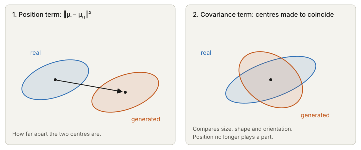
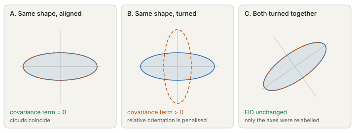
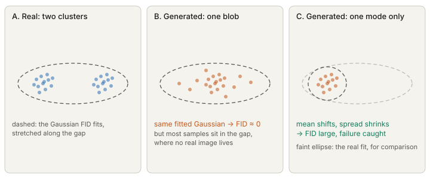

## Why this page exists

These notes came out of reading Wu et al., *A Pragmatic Note on Evaluating Generative Models with
FID for Retinal Image Synthesis* (MIDL 2026; see the [MIDL 2026 overview](../midl2026-overview/index.html)).
The paper shows that FID does not track how useful synthetic images are for training. To see
*why* that is unsurprising, it helps to know exactly what FID can and cannot see. The answers
below are written as the questions came up, with pictures instead of calculations.

The formula, for reference. Fit a Gaussian to the real features ($\mu_r,\Sigma_r$) and one to the
generated features ($\mu_g,\Sigma_g$), then

$$
\text{FID} \;=\; \underbrace{\lVert \mu_r-\mu_g\rVert^2}_{\text{position}} \;+\; \underbrace{\operatorname{Tr}\!\Big(\Sigma_r+\Sigma_g-2\big(\Sigma_r\Sigma_g\big)^{1/2}\Big)}_{\text{size, shape and orientation}} .
$$

This is the 2-Wasserstein distance between the two fitted Gaussians (see
[optimal transport](../optimal-transport/index.html), *Closed forms worth memorising*).

<figure>

<figcaption><b>FID splits into two independent parts.</b> <b>Left:</b> the position term only asks
how far apart the centres are. <b>Right:</b> the covariance term compares the two clouds as if
their centres had been moved on top of each other.</figcaption>
</figure>

## Q1. Does FID require the two feature clouds to have the same mean?

**No. It allows different means but charges for them.** The first term is the squared
distance between the two centres. It is zero only when they coincide, and otherwise it adds to the
score directly. It is completely separate from the covariance term: shifting one cloud without
changing its shape raises the first term and leaves the second untouched.

## Q2. Is FID blind to orientation because of the trace?

**No. The trace makes FID ignore a rotation of the *whole* space, not a rotation of one cloud
against the other.** Two different things are going on inside the covariance term:

- $\operatorname{Tr}(\Sigma_r)$ and $\operatorname{Tr}(\Sigma_g)$ are each a cloud's *total
  variance*. These two pieces really are indifferent to orientation.
- The cross term $\operatorname{Tr}\big((\Sigma_r\Sigma_g)^{1/2}\big)$ is not. It measures how
  well the two clouds' principal axes line up. It is largest when they are aligned and shrinks as
  they turn apart, and because it is subtracted, misalignment *raises* FID.

So two clouds with the same shape and size but different orientations get a positive FID. The only
shape that looks the same at every orientation is a round one, and only then does turning it change
nothing.

<figure>

<figcaption><b>What the trace does and does not forgive.</b> <b>A:</b> same shape, same orientation,
no cost. <b>B:</b> same shape, turned relative to the other, so FID sees a difference. <b>C:</b>
turning <i>both</i> clouds together, which only relabels the axes, leaves FID unchanged.</figcaption>
</figure>

**What FID does ignore.** Rotating, reflecting or shifting *both* clouds together. That is the
invariance the trace buys: the choice of coordinate axes does not matter, but how the two clouds
sit relative to each other does.

**Where the "orientation-invariant" intuition comes from.** The covariance term is the squared
*Bures–Wasserstein* distance between the two covariance matrices, and one way to write it involves a
minimisation over rotations. That looks like "the best rotation is chosen for you", but it is not a
rotation of the cloud. A covariance matrix has many "square-root" factors $A$ with $AA^\top=\Sigma$,
which all describe the *same* cloud, and the minimisation only picks the most convenient one. No
cloud is ever turned. When the two clouds' axes happen to be aligned, the covariance term reduces to
comparing their spreads axis by axis; any misalignment adds to that.

## Q3. How does FID treat one Gaussian versus two separate clusters?

**It cannot tell them apart, because it only ever sees a mean and a covariance.** FID replaces
each feature cloud by the single Gaussian with the same mean and covariance. For a cloud made of two
separated clusters, that fitted Gaussian is centred in the *gap* between them and stretched along
the line joining them: the covariance adds the spread *within* each cluster to the spread *between*
the cluster centres. A single blob with that same mean and covariance has the same fitted Gaussian,
so FID between the two is zero.

<figure>

<figcaption><b>Two clusters through FID's eyes.</b> <b>A:</b> the Gaussian fitted to two clusters
covers the empty gap. <b>B:</b> one blob with the same mean and covariance looks identical to FID,
though most of its samples sit where no real image does. <b>C:</b> collapsing onto one cluster moves
the mean and shrinks the spread, so this failure <i>is</i> caught.</figcaption>
</figure>

What this means in practice, case by case:

| What the generator does | What FID sees | Caught? |
|---|---|---|
| One blob filling the gap between two real clusters (blurry "in-between" images) | same mean and covariance as the real data | **No** |
| Collapses onto one of two equal clusters | mean shifts by half the gap, between-cluster spread disappears | **Yes** |
| Drops a *small* cluster (a rare class or rare finding) | mean and covariance barely move | **Mostly no** |
| Right clusters, wrong proportions | mean moves towards the over-represented cluster | **Partly** |
| Right mean and covariance, wrong shape in other ways (skew, heavy tails, rings) | nothing beyond second moments | **No** |

The third row is the one that matters most for medical imaging. The rare classes and rare findings
are exactly what synthetic data is often meant to supply, and they are what a mean-and-covariance
summary weighs least. This is one concrete reason a good FID need not mean useful training data,
which is the point of the MIDL paper.

**What does see clusters.** Metrics that compare whole distributions rather than two moments:
KID (a kernel two-sample statistic, which with its polynomial kernel reaches beyond the covariance),
precision and recall in feature space, which separate "are the samples realistic" from "is every
region of the real data covered", or simply counting samples per class or per cluster. Changing the
feature network (CLIP, DINOv2, a domain model) changes *where* the clusters lie but not the fact
that FID summarises them with one Gaussian.

## Questions and doubts

- Real feature distributions in a 2048-dimensional Inception space are clustered by class and
  content, so the "two clusters" picture is the normal case, not an edge case. How much of FID's
  value on a typical dataset comes from the between-cluster spread rather than the realism of
  individual images?
- The closed form is exact for Gaussians and, as the MIDL authors note in their rebuttal, for the
  wider family of elliptical distributions. Either way it depends only on the mean and covariance,
  so the blind spots above remain.
- For a class-conditional generator, computing FID *per class* would remove the between-class
  spread and the gap-filling blind spot. How often is that reported?

## Takeaways

- The mean term charges for a shift; the means do not have to match, but every bit of distance costs.
- The trace forgives rotating the whole space, not rotating one cloud against the other.
- FID sees each dataset as one Gaussian, so it cannot distinguish one blob from two clusters, and it
  barely notices a missing rare cluster.
