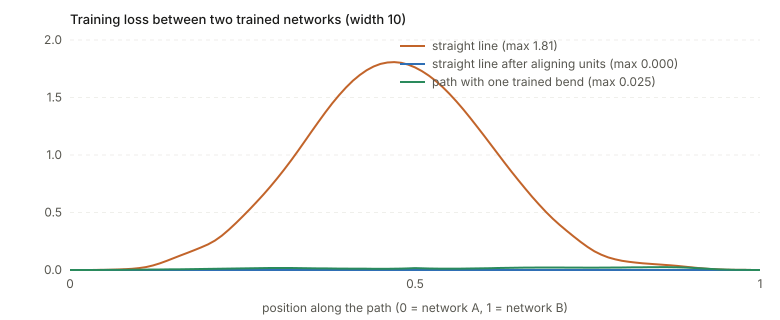
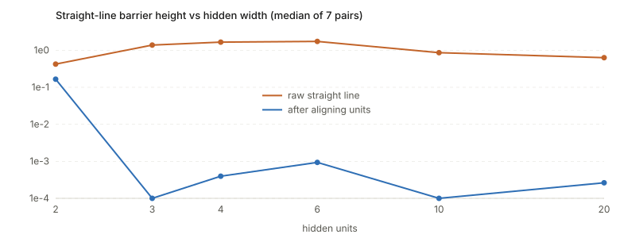

## Links

- **[Runnable code](https://github.com/msrepo/theory_inclined_papers_with_annotations/blob/main/foundations/mode-connectivity/code/connectivity.py)**:
  numpy only. Trains small networks, measures the straight-line barrier, aligns hidden units, trains a bend
  point, sweeps the width. `make verify` runs it.
- **[Fort & Jastrzebski 2019, wedges](../2019-fort-loss-landscape-wedges/index.html)**: the paper that explains
  why a straight-line wall and a curved connector can coexist, with a wedge toy model and an
  interactive page.
- **[Principal angles between subspaces](../principal-angles-subspaces/index.html)** and
  **[Gram matrix](../gram-matrix/index.html)**: nothing here depends on them, but weight-space geometry in
  these notes uses the same tools (distances and angles between high-dimensional vectors).

## In one paragraph

Train the same network twice from different random starts and you get two solutions, two points $\theta_A$ and
$\theta_B$ in weight space, each with near-zero training loss. **Mode connectivity** asks whether they lie in
the same region of low loss. The answer depends on what you allow as a path between them. Along the **straight
line** the loss usually rises to a high wall (this page's small network: from $10^{-4}$ to 1.8). Along a **curve**
with one trained bend it stays low (peak 0.025). And if you first **re-order the hidden units** of one network, which does
not change the function it computes, the straight line is low too (peak 0.0003). The three views are about the
same two solutions and give three different answers, which is the main thing to hold on to.

## Setup and notation

| Symbol | Meaning |
|---|---|
| $\theta\in\mathbb R^P$ | all weights of a network, flattened; the point in **weight space** |
| $L(\theta)$ | loss on the training set (or the test set, when stated) |
| mode, solution | a point $\theta$ SGD ends at with low loss; here, $L<10^{-3}$ |
| $\theta_\alpha=(1-\alpha)\theta_A+\alpha\theta_B$ | the straight line between two solutions, $\alpha\in[0,1]$ |
| $\gamma(s)$ | a general path from $\theta_A$ to $\theta_B$ |
| $\mathrm{BH}(\theta_A,\theta_B)$ | barrier height on the straight line (below) |
| permutation symmetry | reordering the hidden units of a layer, with matching reordering of the next layer's inputs, leaves the network function unchanged |

## Barriers

How far the loss rises above the straight line between the endpoint losses (Entezari et al. 2021):

$$
\mathrm{BH}(\theta_A,\theta_B)=\sup_{\alpha\in[0,1]}\Big[L(\theta_\alpha)-\big((1-\alpha)L(\theta_A)+\alpha L(\theta_B)\big)\Big].
$$

If $L$ were convex, $L(\theta_\alpha)\le(1-\alpha)L(\theta_A)+\alpha L(\theta_B)$ and $\mathrm{BH}\le0$. So a positive
barrier is a direct measurement of non-convexity along that line. When both endpoints have loss $\approx0$,
BH is just the maximum loss on the path, which is the number the code reports.

## Three notions of "connected"

| Notion | Question | Typical answer for independently trained deep nets |
|---|---|---|
| **Linear connectivity** | is $L(\theta_\alpha)$ low for all $\alpha$? | no: a wall in the middle |
| **Mode connectivity** | is there *some* path $\gamma$ with $\max_sL(\gamma(s))$ low? | yes (Freeman & Bruna 2017, Draxler et al. 2018, Garipov et al. 2018) |
| **Linear connectivity up to symmetry** | is there a symmetry-equivalent copy $\pi(\theta_B)$ with a low straight line from $\theta_A$? | often yes, for wide enough nets (Entezari et al. 2022, Ainsworth et al. 2023) |

A fourth, loosely stated, notion is the **connected volume**: many solutions on one low-loss surface (Fort &
Jastrzebski 2019, Benton et al. 2021), which the wedge notes work out.

### Why a path can exist when the line fails

Two points that sit on opposite sides of a high ridge are joined by a path around the ridge, but not by the line
across it. In weight space with millions of dimensions the room to go around is enormous, so detours are cheap.
That is the intuition; the first question after it is *what the ridge is*.

**Symmetry gives part of the answer.** Take a hidden layer of width $H$ with tanh units. Reorder the units, and
reorder the next layer's incoming weights to match: the network computes the same function. Flip the signs of
one unit's incoming weights, bias and outgoing weight: tanh is odd, so again the same function. That is
$H!\cdot2^H$ different parameter vectors for one function; for $H=10$ it is $10!\cdot2^{10}=3.7\times10^{9}$.
Two training runs from different starts land in different copies, and the straight line between two copies
passes through weights that average *unrelated* units: unit 3 of $A$ averaged with unit 3 of $B$, which in
$B$'s ordering plays the role of some other feature. Re-ordering $B$ to match $A$ before interpolating
removes this particular source of ridge.

## What happens on a small network

Setup: a one-hidden-layer tanh network ($2\to H\to1$) on two noisy half-moons, logistic loss, Adam; 300 training
points, 2000 test points; six solutions from six seeds. Two solutions $A$, $B$ at $H=10$ both fit the training set
(loss $1.4\times10^{-4}$ and $3.1\times10^{-4}$, test accuracy 0.989 and 0.990).

| path from $A$ to $B$ | max training loss | barrier height | test accuracy at the midpoint |
|---|---|---|---|
| straight line | **1.808** | 1.808 | 0.760 |
| straight line after aligning $B$'s units to $A$'s | 0.0003 | 0.0000 | 0.989 |
| path with one trained bend point | 0.025 | 0.025 | 0.984 |

Aligning is exact: the function of $B$ changes by at most $7\times10^{-15}$ on the test inputs (rounding error), so it is
the same network written in a different order. The bend point is trained as in Garipov et al.: the path is
$\gamma(s)=2s\,\theta_m+(1-2s)\theta_A$ for $s\le\tfrac12$ and $2(1-s)\theta_m+(2s-1)\theta_B$ after, and
$\theta_m$ minimises the expected loss over $s\sim U[0,1]$ by gradient steps (the gradient to $\theta_m$ at a sampled $s$
is the loss gradient at $\gamma(s)$ times its weight $2s$ or $2(1-s)$).

The picture the loss makes on the plane through $A$, $B$ and the trained bend point:

*The dashed straight line crosses the red ridge; the solid path goes around it. This is the picture from Garipov et al.
(their Fig. 1), computed here for the small network.*

### Five pairs against one reference

Barrier height of the straight line between solution 0 and each of solutions 1–5:

| pair | 0–1 | 0–2 | 0–3 | 0–4 | 0–5 | median |
|---|---|---|---|---|---|---|
| raw | 0.293 | 1.806 | 1.695 | 0.376 | 1.135 | 1.135 |
| after aligning | 0.0000 | 0.0000 | 0.0000 | 0.0000 | 0.0001 | 0.0000 |

The size of the raw barrier varies a lot from pair to pair (0.29 to 1.8). The aligned barrier is $\le10^{-4}$ for every pair.

### Width

Median barrier height over seven pairs, by hidden width:

| width | 2 | 3 | 4 | 6 | 10 | 20 |
|---|---|---|---|---|---|---|
| raw | 0.422 | 1.378 | 1.653 | 1.734 | 0.858 | 0.631 |
| aligned | 0.1655 | 0.0000 | 0.0004 | 0.0009 | 0.0000 | 0.0003 |

Two things to read off. The raw barrier does **not** fall monotonically with width on this problem; it peaks at
$H=6$ and only then declines. And alignment removes it completely from $H=3$ upward, but not at $H=2$. Both are
specific to this easy 2-D task and should not be extrapolated.

## The literature map

Each entry is marked: **read** if I read the paper in full, **searched** if I confirmed it by search and did not
read the paper, **memory** if I am citing it from memory and have not checked it.

| Thread | Paper | What it shows |
|---|---|---|
| Curves exist | Freeman & Bruna, ICLR 2017 (*searched*) | one-hidden-layer ReLU nets are asymptotically connected; connected level sets on MNIST, more rugged on CIFAR-10 |
| | Draxler et al., ICML 2018 (*searched*) | AutoNEB finds nearly flat paths between ResNet/DenseNet minima on CIFAR |
| | Garipov et al., NeurIPS 2018 (*searched*) | Bézier curve or polygonal chain with a trained bend; used for fast geometric ensembling |
| Volumes | Fort & Jastrzebski, NeurIPS 2019 (*read*) | wedge model; connectors through $m+1$ optima |
| | Benton et al., ICML 2021 (*searched*) | low-loss simplexes containing many modes |
| Theory | Kuditipudi et al., NeurIPS 2019 (*searched*) | connectivity from dropout and noise stability; piecewise-linear paths with two segments |
| | Nguyen et al.; Nguyen, Bréchet & Mondelli, NeurIPS 2021 (*searched*) | connected sublevel sets for wide nets; connectivity tied to memorisation capacity |
| Symmetry and the line | Singh & Jaggi, NeurIPS 2020; Entezari et al., ICLR 2022; Ainsworth et al., ICLR 2023 (*memory*) | after re-matching units, the line has a low barrier; the conjecture that SGD solutions share one basin up to permutation |
| | Frankle et al., ICML 2020 (*memory*) | runs become linearly connected after enough shared early training |
| Pretrained models | Neyshabur et al., NeurIPS 2020 (*read*) | solutions fine-tuned from one pretrained model share a basin; from-scratch ones do not |
| | Juneja et al., ICLR 2023 (*read*) | fine-tuned BERTs on MNLI and QQP fall into separate linear basins that match generalisation strategies |
| | Qin et al., EMNLP 2022 (*searched*) | mode connectivity of fine-tuned language models |
| Meaning of a basin | Lubana et al., ICML 2023 (*searched*) | no linear connectivity between models implies different mechanisms |
| | Altıntaş et al., 2023 workshop (*searched*) | controlled study of when linear connectivity holds; Adam breaks it earlier than SGD in linear nets |
| Beyond permutations | *Generalized Linear Mode Connectivity for Transformers*, NeurIPS 2025 (*searched*) | orthogonal and invertible reparameterisations for ViT and GPT-2 |

## Questions and doubts

- **This is a tiny network.** One hidden layer, 2-D inputs, a task that three hidden units already solve. The full
  removal of the barrier by alignment may be an effect of an easy problem with an almost unique solution up to
  symmetry; large networks fine-tuned on large data (the settings of the papers above) are where it is contested.
- **Linear connectivity up to permutation is a statement about a *chosen* copy.** The alignment step searches over
  $H!\cdot2^H$ copies (here with an assignment solver on weight similarity); it finds a copy where the line is low.
  That differs from "all copies are connected", which is false: the raw barriers above are large.
- **The three paths have different costs.** The straight line costs nothing. The aligned line costs an assignment problem.
  The bend point costs 600 steps of training, so the "curve exists" result is not free: it is found by optimisation, and
  its quality depends on how long that runs.
- **Training loss versus test loss.** Everything here is training loss except the midpoint accuracy column. The papers
  differ in which they report, and "no barrier on training loss" can coexist with a drop in test accuracy.
- **Loss barrier is not accuracy barrier.** A low-loss midpoint can have lower accuracy than the endpoints (the Juneja
  et al. figures show loss and accuracy not tracking each other along the line).
- **Many of the entries above are not checked beyond a search summary**, and the symmetry-line papers are cited from
  memory. Before quoting any of their numbers, read them.

## Takeaways

- "Connected" depends on the allowed path. A straight-line wall does not mean separate basins; a curve can go around it.
- A large share of the straight-line wall between independent runs is symmetry: unit $i$ in one network is not
  unit $i$ in the other. Aligning units can remove the wall, on this small network completely.
- Barrier height $\mathrm{BH}$ measures non-convexity along the line, and it is the right quantity for asking whether
  averaging weights is safe (model soups, WiSE-FT, SWA all rely on it being small).
- Connectivity statements for fine-tuned pretrained models (Neyshabur, Juneja, Qin) are about a different regime
  from independent runs from scratch, and the two should not be mixed.

---

*Notes written 2026-10-14.*
