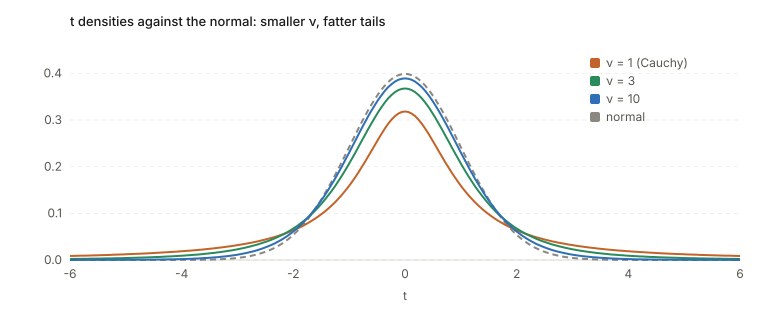
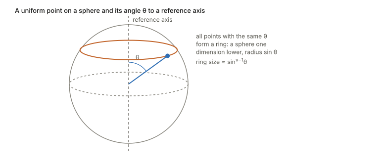
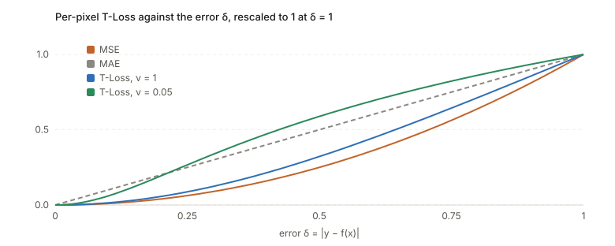

## Links

- **[Interactive version](figures/interactive.html)**: four small experiments. Drag ν and watch the tails; shrink the
  sample size and watch the ruler get noisy; throw random points on a sphere; slide ν in a loss function.
- **[Gonzalez-Jimenez et al. 2023, Robust T-Loss](https://arxiv.org/abs/2306.00753)**: the paper whose idea is worked through
  in the last section. Medical image segmentation with a Student-t negative log-likelihood and a learned ν.
- **Video**: the geometric construction below follows
  [the YouTube video at `rawxsBUnUY8`](https://www.youtube.com/watch?v=rawxsBUnUY8) (the transcript was taken from its
  auto-generated captions).
- **[Liu et al. 2025, BayeSMM](https://papers.miccai.org/miccai-2025/paper/0645_paper.pdf)**: the t as an intensity model for
  joint registration and segmentation of multi-modality cardiac MR; the second paper worked through below.
- **[Gaussianity in practice](../gaussianity-in-practice/index.html)** and **[ELBO](../elbo/index.html)**: where a
  Gaussian error model is the default that this page loosens.

## In one paragraph

The t-distribution is a bell curve whose width is itself uncertain. If you knew the noise level $\sigma$ exactly,
the standardized sample mean would be exactly normal. In practice you estimate $\sigma$ from the same few
numbers, so the ruler you measure with wobbles. Sometimes it comes out too small and the measurement is divided by
almost nothing, which produces a huge value. A handful of such huge values is what a **heavy tail** is. One number,
the **degrees of freedom** $\nu$, says how much the ruler wobbles: small $\nu$ means a lot, and $\nu\to\infty$
means not at all (back to the normal). The same density can be reached in three unrelated ways, as a ratio of
a normal to a chi-square (Gosset), as a normal whose variance is averaged over a random value, and as a function
of the angle of a random point on a sphere. Each way explains something different about $\nu$.

## Setup and notation

| Symbol | Meaning |
|---|---|
| $Z\sim N(0,1)$ | a standard normal |
| $W\sim\chi^2_\nu$ | a sum of $\nu$ independent squared standard normals |
| $\nu$ | degrees of freedom, a positive real in general ($n-1$ for $n$ data points) |
| $T$ | a t-distributed variable with $\nu$ degrees of freedom, written $T\sim t_\nu$ |
| $\tau$ | a **precision**, the inverse of a variance |
| $\Gamma(a)$ | the gamma function, $\int_0^\infty \tau^{a-1}e^{-\tau}\,d\tau$ (the factorial: $\Gamma(n)=(n-1)!$) |
| $B(a,b)$ | the beta function, $\Gamma(a)\Gamma(b)/\Gamma(a+b)$ |

The density of $t_\nu$ (one number $t$) is

$$
f_\nu(t)=\frac{\Gamma\!\big(\tfrac{\nu+1}{2}\big)}{\Gamma\!\big(\tfrac{\nu}{2}\big)\sqrt{\pi\nu}}\Big(1+\frac{t^2}{\nu}\Big)^{-\frac{\nu+1}{2}}.
$$

The **shape** is only the last factor. The Gamma ratio in front is a constant that makes the total area equal to 1.

## Three ways to the same density

### 1. Gosset: a normal over a noisy ruler

Take $n$ numbers from a normal with unknown mean $\mu$ and unknown $\sigma$. With $\sigma$ known,
$(\bar X-\mu)/(\sigma/\sqrt n)$ is exactly $N(0,1)$ (this needs no central limit theorem). With $\sigma$ replaced
by the sample standard deviation $S$,

$$
T=\frac{\bar X-\mu}{S/\sqrt n}=\frac{Z}{\sqrt{W/\nu}},\qquad W\sim\chi^2_{\nu},\ \nu=n-1,
$$

with $Z$ and $W$ independent. This is the statement that for Gaussian data the sample mean and sample variance are
independent, which is false for a generic parent distribution. So $T$ is "a standard normal divided by a random
number close to 1", and the randomness of that number is the estimation error of $S$.

*Why $\nu=n-1$.* The deviations $x_i-\bar x$ always sum to zero, so only $n-1$ of them carry information about
the spread. Their squared length is a sum of $n-1$ independent squared normals, a $\chi^2_{n-1}$. This is also why
$S^2$ divides by $n-1$: the deviations are measured from a mean that was fitted to the same points, which makes them
slightly too small.

*How noisy is the ruler.* $W/\nu$ is an average of $\nu$ squared normals, each with mean 1 and variance 2. So it has
mean 1 and variance $2/\nu$, and the relative error of $S^2$ is $\sqrt{2/\nu}$. Large $\nu$ means a precise ruler
and $T\approx Z$. Small $\nu$ means a loose ruler and heavy tails.

### 2. A normal whose variance is averaged over (the scale mixture)

Reverse the order. Say each observation has its own unknown precision $\tau$, drawn first, and then $y$ is drawn
from a normal with that precision:

$$
y\mid\tau\sim N\!\big(0,\tfrac1\tau\big),\qquad \tau\sim\mathrm{Gamma}\big(\tfrac\nu2,\ \text{rate }\tfrac\nu2\big).
$$

This $\tau$ has mean 1 and variance $2/\nu$, exactly the distribution of $W/\nu$ above. The chance of seeing $y$
is the average over every possible $\tau$ (the law of total probability with a continuum of scenarios):

$$
p(y)=\int_0^\infty\sqrt{\tfrac{\tau}{2\pi}}\,e^{-\tau y^2/2}\cdot\frac{(\nu/2)^{\nu/2}}{\Gamma(\nu/2)}\tau^{\nu/2-1}e^{-\nu\tau/2}\,d\tau .
$$

Collect all powers of $\tau$ and all exponentials of $\tau$. What stays inside the integral is
$\tau^{\frac{\nu+1}{2}-1}\,e^{-\tau\frac{\nu+y^2}{2}}$, a gamma integral, and the identity
$\int_0^\infty\tau^{a-1}e^{-b\tau}d\tau=\Gamma(a)/b^a$ with $a=\frac{\nu+1}2$ and $b=\frac{\nu+y^2}2$ finishes it.
The powers of 2 cancel, and writing $\nu+y^2=\nu(1+y^2/\nu)$ gives exactly $f_\nu(y)$ above. With $D$ coordinates and a
covariance $\Sigma$ the same steps give the multivariate density used in the T-Loss paper, with the exponent
$-\frac{\nu+D}{2}$ and the quadratic form $(y-\mu)^\top\Sigma^{-1}(y-\mu)$.

*Intuition.* Each $\tau$ gives a narrow or a wide bell. The mixture is a pile of bells of different widths, and
the pile has a sharp centre (the narrow ones) and long tails (the wide ones). The gamma distribution is not
arbitrary: it is what a $\chi^2$ (a sum of squared normals) looks like.

This view is the one that matters for the loss function below, because it turns "outliers" into "observations
with a low precision".

### 3. A random point on a sphere (the geometric view)

The third construction removes the Gaussian altogether. Take a sphere $S^\nu$ (the surface of a ball in $\nu+1$
dimensions), fix a reference axis, and pick a point uniformly at random. Let $\theta$ be the angle between the point's
radius and the axis. Then

$$
T=\sqrt\nu\,\cot\theta\ \sim\ t_\nu .
$$

So $\nu$ is **the dimension of the sphere**, which matches the old meaning of "degrees of freedom": the number of
coordinates needed to say where you are on it.

*Step 1: from Gosset to the sphere.* Write $T=Z_1/\sqrt{(Z_2^2+\dots+Z_{\nu+1}^2)/\nu}$ with $\nu+1$ independent
standard normals. A vector of independent normals is **spherical**: its density depends only on its length, so
rotating it changes nothing. For a spherical vector the length $R$ and the direction $U=Z/\|Z\|$ are independent and
$U$ is uniform on the sphere (the polar representation; the video states this without proof). Divide top and bottom by $R$.
The length cancels, and since $U_1^2+\dots+U_{\nu+1}^2=1$,

$$
T=\sqrt\nu\,\frac{U_1}{\sqrt{1-U_1^2}}=\sqrt\nu\,\cot\theta,\qquad U_1=\cos\theta .
$$

*Step 2: the density of $\theta$ from volumes.* Fix $\theta$. Then $U_1=\cos\theta$ is fixed, so the other coordinates
satisfy $U_2^2+\dots+U_{\nu+1}^2=\sin^2\theta$: a sphere of dimension $\nu-1$ and radius $\sin\theta$. Volume scales
as radius to the power of the dimension, so this ring has size $\propto\sin^{\nu-1}\theta$, and a thin strip
between $\theta$ and $\theta+d\theta$ has probability $\propto\sin^{\nu-1}\theta\,d\theta$. The normalizing integral
$\int_0^\pi\sin^{\nu-1}\theta\,d\theta$ is a beta integral, equal to $B(\tfrac12,\tfrac\nu2)$ (substitute $x=\sin^2\theta$).

*Step 3: change of variable.* With $t=\sqrt\nu\cot\theta$, $|d\theta/dt|=\sin^2\theta/\sqrt\nu$. Then
$f_T(t)=\sin^{\nu+1}\theta\big/\big(\sqrt\nu\,B(\tfrac12,\tfrac\nu2)\big)$. A right triangle with $\cot\theta=t/\sqrt\nu$
gives $\sin\theta=(1+t^2/\nu)^{-1/2}$, so

$$
f_T(t)=\frac{1}{\sqrt\nu\,B(\tfrac12,\tfrac\nu2)}\Big(1+\frac{t^2}{\nu}\Big)^{-\frac{\nu+1}{2}},
$$

the same density, since $B(\tfrac12,\tfrac\nu2)=\sqrt\pi\,\Gamma(\tfrac\nu2)/\Gamma(\tfrac{\nu+1}2)$.

*Two things to see.* At $\nu=1$ the sphere is a circle, $\theta$ is uniform, and $T=\cot\theta$ is the Cauchy distribution.
As $\nu$ grows, $\sin^{\nu-1}\theta$ piles up near $\theta=90^\circ$ (a random point on a high-dimensional sphere is nearly on the
equator of any axis you pick), where $\cot\theta\approx0$. That is why the factor $\sqrt\nu$ is needed, and why large
$\nu$ looks normal.

## What $\nu$ means, in the three views

| View | What $\nu$ is | Small $\nu$ | Large $\nu$ |
|---|---|---|---|
| Gosset | $n-1$, the information left to judge spread | loose ruler | exact ruler |
| Mixture | $2/\nu$ is the variance of the precision $\tau$ | noise level varies a lot | noise level is constant |
| Sphere | dimension of the sphere | angle spread wide | angle stuck at $90^\circ$ |

## Properties worth keeping

- **Tails are a power law.** $f_\nu(t)\propto|t|^{-(\nu+1)}$ for large $|t|$, against $e^{-t^2/2}$ for the normal.
- **Moments stop at $\nu$.** The mean exists for $\nu>1$, the variance for $\nu>2$ (it equals $\nu/(\nu-2)$, always above 1).
  $\nu=1$ is the Cauchy distribution and has no mean.
- **$\nu\to\infty$ is the normal.**
- **Normal confidence intervals break at small $n$**: the 95% cutoff is $t_{\nu,0.975}$, not 1.96, and it is larger the
  smaller $\nu$ is.

## From density to a loss function

A Gaussian error model gives MSE: $-\log N(y\mid\mu,\sigma^2)=\frac{(y-\mu)^2}{2\sigma^2}+\text{const}$. Replace the
Gaussian by a t and take $-\log$ in the same way. With $\Sigma=I$ and $\delta=\|y-\mu\|$,

$$
-\log p=\underbrace{-\log\Gamma\!\big(\tfrac{\nu+D}2\big)+\log\Gamma\!\big(\tfrac\nu2\big)+\tfrac D2\log(\pi\nu)}_{\text{normalizer}}
+\tfrac{\nu+D}{2}\log\!\Big(1+\frac{\delta^2}{\nu}\Big).
$$

**Two regimes.** The loss depends on $\delta$ only through $\log(1+\delta^2/\nu)$. If $\delta^2\ll\nu$, use $\log(1+x)\approx x$: the loss
is $\approx\frac{\nu+D}{2\nu}\delta^2$, a parabola, so it acts like MSE. If $\delta^2\gg\nu$ the 1 is negligible:
$\log(1+\delta^2/\nu)\approx2\log\delta-\log\nu$, so the loss grows like $(\nu+D)\log\delta$. The crossover is at
$\delta\approx\sqrt\nu$, the size of error that still counts as ordinary. As $\nu\to\infty$ the parabola wins everywhere
(MSE). Compare MAE, which grows like $\delta$: the log grows even more slowly.

**The gradient is the point.** For one coordinate ($D=1$),

$$
\frac{d}{d\delta}\ \tfrac{\nu+1}{2}\log\!\Big(1+\frac{\delta^2}{\nu}\Big)=\frac{\nu+1}{\nu+\delta^2}\,\delta .
$$

This is MSE's gradient $\delta$ times a weight $w(\delta)=\frac{\nu+1}{\nu+\delta^2}$ that shrinks as the error grows. The
gradient rises, peaks at $\delta=\sqrt\nu$, and then **falls** towards 0 like $(\nu+1)/\delta$: a badly wrong point
stops pulling on the model. In the mixture view this weight is the model's own estimate of that observation's precision,
$w=\mathbb E[\tau\mid y]=\frac{\nu+D}{\nu+\Delta}$ with $\Delta$ the squared error. A large error means "this one is probably
noisy", so it gets a low weight. The loss is reweighted least squares done automatically.

**Learning $\nu$.** The normalizer terms are not decoration. A density has to integrate to 1, and different $\nu$ give
different shapes, so those terms make comparing densities across $\nu$ fair. Keeping them makes the minimization over
$\nu$ a maximum-likelihood fit. Clean data (all errors small) favours large $\nu$; a few huge errors favour small $\nu$.
The $\Gamma$'s need a numerical routine, and training $\nu$ also needs its derivative, the digamma function
$\psi=\Gamma'/\Gamma$ (both are `lgamma` and `digamma` in a deep learning framework).

## Where it is used: medical imaging

### Robust T-Loss (Gonzalez-Jimenez et al. 2023)

*The problem.* Medical masks are drawn by people and are noisy: eroded, dilated or shifted. A network trained with a
Gaussian-based loss tries to fit every wrong pixel and eventually memorizes the noise.

*The idea.* Use the t negative log-likelihood above as the segmentation loss, with $\mu=f_w(x)$ the network's prediction
and the mask $y$ the observation. Make $\nu$ trainable: $\nu=e^{\tilde\nu}+\epsilon$ (positive, trained on a log scale), optimized together
with the weights by gradient descent. No separate noise estimate and no EM steps are needed, since clean-looking
data pushes $\nu$ up and noisy data pushes it down.

*How it connects to the page.* The mechanism is the weight $w(\delta)$ above: pixels whose label disagrees strongly with the
prediction are down-weighted instead of fitted, which is what stops memorization. The paper's own argument for the t is heuristic
("errors following a Student-t allow much larger noise tolerance than a Gaussian"), not a measured noise model. They set $\Sigma=I$
because a full covariance over all pixels of an image is far too large to estimate, though neighbouring pixels are obviously not independent.

*Reported evidence (the paper's, not re-run here).* Experiments on skin lesion (ISIC) and lung (Shenzhen) segmentation with an nnU-Net, with
simulated erosion, dilation and affine noise on part of the training masks. At no noise all losses tie; the gap opens as the noise fraction grows, and
the other robust losses degrade late in training as they memorize wrong masks while T-Loss does not.

### Other uses, found by search (abstract level only)

- **Student-t mixture models for segmentation.** Before deep learning, intensity classes in an image were modelled as a mixture of t-distributions
  (instead of Gaussians) fitted by EM, because Gaussians are dragged around by outlier intensities. Examples: Sfikas, Nikou and Galatsanos (ICIP 2007),
  and versions with spatial Markov random field priors (Xiong et al. 2018).
- **A polyp-segmentation extension of T-Loss.** Reported to make $\nu$ per-image (predicted by a small network) with per-pixel precision weights.
  Not yet checked; it appears to be a workshop-level paper.

### BayeSMM (Liu et al., MICCAI 2025): the t as a model of pixel intensities

[Paper](https://papers.miccai.org/miccai-2025/paper/0645_paper.pdf); code reported at `github.com/HenryLau7/BayeSMM`
(not checked). Here the t is not a loss on labels. It is the model of **what intensities a tissue class produces**.

*The problem.* Cardiac MR is scanned in several modalities (LGE, bSSFP, T2) that are not aligned, and the goal is to segment and
align them together. Disease puts a few extreme pixels inside a tissue class (scar is bright in LGE, oedema is bright in T2),
which stretches a Gaussian model of that class's intensities and hurts both tasks.

*The model.* Every pixel $x$ in a shared space has a hidden tissue class $z_x$ (one of $K$), with class proportions $\pi$. Given the
class, the modalities are independent, and each modality's intensity is Student-t with a class-specific mean $\mu$ and inverse-variance $\lambda$,
written as the scale mixture of this page:

$$
I_{x,i}\mid z_{x,k}=1,\ u\sim N\!\Big(\mu_{i,k},\ \frac{1}{u_{x,i,k}\,\lambda_{i,k}}\Big),\qquad u_{x,i,k}\sim\mathrm{Gamma}\big(\tfrac\nu2,\ \text{rate }\tfrac\nu2\big).
$$

So $u_{x,i,k}$ is the precision multiplier $\tau$ of one pixel in one modality. Its posterior value is that pixel's weight: close to 1 for a
normal member of the class, small for a far-out pixel, which then sits under a wide, tolerant Gaussian and barely moves $\mu$ and $\lambda$.
This is the same reweighting as in the T-Loss, applied to the intensity model rather than a loss. Here $\nu$ is a hand-chosen hyperparameter, not learned.
The interactive page's last demo shows this weight on one class with a few bright pixels. How the paper estimates $u$ (a variational
scheme with a network) is left to a separate section on variational inference.

*Reported evidence (the paper's).* On MS-CMR (45 patients, three modalities, three-fold cross-validation) the model is used inside a joint registration and segmentation network. For the t itself, the relevant test is a synthetic one in which a share of
pixels is replaced by extreme intensities: BayeSMM degrades less than BayeSMM(w/o), the same model with $u$ fixed to 1 (a Gaussian). Its $\hat u$ maps are shown
to light up on scar and oedema.

## Questions and doubts

- **One log per image, or one per pixel?** The paper's Eq. (3) treats the whole mask as one $D$-dimensional t variable, so $\delta^2$ is the squared error
  summed over all pixels and there is a single $\log(1+\cdot)$ per image. The pictures on this page use the one-coordinate version. The shapes and the
  $\sqrt\nu$ scale are the same, but the overall scale differs, and which one the released code uses has not been checked.
- **Does a learned $\nu$ really track the noise level?** The paper shows $\tilde\nu$ settling at different values for different noise levels, but the
  noise is simulated (erosion, dilation, affine), and the link between $\nu$ and the fraction of bad labels is empirical.
- **Why not scale as well?** A t has a scale parameter that the loss fixes to 1 ($\Sigma=I$). Letting the scale be learned (per image) would give the
  network a second way to explain large errors, so how $\nu$ and the scale interact is unclear.
- **BayeSMM: how large is the benefit of the t?** In the synthetic-outlier table the BayeSMM versus BayeSMM(w/o) gaps are small compared with
  the spread across folds (for example about 0.1 to 0.7 Dice points against standard deviations of 0.3 to 1.4), so the ablation alone does not
  clearly separate them. The 80% and clean-data rows are similar.
- **BayeSMM: which way does $u$ point?** By the paper's Eq. (3) the variance is $1/(u\lambda)$, so an outlier pixel should have a *small* $u$.
  Figure 3 describes the abnormal regions as lighter areas with *high* $u$, after "adjusting the brightness". That looks inverted relative to the
  equations; it could be a different quantity plotted (such as $1/u$) or a different parametrization of the $D_U$ output. The code would settle it.
- **BayeSMM: why is $\nu$ fixed?** It is hand-chosen, with its posterior "implicitly updated", and no sensitivity to it is shown. Compare T-Loss, where
  it is the learned quantity.
- **Is the independence in the mixture view realistic?** The mixture view gives each observation its own $\tau$, but label errors are spatially correlated
  (a whole border shifts). A multivariate t with one shared $\tau$ per image, as in the $D$-dimensional form, is closer to that, which may be the reason
  the paper's image-level formula is the natural one.

## Takeaways

- A t-distribution is a normal with an uncertain width. $\nu$ measures how uncertain, and $2/\nu$ is the variance of the precision.
- Three derivations give the same density: Gosset's ratio, a gamma-averaged normal, and the angle of a random point on a sphere of dimension $\nu$.
- Heavy tails make a loss robust because the gradient of $\log(1+\delta^2/\nu)$ falls for large errors: far-out points are down-weighted by the
  model's own estimate of their precision.
- The same $u$ (the per-observation precision) appears in both papers: in T-Loss as the weight on a pixel's label error, in BayeSMM as the weight on
  a pixel's intensity within its tissue class. One mechanism, two places to put it.
- Making $\nu$ trainable lets the data choose the tolerance; the normalizing constants are what make that a proper likelihood fit.
