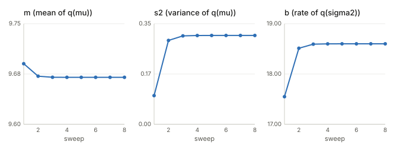
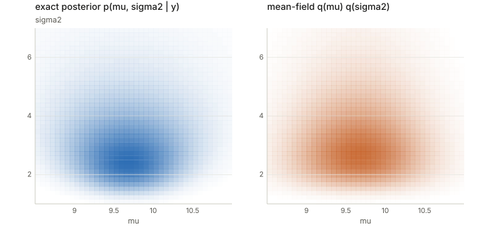
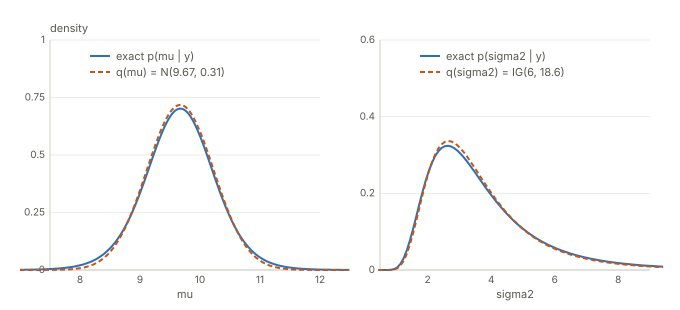

## Links

- **Paper being read:** Tran, Nguyen and Dao, *A practical tutorial on Variational Bayes*, 2021.
  [arXiv abstract](https://arxiv.org/abs/2103.01327) · [PDF](https://arxiv.org/pdf/2103.01327).
  These notes follow its opening pages and its Example 2.1, and fill in the steps it skips.
- **[The ELBO](../elbo/index.html)**: the same bound derived from Jensen's inequality, with the two-coin
  example. Here the bound is reached by splitting the KL instead.
- **[Expectation–Maximization](../expectation-maximization/index.html)**: the E-step chooses $q$ exactly,
  which is the special case of VB where the posterior is tractable.
- **[The reparameterization trick](../reparameterization-trick/index.html)**: how the gradients used by
  fixed-form VB (§4) are estimated.
- `code/mfvb_normal.py` prints every number quoted in §8 and, with `--figures`, redraws the three figures.

## In one paragraph

Bayesian inference wants the posterior $p(\theta\mid y)=p(\theta)p(y\mid\theta)/p(y)$, but the normaliser
$p(y)=\int p(\theta)p(y\mid\theta)\,d\theta$ is usually an integral we cannot do. Variational Bayes (VB)
replaces the posterior by the closest member $q^*$ of a family $\mathcal Q$ of tractable distributions,
where "closest" means smallest $\mathrm{KL}(q\|p(\cdot\mid y))$. The KL itself contains the intractable
$p(y)$, but it only enters as an additive constant, so minimising the KL over $q$ is *exactly* the same as
maximising a quantity, the ELBO, that never needs $p(y)$. All of the approximation error comes from
restricting $q$ to $\mathcal Q$.

## 1. Questions, in plain words and in symbols

| # | Plain-language question | Mathematical question |
|---|---|---|
| 1 | The distance between my guess and the true posterior mentions the very number I cannot compute. How can I minimise it? | Show $\mathrm{KL}(q\|p(\cdot\mid y))=-\int q\log\frac{p(\theta)p(y\mid\theta)}{q}\,d\theta+\log p(y)$. |
| 2 | Is swapping the distance for the computable part an approximation? | Is $\arg\min_q\mathrm{KL}=\arg\max_q\mathrm{ELBO}$ exact? Where does the approximation enter? |
| 3 | What does "assume the pieces are independent" cost, and what are the alternatives? | Define the mean-field family; compare it with fixed-form VB and normalizing flows. |
| 4 | With two independent pieces, how do I improve one while the other is frozen? | Write the ELBO for $q_1q_2$, isolate $q_1$, and find $\arg\max_{q_1}$. |
| 5 | When does each update land in a familiar distribution? | State conditional conjugacy and show $q_1$ stays in the prior's family. |
| 6 | Does all of this really work on a small problem? | Run it on Example 2.1 and compare with the exact posterior. |

## Notation

| Symbol | Meaning |
|---|---|
| $y$ | observed data |
| $\theta$ | unknown parameters ($\theta=(\theta_1,\dots,\theta_d)$ when split into blocks) |
| $p(\theta)$, $p(y\mid\theta)$ | prior, likelihood |
| $p(\theta\mid y)$ | posterior $=p(\theta)p(y\mid\theta)/p(y)$ |
| $p(y)$ | evidence $=\int p(\theta)p(y\mid\theta)\,d\theta$, the intractable normaliser |
| $q(\theta)$ | the approximating density; $\mathcal Q$ is the family it is chosen from |
| $\mathrm{ELBO}(q)$ | $\int q(\theta)\log\frac{p(\theta)p(y\mid\theta)}{q(\theta)}\,d\theta$ (the paper writes $\mathrm{LB}$) |
| $E_{-\theta_1}[\cdot]$ | average over every block except $\theta_1$, under the current $q$ of those blocks |

## 2. Question 1: the KL splits into two pieces

Start from the definition and substitute Bayes' rule inside the logarithm.

$$\mathrm{KL}(q\,\|\,p(\cdot\mid y))=\int q(\theta)\log\frac{q(\theta)}{p(\theta\mid y)}\,d\theta,\qquad
p(\theta\mid y)=\frac{p(\theta)p(y\mid\theta)}{p(y)}.$$

Plugging in, the ratio becomes
$$\log\frac{q(\theta)}{p(\theta\mid y)}=\log\frac{q(\theta)\,p(y)}{p(\theta)p(y\mid\theta)}
=\log\frac{q(\theta)}{p(\theta)p(y\mid\theta)}+\log p(y),$$
using $\log(ab)=\log a+\log b$. Integrate against $q$, term by term:

- the first term is $\int q\log\frac{q}{p(\theta)p(y\mid\theta)}\,d\theta=-\int q\log\frac{p(\theta)p(y\mid\theta)}{q}\,d\theta$,
  because swapping numerator and denominator flips the sign of a logarithm;
- the second term does not involve $\theta$, so it leaves the integral, and $\int q\,d\theta=1$ leaves exactly $\log p(y)$.

$$\boxed{\ \mathrm{KL}(q\|p(\cdot\mid y))=-\mathrm{ELBO}(q)+\log p(y)\ }
\qquad\Longleftrightarrow\qquad \log p(y)=\mathrm{ELBO}(q)+\mathrm{KL}(q\|p(\cdot\mid y)).$$

The ELBO involves only the prior, the likelihood and $q$, all of which we can evaluate. $\log p(y)$ is
the part we cannot compute, and it does not depend on $q$.

## 3. Question 2: exact, not an approximation

Because $\log p(y)$ is a constant in $q$, every increase of the ELBO is an equal decrease of the KL.
So for any family $\mathcal Q$,
$$\arg\min_{q\in\mathcal Q}\mathrm{KL}(q\|p(\cdot\mid y))=\arg\max_{q\in\mathcal Q}\mathrm{ELBO}(q).$$
Since $\mathrm{KL}\ge0$, also $\mathrm{ELBO}(q)\le\log p(y)$, which is where the name (evidence lower bound) comes from.

The approximation is the restriction $q\in\mathcal Q$.

- If the true posterior lies in $\mathcal Q$, the minimum KL is $0$ and $q^*$ *is* the posterior; the ELBO equals $\log p(y)$.
- Otherwise the minimum KL is positive, $q^*$ is the closest member of $\mathcal Q$, and $\log p(y)-\mathrm{ELBO}(q^*)$
  is that leftover KL.

One more thing is fixed by the objective, not by $\mathcal Q$: the KL is taken in the order
$\mathrm{KL}(q\|p)$, the "reverse" direction, which tends to make $q^*$ settle on one region of the
posterior and understate its spread. §8 shows this on a real example (the standard deviation of $\mu$).

## 4. Question 3: choosing the family $\mathcal Q$

**Mean-field.** $\mathcal Q$ is every $q$ that factorises across blocks of parameters:
$$q(\theta)=q_1(\theta_1)\,q_2(\theta_2)\cdots q_d(\theta_d).$$
The form of each factor is *not* chosen; it falls out of the optimisation (§6). The price is that the
dependence between blocks in the true posterior is thrown away. If the true posterior of two parameters
is a tilted ellipse, the best product is an axis-aligned blob, so it cannot tilt.

**Fixed-form VB (FFVB)** and **mean-field VB (MFVB)** are the two classes the paper distinguishes. They differ
in how $\mathcal Q$ is specified and fitted, not in the objective:

| | MFVB | FFVB |
|---|---|---|
| What is restricted | $q$ factorises | $q$ has a parametric form chosen in advance (e.g. a Gaussian $N(\mu,\Sigma)$) |
| Form of each factor | determined by the model | chosen by you |
| Dependence between coordinates | none | possible (a full-covariance Gaussian keeps it) |
| Optimisation | coordinate ascent, closed-form updates | stochastic gradient ascent on the parameters of $q$ |
| Needs | model-specific derivation | only the ability to evaluate $\log p(\theta)p(y\mid\theta)$ |

They can overlap: a diagonal Gaussian fitted by gradients is fixed-form *and* mean-field in structure.

**Normalizing flows** are a very flexible fixed form. Take a simple base density $q_0(z)$ and an
invertible, differentiable map $T_\phi$, set $\theta=T_\phi(z)$, and the density is exact:
$$q_\phi(\theta)=q_0(z)\,\bigl|\det\partial T_\phi/\partial z\bigr|^{-1},\quad z=T_\phi^{-1}(\theta).$$
If $T_\phi$ mixes coordinates, $q_\phi$ has dependence between them; if it acts coordinate by coordinate,
you get a mean-field $q$. So mean-field is one end of the scale (cheap, restrictive) and a rich flow is the
other (expensive, nearly unrestricted).

## 5. Question 4: the ELBO for two factors

Take $\theta=(\theta_1,\theta_2)$ and $q=q_1q_2$. Write $\log p(\theta,y)$ for $\log p(\theta)p(y\mid\theta)$.

$$\mathrm{ELBO}(q_1,q_2)=\iint q_1q_2\log p(\theta,y)\,d\theta_1d\theta_2-\iint q_1q_2\log(q_1q_2)\,d\theta_1d\theta_2.$$

**The entropy term splits.** $\log(q_1q_2)=\log q_1+\log q_2$. In $\iint q_1q_2\log q_1$ the factor $q_1\log q_1$
does not involve $\theta_2$, so it leaves the inner integral, which is $\int q_2\,d\theta_2=1$:
$$\iint q_1q_2\log(q_1q_2)=\int q_1\log q_1\,d\theta_1+\int q_2\log q_2\,d\theta_2.$$
(The entropy of independent pieces is the sum of their entropies.)

**The first term, as an iterated integral.**
$$\iint q_1q_2\log p(\theta,y)=\int q_1(\theta_1)\Bigl[\int q_2(\theta_2)\log p(\theta,y)\,d\theta_2\Bigr]d\theta_1
=\int q_1(\theta_1)\,E_{-\theta_1}[\log p(y,\theta)]\,d\theta_1,$$
where $E_{-\theta_1}[\log p(y,\theta)]:=E_{q_2}[\log p(y,\theta)]$ is a function of $\theta_1$ only, since $\theta_2$ has been averaged out.

Putting the pieces together,
$$\mathrm{ELBO}(q_1,q_2)=\int q_1E_{-\theta_1}[\log p(y,\theta)]\,d\theta_1-\int q_1\log q_1\,d\theta_1+C(q_2),
\qquad C(q_2)=-\int q_2\log q_2\,d\theta_2.$$

$C(q_2)$ is "a constant" only *with respect to $q_1$*: the ELBO still depends on both factors. In coordinate
ascent $q_2$ is frozen while $q_1$ is updated, then the roles swap, and the term that was a constant becomes
the one being optimised.

**Merging the $q_1$ terms** (linearity of the integral, $\int f-\int g=\int(f-g)$), then using
$x=\log e^x$ and $\log a-\log b=\log(a/b)$:
$$\mathrm{ELBO}=\int q_1\Bigl\{E_{-\theta_1}[\log p(y,\theta)]-\log q_1\Bigr\}d\theta_1+C(q_2)
=\int q_1\log\frac{\exp\bigl(E_{-\theta_1}[\log p(y,\theta)]\bigr)}{q_1}\,d\theta_1+C(q_2).$$

This has the shape of the ELBO from §2. The function in the numerator is not a density yet; normalise it,
$$q_1^*(\theta_1)=\frac{\exp(E_{-\theta_1}[\log p(y,\theta)])}{Z},\qquad Z=\int\exp(E_{-\theta_1}[\log p(y,\theta)])\,d\theta_1,$$
and the $q_1$-part of the ELBO equals $-\mathrm{KL}(q_1\|q_1^*)+\log Z$. The KL is smallest (zero) at $q_1=q_1^*$, so
$$\boxed{\ \log q_1^*(\theta_1)=E_{-\theta_1}[\log p(y,\theta)]+\text{const}\ }$$
is the exact best $q_1$ given $q_2$, and the same holds for every block.

**Why coordinate ascent here, rather than gradient ascent.**

- each update is the *exact* maximiser over one block, so there is no step size to tune and the ELBO never goes down;
- the unknown is a whole function $q_1$, and the formula gives it directly, with no parametric form to choose first;
- for conditionally conjugate models the update is an explicit formula (§7).

Gradient ascent is used when this expectation has no closed form, when $q$ must keep dependence between
coordinates, or when minibatches are needed for large data: that is FFVB. The weakness of coordinate ascent is
that it zigzags when coordinates are strongly dependent in the true posterior.

## 6. Question 5: conjugacy, and why $q_1$ stays in the prior's family

A prior is **conjugate** to a likelihood if their product is in the prior's family. Beta prior, Bernoulli
likelihood: $\theta^{a-1}(1-\theta)^{b-1}\cdot\theta^h(1-\theta)^{n-h}\propto\theta^{a+h-1}(1-\theta)^{b+n-h-1}$ is
Beta$(a+h,\,b+n-h)$ again, with updated numbers. A model is **conditionally conjugate** if each block, given all the others, has
this property.

In the update $\log q_1^*=E_{-\theta_1}[\log p(y,\theta)]+\text{const}$, only the terms with $\theta_1$ matter, so
$\log q_1^*=E_{q_2}[\log p(\theta_1\mid\theta_2,y)]+\text{const}$. If the full conditional is an exponential-family member of the prior's family,
$$\log p(\theta_1\mid\theta_2,y)=\eta(\theta_2,y)^\top T(\theta_1)+\log h(\theta_1)+\text{const},$$
then only $\eta$ involves $\theta_2$, and the average over $q_2$ just replaces $\eta$ by $E_{q_2}[\eta]$:
$$q_1^*(\theta_1)\propto h(\theta_1)\exp\bigl(E_{q_2}[\eta]^\top T(\theta_1)\bigr),$$
the same family with the "expected parameters". Without conditional conjugacy, $\log p(\theta_1\mid\theta_2,y)$ is not of this
form, $q_1^*$ is not a recognisable distribution, and the exact update is not available.

## 7. Example 2.1 set up

Ten observations $y=(11,12,8,10,9,8,9,10,13,7)$ from $N(\mu,\sigma^2)$, with priors
$\mu\sim N(\mu_0,\sigma_0^2)$, $\sigma^2\sim\text{Inverse-Gamma}(\alpha_0,\beta_0)$, and
$\mu_0=0$, $\sigma_0^2=100$, $\alpha_0=\beta_0=1$. Factorise $q(\mu,\sigma^2)=q(\mu)q(\sigma^2)$. The model is
conditionally conjugate (a Normal given $\sigma^2$, an Inverse-Gamma given $\mu$) but not jointly conjugate, so the
posterior has no closed form, which is why VB is used.

**Update for $q(\mu)=N(m,s^2)$.** Keep the $\mu$-terms of $\log p(y,\mu,\sigma^2)$ and average $\sigma^2$ out; it appears only through
$\tau:=E_{q(\sigma^2)}[1/\sigma^2]$.
$$\log q(\mu)=-\tfrac{\tau}{2}\sum_i(y_i-\mu)^2-\frac{(\mu-\mu_0)^2}{2\sigma_0^2}+\text{const}
=-\tfrac12\mu^2\Bigl(n\tau+\tfrac1{\sigma_0^2}\Bigr)+\mu\Bigl(\tau\textstyle\sum y_i+\tfrac{\mu_0}{\sigma_0^2}\Bigr)+\text{const}.$$
A $N(m,s^2)$ has log-density $-\mu^2/(2s^2)+\mu m/s^2+\text{const}$. Matching coefficients:
$$\frac1{s^2}=n\tau+\frac1{\sigma_0^2},\qquad m=s^2\Bigl(\tau\sum y_i+\frac{\mu_0}{\sigma_0^2}\Bigr).$$
The data precision $n\tau$ adds to the prior precision, and $m$ is a precision-weighted average of data and prior mean.

**Update for $q(\sigma^2)=\text{IG}(\alpha,\beta)$.** Keep the $\sigma^2$-terms and average $\mu$ out:
$$\log q(\sigma^2)=-\Bigl(\alpha_0+\tfrac n2+1\Bigr)\log\sigma^2-\frac{\beta_0+\tfrac12E_{q(\mu)}\sum_i(y_i-\mu)^2}{\sigma^2}+\text{const}.$$
Under $q(\mu)=N(m,s^2)$, $E[(y_i-\mu)^2]=(y_i-m)^2+s^2$, so $E\sum(y_i-\mu)^2=\sum(y_i-m)^2+ns^2$. The extra $ns^2$ is the price of not
knowing $\mu$ exactly. Matching $-(\alpha+1)\log\sigma^2-\beta/\sigma^2$:
$$\alpha=\alpha_0+\tfrac n2,\qquad \beta=\beta_0+\tfrac12\Bigl[\sum_i(y_i-m)^2+ns^2\Bigr],\qquad \tau=E[1/\sigma^2]=\alpha/\beta.$$
The two factors pass information through $\tau$ (from $q(\sigma^2)$ to $q(\mu)$) and through $(m,s^2)$ (the other way). $\alpha=6$
never changes; $\beta$ moves until $m$ and $s^2$ settle.

## 8. The code, line by line

`code/mfvb_normal.py` implements §7 and checks it against the exact posterior on a grid. The comments in the file carry the
same explanations as below.

| Code | What it does |
|---|---|
| `s2 = 1/(n*tau + 1/s0sq)` | $s^2$: data precision $n\tau$ plus prior precision $1/\sigma_0^2$, inverted |
| `m = s2*tau*y.sum()` | $m=s^2(\tau\sum y_i+\mu_0/\sigma_0^2)$ with the $\mu_0$ term dropped because $\mu_0=0$ (a nonzero $\mu_0$ needs `+ mu0/s0sq` inside the bracket) |
| `a = a0 + n/2` | $\alpha=\alpha_0+n/2=6$, fixed |
| `b = b0 + 0.5*(((y-m)**2).sum() + n*s2)` | $\beta$: the residual sum of squares around $m$ plus $ns^2$ for the uncertainty in $\mu$ |
| `tau = a/b` | $E[1/\sigma^2]$ under $\text{IG}(\alpha,\beta)$, fed into the next sweep |
| `M, S = np.meshgrid(mu, sg)` | two arrays holding $\mu$ and $\sigma^2$ at every grid point, so each density is evaluated at all points at once |
| `lp = norm_logpdf(M, mu0, s0sq) + ig_logpdf(S, a0, b0)` | log prior of $\mu$ plus log prior of $\sigma^2$ |
| `lp = lp + norm_logpdf(yi, M, S)` per data point | adds the log-likelihood (a sum, since observations are independent); `lp` is then $\log p(\mu,\sigma^2,y)$, the true log-posterior up to the constant $\log p(y)$ |
| `P = np.exp(lp - lp.max())` | exponentiate; subtracting the maximum first avoids underflow and only rescales by a constant |
| `P / (P.sum() * dmu * dsg)` | normalise by a Riemann sum of $\iint P$, a numerical stand-in for the intractable $p(y)$; the result integrates to about 1 |
| `mean_field_density(...)` | $q(\mu)q(\sigma^2)$ on the same grid; already normalised, since each factor is |
| `P.sum(0)*dsg`, `P.sum(1)*dmu` | exact marginals of $\mu$ and $\sigma^2$: sum the grid over the other variable |

## 9. Results

Running the script gives, for the first sweeps and at convergence:

| sweep | $m$ | $s^2$ | $\alpha$ | $\beta$ |
|---|---|---|---|---|
| 1 | 9.6903 | 0.0999 | 6 | 17.5500 |
| 2 | 9.6717 | 0.2916 | 6 | 18.5122 |
| 3 | 9.6702 | 0.3076 | 6 | 18.5924 |
| 5 | 9.6700 | 0.3090 | 6 | 18.5996 |

So $q(\mu)=N(9.670,\,0.309)$ and $q(\sigma^2)=\text{IG}(6,\,18.60)$, after about five sweeps.

Against the exact posterior on a grid:

| | exact | VB |
|---|---|---|
| $E[\mu]$ | 9.664 | 9.670 |
| sd of $\mu$ | 0.611 | 0.556 |
| $E[\sigma^2]$ | 3.784 | 3.720 |

- The exact posterior correlation of $(\mu,\sigma^2)$ is $-0.028$, essentially zero. That is why a product loses little here: the
  contours are nearly axis-aligned already.
- The marginals nearly coincide. The visible difference is in the spread: VB's $\mu$ has standard deviation $0.556$
  against the exact $0.611$, about 9% too narrow, the under-dispersion that the reverse KL tends to produce (§3).

## Questions and doubts

- **How general is the under-dispersion?** Here the loss is small because the posterior is nearly uncorrelated. I have only checked this
  one example; with strongly correlated parameters I would expect mean-field to understate marginal spread by much more, but I have not tested it.
- **Local optima.** Each coordinate update is exact, and the ELBO never decreases, but the ELBO need not be concave in $(q_1,q_2)$ jointly.
  For this model I started the loop from $\tau=0.001$, $1$ and $100$ and all reach the same fixed point ($m=9.670$, $s^2=0.309$, $\beta=18.60$ after 100 sweeps), but that says nothing about models with several local optima.
- **The $\mu_0$ term.** The script's `m` line drops $\mu_0/\sigma_0^2$ because $\mu_0=0$. The general formula is in the table
  of §8 but I have not run a case with $\mu_0\neq0$.
- **Grid truncation.** The $\sigma^2$ grid ends at 60, since the Inverse-Gamma tail is heavy; with a grid ending at 9 the exact $E[\sigma^2]$ came
  out as 3.59 instead of 3.78, so the exact column above depends on the grid reaching far enough.
- **Only the opening pages and Example 2.1 were read.** I have not worked through the paper's later sections (the general MFVB procedure and the
  FFVB algorithms), so the FFVB row in §4 reflects the usual meaning of "fixed-form VB", which I matched against the paper's one defining sentence only.
- **What would a tighter family buy?** A full-covariance Gaussian or a flow would recover the correlation, but on this example the correlation
  is already about zero, so the extra cost would buy almost nothing; whether that holds with more parameters is not examined.

## Cheat sheet

- Posterior: $p(\theta\mid y)=p(\theta)p(y\mid\theta)/p(y)$, with $p(y)$ intractable.
- Exact identity: $\log p(y)=\mathrm{ELBO}(q)+\mathrm{KL}(q\|p(\cdot\mid y))$, with $\mathrm{ELBO}(q)=\int q\log\frac{p(\theta)p(y\mid\theta)}{q}\,d\theta$.
- Maximising the ELBO over $q\in\mathcal Q$ is exactly minimising the KL; the approximation is $q\in\mathcal Q$.
- Mean-field: $q=\prod_jq_j(\theta_j)$; entropy of the product is the sum of the entropies.
- Optimal factor: $\log q_j^*(\theta_j)=E_{-\theta_j}[\log p(y,\theta)]+\text{const}$; coordinate ascent cycles through the $j$.
- Conditional conjugacy: $q_j^*$ is in the prior's family with parameters replaced by their expectations under the other factors.
- Example 2.1: $1/s^2=n\tau+1/\sigma_0^2$, $m=s^2(\tau\sum y+\mu_0/\sigma_0^2)$, $\alpha=\alpha_0+n/2$,
  $\beta=\beta_0+\frac12[\sum(y-m)^2+ns^2]$, $\tau=\alpha/\beta$; converges to $N(9.670,0.309)$ and $\text{IG}(6,18.60)$.
