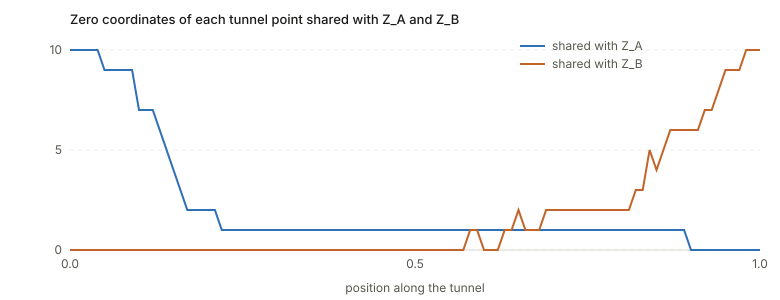
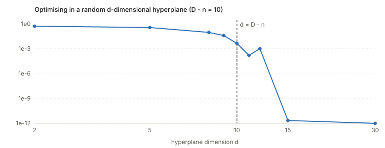
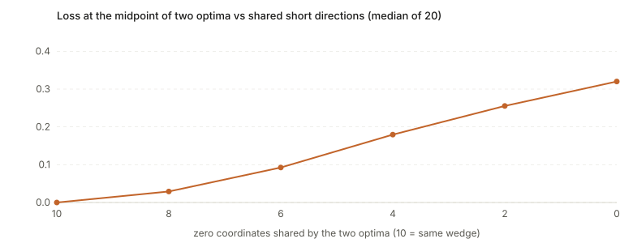

## Links

- **[NeurIPS 2019 page](https://papers.nips.cc/paper/2019/hash/48042b1dae4950fef2bd2aafa0b971a1-Abstract.html)**: the venue page.
- **[arXiv:1906.04724](https://arxiv.org/abs/1906.04724)**: preprint (9 pages). `make fetch` pulls the PDF from here.
- **[Interactive companion](figures/interactive.html)**: the wedge landscape with $D=3$ (the three coordinate
  planes). Put two optima on different planes and compare the straight line with the tunnel.
- **[Code](code/wedges.py)**: numpy only. `python3 code/wedges.py` prints every number quoted below;
  `--figures` regenerates the four SVGs.
- **[Mode connectivity](../mode-connectivity/index.html)**: the background page this paper sits in: linear
  connectivity, curved connectivity, connected volumes, and a small experiment that shows each.

Fort and Jastrzebski, *Large Scale Structure of Neural Network Loss Landscapes*, NeurIPS 2019.

## In one paragraph

Two networks trained from different random starts have a high loss wall on the straight line between their weights,
yet a curve between them with no wall exists. The paper proposes a picture that makes both facts unsurprising:
the set of good weight vectors is a union of huge flat pieces, **wedges**, each stretching far in $n$ directions and
thin in the other $D-n$, with $n$ only slightly below the full dimension $D$. Any two wedges intersect, so you can go
from one to the other along the intersection, while the straight line between two points on different wedges
leaves both. The paper does three things with the picture. It builds the corresponding toy loss and shows the toy
reproduces known behaviour (low-dimensional training, connectors between pairs). It predicts and finds
low-loss connectors between many optima at once ($m$-connectors). And it explains when averaging weights (SWA)
works and when it fails.

## The spine of the argument

1. Modes are connected by curves, not lines. Linear interpolation hits a wall but a curved connector exists
   (Draxler et al. 2018, Garipov et al. 2018).
2. In high dimension, "walls" and "valleys" from 2-D pictures mislead. Model the low-loss set as a union of
   $n$-dimensional wedges in $D$ dimensions, with $s=D-n\ll D$ short directions.
3. Consequences, all checked against the toy: any two wedges intersect; the straight line between points on
   different wedges leaves them; a hyperplane of dimension $d$ reaches a wedge iff $d\ge D-n$ (the intrinsic dimension);
   a path switching wedges has deviations from the line aligned within each half and orthogonal across halves.
4. Predicted and then found: tunnels connect not only pairs but $m+1$ optima ($m$-connectors).
5. Regularisers (learning rate, L2, dropout) widen the tunnel the optimiser travels in; larger batch narrows it.
6. SWA averages snapshots, which only lands in the low-loss set if the snapshots share a wedge.

## Setup and notation

| Symbol | Meaning |
|---|---|
| $D$ | number of weights (dimension of weight space) |
| $n$, $s=D-n$ | long (free) dimensions of a wedge, and its short (thin) directions |
| $n$-wedge | a cuboid long along $n$ coordinate axes, thin along the rest; one for every choice of $n$ axes |
| $L_{\rm toy}(P)$ | surrogate loss: Euclidean distance from $P$ to the nearest wedge |
| optimum, mode | a point where $L_{\rm toy}=0$ (on a wedge); in a real network, a trained solution |
| connector, tunnel | a path between two optima along which the loss stays low |
| $m$-connector | a low-loss $m$-dimensional surface through $m+1$ optima |
| $d_{\rm int}$ | intrinsic dimension: smallest random-hyperplane dimension in which training still works (Li et al. 2018) |
| SWA | stochastic weight averaging: average the weights of several snapshots |

## The toy model

**The loss.** To get the distance to the nearest axis-aligned wedge, sort $|P_1|,\dots,|P_D|$, take the $s=D-n$
smallest, and

$$
L_{\rm toy}(P)=\sqrt{\textstyle\sum_{i\in\text{the }s\text{ smallest}}P_i^{\,2}} .
$$

A point has zero loss exactly when at least $s$ of its coordinates are zero (then it lies on the wedge whose short
directions are those coordinates). Gradient descent on $\tfrac12L_{\rm toy}^2$ updates only the currently smallest $s$
coordinates, $P_i\leftarrow P_i-\eta P_i$, shrinking them geometrically to zero and leaving the other $n$ coordinates
where they were. In the code, a random start therefore lands on a random wedge and keeps its norm
($\lVert A\rVert=9.65$ for $D=100$): "the radius stays and the optimiser moves along a tunnel".

**Why the straight line leaves the wedges.** Let $A$ have zero set $Z_A$ and $B$ have $Z_B$, both of size $s$. At the
midpoint $\tfrac12(A+B)$ the coordinates in $Z_A\cap Z_B$ are zero, those in $Z_A\setminus Z_B$ equal $B_i/2$, those in
$Z_B\setminus Z_A$ equal $A_i/2$, and the rest are $(A_i+B_i)/2$. So the number of zero coordinates is
$|Z_A\cap Z_B|<s$ unless the two share a wedge, and the loss is positive. (My derivation; the paper states the
conclusion.) Two random wedges share about $s^2/D$ short directions, i.e. almost none.

**Why the intersection exists.** The intersection of two wedges has zeros in $Z_A\cup Z_B$, so it has about $2s$ short
directions. It is a smaller wedge but nonempty: it contains every point whose coordinates on $Z_A\cup Z_B$ are zero.
Moving from $A$ to $B$ along it is the connector of Figure 1.

**The intrinsic dimension.** A random $d$-dimensional hyperplane meets an $n$-dimensional set in $D$ dimensions
generically when $d+n\ge D$, i.e. $d\ge D-n=s$. So in the toy $d_{\rm lim}=D-n$, which the paper identifies with the
intrinsic dimension $d_{\rm int}$ of Li et al. (2018).

### Check 1: two optima, the straight line, and the midpoint

($D=100$, $n=90$, $s=10$.) Two random starts optimised to zero loss have $|Z_A|=|Z_B|=10$ zero coordinates and share
**0** of them (a random pair would share about $s^2/D=1$). The midpoint has **0** zero coordinates, against the 10 a wedge
point needs. Loss on the straight line: max **0.287** (at $t=0.14$); midpoint **0.148**. Compare $\lVert A\rVert=9.65$:
in the toy the wedge thickness is zero, so any positive loss is a wall, but its size is small next to the norm.

### Check 2: the tunnel algorithm of Section 4.2

The algorithm: cut the line into segments; at each point put a $(D-1)$-dimensional hyperplane normal to the line;
minimise the loss inside it, starting from the line; join the optimised points. The toy version (100 segments)
gives loss $\le10^{-119}$ at all 101 optimised points. The polyline joining them has max loss **0.071**
(straight line: 0.287), the small excess coming from consecutive points lying on different wedges.

*One random pair. The straight line (orange) has a wall along its whole length; the tunnel (green) sits on the floor.
The small bumps in the straight line are real: the loss is a sorted-coordinate function, so its derivative jumps
where the ordering of coordinates changes.*

**The alignment claim** (their Figure 3, middle). The deviation of each tunnel point from the line, as a vector, is
$\delta_k=p_k-\big((1-t_k)A+t_kB\big)$. Cosines between deviations: within the first half **0.24**, within the second half
**0.28**, across halves **+0.01**. So the deviations are positively aligned inside each half and orthogonal
across, as the paper reports for real networks. (Aligned but not parallel: 0.24–0.28, not 1.)

**What the tunnel does** (not stated in the paper). Tracking which short directions each tunnel point shares with
$Z_A$ and $Z_B$, at $t=0,0.1,\dots,1$:

| | 0 | .1 | .2 | .3 | .4 | .5 | .6 | .7 | .8 | .9 | 1 |
|---|---|---|---|---|---|---|---|---|---|---|---|
| shared with $Z_A$ | 10 | 7 | 2 | 1 | 1 | 1 | 1 | 1 | 1 | 0 | 0 |
| shared with $Z_B$ | 0 | 0 | 0 | 0 | 0 | 0 | 0 | 2 | 2 | 6 | 10 |

Every point has exactly 10 zero coordinates, so each sits on one wedge. But through the middle of the path the points
share 0–1 of them with either end: the tunnel does not hop from wedge $A$ straight to wedge $B$. It travels over a
series of **intermediate wedges**, each close to the previous one.

### Check 3: random hyperplanes and the intrinsic dimension

Start at a random point, optimise inside a random $d$-dimensional hyperplane; median final loss over 5 draws
($D-n=10$):

| $d$ | 2 | 5 | 8 | 9 | 10 | 11 | 12 | 15 | 30 |
|---|---|---|---|---|---|---|---|---|---|
| loss | 0.52 | 0.36 | 0.094 | 0.039 | 4.4e−3 | 1.6e−4 | 1.0e−3 | 2e−12 | 4e−46 |

The loss falls steeply across $d\approx D-n=10$ and is numerically zero by 15. The edge is blurred rather than sharp
because 3000 gradient steps cannot finish convergence when the hyperplane only just reaches a wedge.

### Check 4: $m$-connectors

Take $m+1$ optima, pick random points of their convex hull (average loss before: 0.11–0.16 depending on $m$), project the gradient
to a hyperplane of dimension $D-m$ orthogonal to the hull, optimise from the point. Loss after: **0** (below $10^{-100}$)
for $m=1,2,4,6,10$. The dimension count explains it: a hyperplane of dimension $D-m$ meets an
$n$-dimensional set when $(D-m)+n\ge D$, i.e. $m\le n=90$, far above the 10 the paper tests.

### Check 5: averaging, and the SWA prediction

Two optima that share $j$ of their 10 zero coordinates, with other coordinates random: the loss of their average
is $\sqrt{}$ of the sum of the 10 smallest squares of the averaged vector, so each short direction *not* shared
contributes a half-sized nonzero coordinate. Median over 20 draws:

| shared zero coordinates | 10 | 8 | 6 | 4 | 2 | 0 |
|---|---|---|---|---|---|---|
| loss at the midpoint | 0.000 | 0.029 | 0.093 | 0.180 | 0.255 | 0.320 |

So averaging is free inside one wedge and costs more the less the two optima share. This is the model's reading of
the SWA figure: at low learning rate the snapshots stay on one wedge and their mean is good; at high learning rate
they move between wedges and the mean falls out.

## The experiments on real networks

| Section | What they did | What they found |
|---|---|---|
| 4.2 | Build tunnels between pairs of CNN optima (CIFAR-10, Fashion-MNIST) by the algorithm above | low-loss connectors; deviations aligned within each half, orthogonal across halves (Fig. 3); predicted labels change linearly up to the midpoint, then stay constant; short directions at the ends $\approx300$, close to the CNN's intrinsic dimension |
| 4.3 | Extend to $m+1$ optima | $m$-connectors up to $m=10$; the number of short directions in the middle grows with $m$ (Fig. 4) |
| 4.4 | Vary learning rate, batch size, L2, dropout | higher learning rate, L2 and dropout widen the radial tunnel (up to a point); larger batch narrows it (Fig. 5) |
| 4.5 | SWA with a cyclical learning rate | works at low maximum rate, fails at high rate where snapshots change wedges; averaging predictions still helps (Fig. 6) |

Setting: a small CNN (three $3\times3$ conv layers with 16, 32, 32 channels, tanh) on CIFAR-10, Adam, constant learning rate.

## Questions and doubts

- **A phenomenological model, not a derivation.** The wedge union is chosen to fit what was already known, then
  tested on predictions the model makes. The toy reproduces the qualitative facts (checks 1–5 above reproduce
  several); it does not show the real landscape *is* a wedge union, and no theorem links the two.
- **The tunnel does not hop between two wedges.** The simulation's tunnel crosses a long stretch on wedges that
  share almost nothing with either end (table above). The paper's Figure 3 (right panel: label predictions change
  linearly to the midpoint, then constant) is described as "each wedge is one function". That reading would
  need the real tunnel to have just two wedges, and the toy suggests the structure is richer.
- **The short-direction count in Figure 4.** The paper reports more short directions in the middle of a connector,
  growing with $m$. In my toy every point on any wedge has exactly $s=D-n$ zero coordinates, so counting zeros gives a constant;
  the count would exceed $s$ only at a wedge intersection (about $2s$). I could not reproduce the figure's
  trend with this reading of "short directions", and the main text does not say how the count is measured (it may
  be a measure of local width, not zero coordinates). Check the paper's code before relying on that figure.
- **Axis-aligned wedges and symmetry.** The wedges lie along the *coordinate axes*, though the authors say orientation is
  irrelevant. A real network has permutation symmetries: reordering hidden units leaves the function unchanged, so
  weight space contains many equivalent copies of every solution. Later work (Entezari et al., Ainsworth et al.)
  finds that much of the straight-line barrier disappears after re-matching units. Whether that is a statement about the wedge
  picture, or a different explanation of the same barrier, is left open here.
- **Distance as a loss.** $L_{\rm toy}$ is zero on the wedge and grows linearly. A real loss is smooth near a
  minimum and has curvature set by the Hessian. The model captures the large-scale layout only.
- **Small scale.** One small CNN on CIFAR-10 for the figures, one SWA experiment, one optimizer. They say other
  architectures and datasets agree, but those results are not shown.
- **The wall is small in the toy.** The straight-line loss peaks at 0.29 against a norm of 9.65. It is a wall because
  the model's wedges have zero thickness. The real analogue is a barrier in loss units, which depends on the loss.
- **Why SGD lands where it does** is not addressed: the model describes the geometry, not the dynamics
  that choose a wedge. Section 4.4's tunnel-width results are the only link, and they are correlational.

## Takeaways

- Linear walls and curved connectivity are compatible: two points on different flat high-dimensional pieces are
  joined through the pieces' intersection and separated along the straight line.
- Counting dimensions does the work: a hyperplane of dimension $d$ meets a wedge of dimension $n$ in $D$ dimensions iff
  $d\ge D-n$. That is the paper's explanation of the intrinsic dimension, and the toy confirms it.
- Weight averaging is safe only inside one wedge. In the toy the midpoint loss grows steadily as two optima share
  fewer short directions (0 at 10 shared, 0.32 at none).
- Connectors extend from pairs to many optima, and in the toy up to $m\le n$ at once.
- Treat the wedge union as a picture that fits several facts, not as a measured structure of real loss surfaces.

---

*Notes written 2026-10-14.*
