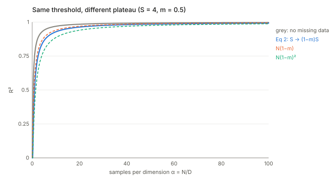
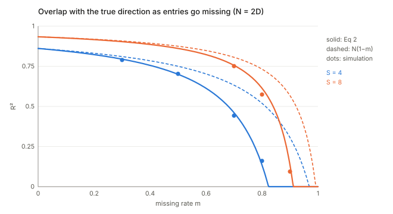

## Links

- **[arXiv:1905.00709](https://arxiv.org/abs/1905.00709)** — preprint; ICML 2019 (PMLR 97). Six
  pages of main text, then a two-page appendix that holds the whole derivation (Appendix A,
  Eqs. 3–33). Everything below about proofs refers to that appendix.
- **[Interactive companion](figures/interactive.html)** — slide $S$, $\alpha$ and the missing rate
  and watch three readings of "missing data" separate; then run the experiment yourself in the
  browser.
- **Code:** [`code/pca_missing.py`](code/pca_missing.py) — numpy only. It re-checks the appendix's
  algebra, simulates the experiment, and regenerates the two figures with `--figures`.
- **Background the paper leans on:** Biehl & Mietzner 1993 and Hoyle & Rattray 2007 (the complete-data
  result by the replica method); Baik, Ben Arous & Péché 2005 and Paul 2007 (the same result proved
  rigorously by random-matrix theory, not cited in the paper).

## In one paragraph

Find the single direction along which a data set varies most. If the data are a planted direction
$a_0$ buried in isotropic noise, how well does that direction recover $a_0$? When there are as many
dimensions $D$ as samples $N$ the answer is a sharp one: below a critical sample ratio the recovered
direction is **no better than random**, above it the overlap climbs smoothly towards 1. The paper
extends this known picture to entries that are missing completely at random with probability $m$, and
the extension is strikingly small: replace the signal-to-noise ratio $S$ by $(1-m)S$ and leave
everything else alone. The headline moral, in the title, is that a missing entry hurts you by
weakening the signal relative to the noise, not by deleting samples — so the folk rule "missing data
is just a smaller $N$" is the wrong picture. The derivation is a replica calculation, which is not
rigorous but whose complete-data answer matches the rigorous one. The notes below rebuild it, and also
show where the printed algebra has slips and where the "not sample size" slogan needs a qualifier.

## The spine of the argument

1. **Model.** Each sample is $x = z\,a_0 + \varepsilon$ with $z\sim\mathcal N(0,1)$, $\|a_0\|=1$, and
   isotropic noise of variance $\sigma^2$. The population covariance is $C=\sigma^2 I + a_0a_0^\top$.
   Two numbers control everything: $S=1/\sigma^2$ and $\alpha=N/D$.
2. **Quantity of interest.** The squared overlap $R^2=(a_0^\top \hat a)^2$ between the true direction and
   the top eigenvector of the sample covariance, averaged over data sets.
3. **Complete data (Eq. 1, known).** $R^2=0$ below $\alpha S^2=1$; above it $R^2=\frac{\alpha S^2-1}{S+\alpha S^2}$.
4. **Replica calculation** turns the average of an eigenvector's overlap into an extremum over two
   overlap numbers $q$ (replica with replica) and $r$ (replica with the truth).
5. **Missing data (Eq. 2, new).** The only change in the calculation is that every sample sees only
   $(1-m)D$ coordinates; averaging gives $\beta\to(1-m)\beta$ and $S\to(1-m)S$.
6. **Evidence.** Simulations and five real data sets, with learning curves in $S$ at fixed $m$.

## Setup and notation

Work with plain words first.

- **A signal direction** $a_0$: a unit vector in $\mathbb R^D$. Think of one face-shaped pattern that
  every image contains with a random brightness $z$, plus pixel noise.
- **Signal-to-noise ratio** $S=\|a_0\|^2/\sigma^2$: how much variance the pattern carries along its own
  direction, measured in units of the noise variance in one direction. $S=20$ means the pattern is
  twenty times louder than the noise along that direction.
- **Samples per dimension** $\alpha=N/D$. The regime is $N,D\to\infty$ with $\alpha$ held fixed. That is
  the right regime for modern data, where the dimension is comparable to the sample count, and it is
  why the result is a sharp transition and not a smooth rate.
- **The estimate** $\hat a$: the unit vector maximising $\sum_n(v^\top x_n)^2$, equivalently the top
  eigenvector of $\hat C=\frac1N\sum_n x_nx_n^\top$ (Eq. 3 and 6).
- **The score** $R^2=(a_0^\top\hat a)^2\in[0,1]$. A *random* direction in $D$ dimensions has
  $R^2\approx 1/D\to0$, so "$R^2=0$" in the large-$D$ limit means "no better than guessing".
- **Missing completely at random (MCAR):** each entry of the $N\times D$ data matrix is independently
  deleted with probability $m$, regardless of its value.

Note on the paper's two uses of $S$. The text defines $S_i=\|a_i\|^2/\sigma^2$ and the appendix uses
$S=1/\sigma^2$, which is the same thing only because $\|a_0\|=1$ there. All formulas below use
$\|a_0\|=1$.

## Why there is a transition at all

Before any replica machinery, here is why a threshold must exist. It is worth having, because the
appendix proves the formula but never says why it is plausible.

Suppose there is **no** signal, $a_0=0$. Then $\hat C$ is the sample covariance of pure noise. With $N$
samples in $D$ dimensions it is *not* $\sigma^2 I$: its eigenvalues spread out into a band, and when
$D$ is comparable to $N$ the band is wide. Its top edge sits at $\sigma^2(1+\sqrt{D/N})^2$ (the
Marchenko–Pastur edge). So even pure noise produces a "top principal component" with a variance well
above $\sigma^2$.

Now plant a signal. Its population eigenvalue is $\sigma^2(1+S)$. The sample covariance can only show it as
a distinct direction if its eigenvalue **detaches from the noise band**. Noise pushes the spike's sample
eigenvalue up to $\sigma^2(1+S)(1+\tfrac{D/N}{S})$, and that is above the band's edge $\sigma^2(1+\sqrt{D/N})^2$
exactly when $S>\sqrt{D/N}=1/\sqrt\alpha$, i.e. $\alpha S^2>1$. Until then the top eigenvector is just the
loudest accident of the noise and carries no information about $a_0$. That is Eq. 1's threshold.

Past the threshold the overlap is not 1 straight away: the top eigenvector is the true direction tilted
towards noise directions, and the tilt shrinks as $\alpha$ grows. Eq. 1 says how fast:

$$R^2=\frac{\alpha S^2-1}{S+\alpha S^2}=1-\frac{S+1}{S+\alpha S^2}\;\approx\;1-\frac{1}{\alpha}\Big(\frac1S+\frac1{S^2}\Big)\quad(\alpha\to\infty).$$

The paper states this expansion with an "$o(1/\alpha^2)$" remainder; it is $O(1/\alpha^2)$ (the next term is
$\tfrac38$ at $S=2$, times $\alpha^{-2}$). Harmless, but a slip.

Writing $c=D/N=1/\alpha$, Eq. 1 reads $R^2=\dfrac{1-c/S^2}{1+c/S}$, which is exactly the overlap formula
proved by Paul (2007) and Baik–Ben Arous–Péché (2005) for a single spike. So the "remarkable
universality" in the paper's introduction is a theorem, not just a physics conjecture.

## The replica derivation, line by line

The appendix is dense, so here is what each step is for. The target is
$\langle R^2\rangle_{\mathcal X}$, an average over data sets of the squared overlap with the top
eigenvector. The eigenvector is a nasty function of the data. The replica method gets the average without
ever computing it.

### Step 1: a partition function whose derivative is the answer (Eqs. 4–6)

Define, for a data set $\mathcal X$,

$$Z(h)=\int da\;\delta(\|a\|-1)\,\exp\Big(\beta\sum_{n=1}^N(a^\top x_n)^2+h^\top a\Big).$$

Read it as a weighting of unit vectors $a$: each $a$ gets weight $e^{\beta\cdot(\text{variance explained by }a)}$.
As $\beta\to\infty$ this weighting piles up on the single best vector, the top eigenvector. The small field
$h$ lets us read off *where* it piles up: $\partial\log Z/\partial h$ is the average $a$ under the weighting,
which tends to $\hat a$. So

$$R^2=\Big(\lim_{h\to0,\beta\to\infty}\frac{\partial\log Z(h)}{\partial h}\cdot a_0\Big)^2 .$$

This is the standard device of statistical mechanics: $\beta$ plays the role of inverse temperature, and
$\beta\to\infty$ is "freeze to the ground state". Here the ground state of the energy
$-\sum(a^\top x_n)^2$ on the sphere is the top eigenvector.

### Step 2: the replica trick (Eqs. 8–9)

We need $\langle\log Z\rangle_{\mathcal X}$, but averaging a logarithm is hard. The identity

$$\log Z=\lim_{w\to0}\frac{Z^w-1}{w}=\lim_{w\to 0}\frac1w\log\langle Z^w\rangle\ (\text{to first order})$$

trades it for $\langle Z^w\rangle$, which for integer $w$ is easy because $Z^w$ is $w$ independent copies
("replicas") $a_1,\dots,a_w$ of the integral, all seeing the same data. Compute for integer $w$, then pretend the
result holds as $w\to0$. That last step is the non-rigorous leap; it is why the argument is a derivation,
not a proof, and why the complete-data agreement with random-matrix theory is reassuring rather than
redundant.

(The paper's Eq. 8 writes $\log Z=\lim_{w\to0}\frac{Z^{w}-1}{w}$ as "$Z^{-1}$ over $w$"; the printed
version has lost the numerator.)

### Step 3: the data average is a Gaussian integral (Eqs. 9–11)

The exponent of each replica is *quadratic* in the data, $\beta(a_j^\top x)^2$. Quadratics in Gaussians are
integrable, but the exponent is $\beta$ times a square, which we linearise with the identity
$e^{\beta y^2}=\int\frac{du}{\sqrt{2\pi}}e^{-u^2/2+\sqrt{2\beta}\,u\,y}$. That introduces one auxiliary
number $u_j$ per replica and per sample. Now the data enter only linearly in the exponent, and for a
Gaussian $x\sim\mathcal N(0,C)$,

$$\Big\langle e^{t^\top x}\Big\rangle=e^{\frac12t^\top Ct},\qquad t=\sum_j\sqrt{2\beta}\,u_ja_j
\ \Rightarrow\ \exp\Big(\beta\sum_{j,j'}u_ju_{j'}\,a_j^\top Ca_{j'}\Big).$$

**Slip.** Eq. 10 prints $C^{-1}$ in this exponent; Eq. 11 and everything after use $C$, which is right (the
exponent of a Gaussian average involves the covariance, not its inverse).

Now substitute $C=\sigma^2I+a_0a_0^\top$. Then $a_j^\top Ca_{j'}=\sigma^2q_{jj'}+r_jr_{j'}$ with the two
**overlap numbers**

$$q_{jj'}=a_j^\top a_{j'}\ \text{(replica with replica)},\qquad r_j=a_j^\top a_0\ \text{(replica with the truth)}.$$

Everything about the data has collapsed into these. The $u$-integral is a plain Gaussian integral with matrix
$M=I-2\beta\sigma^2(Q+S\,rr^\top)$ (Eq. 12), where $Q=(q_{jj'})$ and $S=1/\sigma^2$ appears because
$\sigma^2S=1$. It gives $|M|^{-1/2}$ per sample, so for $N$ samples

$$\langle Z^w\rangle=\int\prod_j da_j\,\delta(\|a_j\|^2-1)\;|M(Q,r)|^{-N/2}.$$

### Step 4: from $a$'s to overlap numbers (Eqs. 13–20)

Now change variables: instead of integrating over the replicas $a_j\in\mathbb R^D$, integrate over their
overlaps $Q,r$ and count how many configurations of the $a_j$ produce each overlap. That count is a volume
in $D$ dimensions, and to leading order in $D$ it is $|Q^+|^{D/2}$ where $Q^+$ is the $(w+1)\times(w+1)$
Gram matrix of $(a_0,a_1,\dots,a_w)$ (Eq. 17, via Ahr–Biehl–Urbanczik). The determinant of that block matrix
is $|Q-rr^\top|$ (Eq. 18, a Schur complement with $\|a_0\|=1$). Putting the count and the data term together,

$$\langle Z^w\rangle\propto\int dQ\,dr\;\exp\Big\{D\Big[\tfrac12\log|Q-rr^\top|-\tfrac\alpha2\log|I-2\beta\sigma^2(Q+Srr^\top)|\Big]\Big\}.$$

This is the shape that makes the large-$D$ limit tractable: a $D$ in front of the exponent, so the integral is
dominated by the **saddle point** of the bracket. Two competing terms: the first (an "entropy") rewards
overlap configurations that many $a$'s realise; the second (the data "energy") rewards configurations that
explain the data variance.

### Step 5: replica symmetry and $w\to0$ (Eqs. 21–24)

Assume all replicas are equivalent: $q_{jj'}=q$ for $j\neq j'$, $r_j=r$. This "replica-symmetric" assumption is
the second unproved step. It is plausible here: the function being optimised is a quadratic form on the sphere,
which has a *single* top eigenvector, so there is no landscape of competing states that would break the symmetry.

The matrices now have the form $(z-y)I+y\mathbf 1\mathbf 1^\top$, with determinant $(1+\frac{wy}{z-y})(z-y)^w$. This yields

$$\tfrac1w\log|Q-rr^\top|\to\frac{q-r^2}{1-q}+\log(1-q),\qquad
\tfrac1w\log|I-2\beta\sigma^2(Q+Srr^\top)|\to\log(1-2v)-\frac{2\beta\sigma^2(q+Sr^2)}{1-2v},$$

with $v=\beta\sigma^2(1-q)$. (The printed Eq. 23 writes $1-Sr^2$ in places where the algebra gives $1-q$; Eq.
24 then restores the right limit.)

### Step 6: the zero-temperature limit and the saddle (Eqs. 25–28)

Take $\beta\to\infty$, so the replicas must agree perfectly: $q\to1$ with $1-q=v/(\beta\sigma^2)$ fixed in $v$.
Both leading terms grow like $\beta$; the $\log(1-q)$ and $\log(1-2v)$ grow like $\log\beta$ at most and are
dropped (the paper's "$\propto$" hides this). What remains, per $\beta\sigma^2 D$, is

$$F(v,r)=\frac{\varphi_1}{2v}+\frac{\varphi_2}{1-2v},\qquad \varphi_1=1-r^2,\quad\varphi_2=\alpha(1+Sr^2).$$

**Slip.** The paper prints $\varphi_1=1+r^2$. The algebra above gives $1-r^2$ (from $\frac{q-r^2}{1-q}$ at $q\to1$),
and only $1-r^2$ reproduces the paper's own stationary point. Eq. 26 also drops the $\tfrac12$ that Eq. 27 then uses.

Extremise in $v$: $v^\star=\frac{\sqrt{\varphi_1}}{2(\sqrt{\varphi_1}\pm\sqrt{\varphi_2})}$ (Eq. 27), and substituting
back,

$$F(v^\star,r)=\big(\sqrt{\varphi_1}+\sqrt{\varphi_2}\big)^2=\Big(\sqrt{1-r^2}+\sqrt{\alpha(1+Sr^2)}\Big)^2.$$

Finally extremise over $r$, the quantity we want. Differentiating $\sqrt{1-r^2}+\sqrt{\alpha(1+Sr^2)}$:

$$\frac{r}{\sqrt{1-r^2}}=\frac{\alpha Sr}{\sqrt{\alpha(1+Sr^2)}}\ \Rightarrow\ \alpha S^2(1-r^2)=1+Sr^2
\ \Rightarrow\ r^2=\frac{\alpha S^2-1}{S+\alpha S^2}.$$

That is Eq. 1 exactly (Eq. 28, with $S(1+\alpha S)=S+\alpha S^2$). If $\alpha S^2<1$ the equation has no
solution with $r^2\ge0$, so the extremum is at the boundary $r=0$: that is the flat part of the phase
transition. With the printed $1+r^2$ there is no interior stationary point at all (the expression increases
with $r$), so the sign matters for the argument, though not for the final line. `code/pca_missing.py` checks both statements on a grid.

## Adding missing data

### What the replica calculation changes (Eqs. 29–33)

Each sample is now $s_n\odot x_n$, with $s_{n,d}=1$ if feature $d$ is observed. The objective in Eq. 29 is
$\sum_n(a^\top(s_n\odot x_n))^2$: it is PCA on the **zero-filled** data. This is a point the paper never states:
the theory describes zero-filling, while the experiments use EM probabilistic PCA fitted on observed entries
only. They agree (see below) but the appendix does not argue why.

Redo Steps 1–3 sample by sample. The Gaussian integral over a sample's observed coordinates uses the
sub-covariance $C_n$ of those coordinates, and the overlaps become sample-dependent:
$q^n_{jj'}=\sum_ds_{n,d}\,a_{j,d}a_{j',d}$ and $r^n_j=\sum_ds_{n,d}\,a_{j,d}a_{0,d}$ (Eq. 31). Now the product over
samples no longer collapses to a single $N$th power. The paper invokes **self-averaging**: replace each
$q^n,r^n$ by its mean over the mask (Eq. 32):

$$\langle q^n_{jj'}\rangle=(1-m)\,q_{jj'},\qquad\langle r^n_jr^n_{j'}\rangle\approx(1-m)^2\,r_jr_{j'}.$$

The $q$ term has one factor of $(1-m)$ because $\sum_ds_{n,d}\,a_{jd}a_{j'd}$ has one mask variable per term; the $rr$ term has two
because it is a product of two separate sums. Substituting into $M$:

$$M=I-2\beta\sigma^2\big[(1-m)\,q+(1-m)^2S\,rr^\top\big]=I-2\beta'\sigma^2\big[q+S'\,rr^\top\big],$$

with $\beta'=(1-m)\beta$ and $S'=(1-m)S$. The calculation is now literally the complete-data one with $\beta'$ and
$S'$. At $\beta\to\infty$ the value of $\beta'$ drops out (only the saddle matters), which leaves Eq. 2.

Why self-averaging is safe here: each $q^n$ is a sum of $D$ terms, so its fluctuation around the mean is $O(1/\sqrt D)$
relative; the correction to $\log|M^n|$ is quadratic in that fluctuation, $O(1/D)$ per sample and $O(N/D)=O(1)$ in total, against a leading
term of order $D$. It does not change the saddle. (This is my gloss; the paper says only "simple self-averaging
assumption".) One gap remains: the paper's step also uses $\langle r^nr^n\rangle\approx(1-m)^2rr$, ignoring a
variance term of order $m(1-m)\sum_d a_{j,d}^2a_{0,d}^2$, small when the vectors are delocalised.

### A derivation with no replicas

The factor $(1-m)$ also drops out of a two-line moment calculation, which is a useful sanity check on the
long derivation. After zero-filling, a sample $\tilde x=s\odot x$ has

$$\mathbb E[\tilde x\tilde x^\top]=(1-m)^2\,a_0a_0^\top+(1-m)\,\sigma^2I+m(1-m)\,\mathrm{diag}(a_0^2).$$

The signal loses a factor $(1-m)^2$: both of its two coordinates have to survive. The noise loses only $(1-m)$: each
noise entry on its own has to survive. So the ratio of signal variance to noise variance is
$(1-m)^2/(1-m)=(1-m)$ times the original $S$. The last term is a small diagonal bump, of order $1/D$ for a
delocalised $a_0$, so it does not matter at leading order. That is Eq. 2's mechanism, in words: **a signal needs
pairs of observed entries; noise does not.**

## Signal-to-noise or sample size?

The paper's slogan sets two stories against each other, and the figure above plots both. Check what
distinguishes them carefully, because algebra alone does not.

- **Sample-size story:** deleting entries is like deleting rows, so replace $\alpha$ by $(1-m)\alpha$. This is the
  $N(1-m)$ curve of the paper's Fig. 2c.
- **Eq. 2:** replace $S$ by $(1-m)S$.

Since Eq. 1 depends on $S$ and $\alpha$ only through $\alpha S^2$ in the threshold, Eq. 2's threshold is the same as
that of "$N\to N(1-m)^2$". That raises a fair question: is the SNR story just the sample-size story with a different
exponent? The answer is *only partly*:

- **The threshold coincides** with $N(1-m)^2$: both give $m_c=1-\dfrac{1}{S\sqrt\alpha}$.
- **The plateau does not.** Far above threshold Eq. 1 gives $1-\frac1\alpha(\frac1S+\frac1{S^2})$, with *both* $\alpha$
  and $S$ appearing, not only the product. Shrinking $S$ changes the $\frac1S$ part; shrinking $\alpha$ by
  $(1-m)^2$ does not. The code compares the two.
- **The paper's chosen comparison is the strawman.** Fig. 2c tests $N(1-m)$, not $N(1-m)^2$. Against $N(1-m)$ Eq. 2
  wins decisively (it puts the transition in the right place), but the more faithful sample-size alternative
  is not tested; it fails too, but differently (right threshold, wrong plateau). So "not sample size" is right as a statement about *which parameter the missing rate multiplies
  and by how much*, and weaker as a statement that the two descriptions are different in practice.

The interactive page lets you drag $m$ and see the three curves.

### Where the transition sits for the paper's Fig. 2a

For $N=2000$, $D=3000$ ($\alpha=\tfrac23$) and $\sigma^2=0.05$: $S_1=1/0.05=20$ and $S_2=0.25/0.05=5$, so
$m_c=1-1/(S\sqrt\alpha)\approx0.94$ and $0.76$. The paper's Fig. 2a shows the second component starting to
learn at a visibly lower missing rate than the first, consistent with that formula.

## What the experiments show

- **Simulations (Fig. 2).** Fit Eq. 2 closely, including the sharp onset. Figures 2a, 2b are generated at $D$ in the
  thousands, where finite-size smearing near threshold is small; at smaller $D$ the corner rounds off (try the
  browser experiment).
- **Real data (Fig. 3).** The authors estimate $S$ from the eigenvalues of the sample covariance: noise variance
  as the mean of the non-signal eigenvalues, signal variance as the top eigenvalue minus that, then *add* noise to
  move along the $S$ axis and compare the learning curve to Eq. 2. They use the full-data top eigenvector as the
  "truth". Two consequences are worth noting. First, the truth is itself a noisy estimate, which caps the
  attainable $R^2$ below 1. Second, the $S$ estimate treats all remaining eigenvalues as noise, which is false for any real data with more than
  one meaningful component. Agreement is good for Faces in the Wild and FashionMNIST, partial for MNIST,
  worse for NCI60 ($N=64$, so far from the large-$D,N$ regime) and the binary food-pairing data.
- **Why the failures are plausible.** MNIST has pixels that are always zero, so the noise is not isotropic, and the
  food-pairing data are binary and sparse. The authors say as much. Note this means the real-data section tests
  *where the isotropic-noise spike model is a decent description*, more than it tests the missing-data claim.

## Questions and doubts

- **The estimator in theory is not the estimator in the experiments.** The replica calculation is for PCA on
  zero-filled data. The experiments use EM probabilistic PCA on observed entries. In the checks in `code/`, at
  moderate $D$ the two track each other and Eq. 2 (with more scatter near threshold), but the paper offers no argument for why a likelihood-based fit should behave like zero-filling.
- **The $(1-m)^2$ versus $(1-m)$ comparison is the real content of the "not sample size" claim, and it is
  not tested.** See above: Fig. 2c plots the weakest competitor.
- **Is the argument rigorous?** No. It rests on the replica trick and on replica symmetry. The complete-data result is a
  known theorem by other routes (BBP/Paul); for missing data the moment calculation above suggests a rigorous route through
  random-matrix results for non-Gaussian noise, which the paper does not take (I have not worked it through). The $(1-m)S$ rule is therefore well supported (moments, replicas and simulation agree) while
  its proof as printed is a physicist's.
- **A single spike only.** Eq. 2 is for one direction. Fig. 2a shows two directions each following their own
  curve, which is reasonable for well-separated spikes, but the appendix does not derive it.
- **MCAR only.** The introduction motivates the work by missing-at-random (MAR) data, which is what probabilistic
  PCA handles in principle, but the theory and all simulations are MCAR. Under informative missingness the
  moment calculation fails at its first line.
- **Typos that could mislead.** $C^{-1}$ for $C$ (Eq. 10), $1+r^2$ for $1-r^2$ (Eqs. 25–26), the lost numerator in
  Eq. 8, $o(\cdot)$ for $O(\cdot)$ in the large-$\alpha$ expansion, $\|a\|=1$ implicit in the definition of $S$, and
  "$m\to0$" for "$w\to0$" in Eq. 24's second line. None changes the final result.
- **The title's exclamation is stronger than the evidence.** What is shown is that $S\to(1-m)S$ fits much better than $N\to(1-m)N$. It is
  not shown that no sample-size description can fit.

## Takeaways

- **Missing entries cost signal, not samples.** A zero-filled sample keeps a fraction $(1-m)^2$ of the signal
  variance but $(1-m)$ of the noise variance, so $S\to(1-m)S$. The proof in the paper is long; this one line is
  the reason.
- **There is a sharp threshold, and it is predictable.** $R^2=0$ until $(1-m)S\sqrt\alpha=1$, i.e. until
  $m_c=1-1/(S\sqrt\alpha)$. If your data are high-dimensional with few samples, the most useful number to know is $S\sqrt\alpha$.
- **Eq. 1 is the single-spike overlap formula of random-matrix theory;** the replica method reaches it by
  extremising $\big(\sqrt{1-r^2}+\sqrt{\alpha(1+Sr^2)}\big)^2$ over the overlap $r$.
- **The "not sample size" claim should read "not $N(1-m)$".** $N(1-m)^2$ shares the threshold, and the paper never
  tests it against Eq. 2 on the plateau.
- **Read the real-data section as a test of the spike model.** Where noise is isotropic the theory holds; where
  it is not (MNIST borders, binary food data) it does not.
