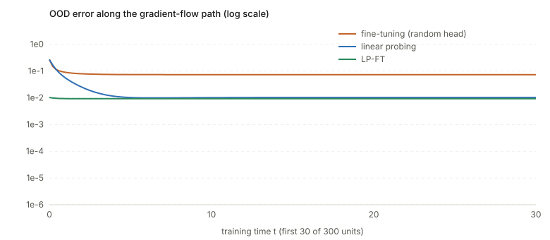

## Links

- **[OpenReview forum](https://openreview.net/forum?id=UYneFzXSJWh)**: the ICLR 2022 venue page.
- **[arXiv:2202.10054](https://arxiv.org/abs/2202.10054)**: preprint, 54 pages with the appendix proofs.
  `make fetch` pulls the PDF from here.
- **[Interactive companion](figures/interactive.html)**: the paper's 2-D toy (Figure 2) as a live
  gradient flow. Drag the tilt of the pretrained feature and the initial head, scrub time.
- **[Code](code/feature_distortion.py)**: numpy only. `python3 code/feature_distortion.py` prints every
  number quoted below; `--figures` regenerates the three SVGs.
- **[Principal angles between subspaces](../../foundations/principal-angles-subspaces/index.html)**: the
  one piece of linear algebra the main theorem is written in.

Kumar, Raghunathan, Jones, Ma and Liang, *Fine-Tuning can Distort Pretrained Features and Underperform
Out-of-Distribution*, ICLR 2022.

## In one paragraph

You have a good pretrained feature extractor and a labelled downstream set. **Linear probing (LP)** freezes the features and trains
only the last linear layer. **Fine-tuning (FT)** trains everything. FT wins on test data that looks like the training data
(in-distribution, ID). The paper shows that when the pretrained features are already good and the test data
is far from the training data (out-of-distribution, OOD), FT loses to LP, by 7 accuracy points on average over
ten benchmarks. The explanation is a piece of mechanics. The gradient on the feature extractor is built from training inputs, so
the features change **only in directions the training data spans** and stay exactly as pretrained in every
other direction. A randomly initialised head, however, is far from right, so fitting the training data forces
the head and the features to move together. The head ends up tuned to the *changed* features, and on OOD
inputs it meets the *unchanged* ones. Starting from a head that is already good (the linear-probed head, the
LP-FT recipe) removes the need to move the features, and the distortion goes with it.

## The spine of the argument

1. Model: $f(x)=v^\top B x$ with feature extractor $B\in\mathbb R^{k\times d}$ and head $v\in\mathbb R^k$. Fit the
   training set by gradient flow on *both*, starting at the pretrained $B_0$.
2. **Fact 1 (Lemma A.3).** $B_{\mathrm{ft}}(t)\,x=B_0\,x$ for every $x$ perpendicular to all training inputs. The
   feature extractor never moves outside the training span $S$.
3. **Fact 2 (Lemma A.4).** $vv^\top-BB^\top$ is conserved. The head and the features cannot move independently.
4. To have small OOD error the head must be close to the true head $v_\star$ (because OOD inputs only
   "see" the unchanged features). The conserved quantity then forces $B$ to move a lot **inside** $S$ if
   $v_0$ is far from $v_\star$, and that raises the ID-side error. Either way some subspace is wrong: this is Theorem 3.3.
5. LP keeps the features, so its OOD error is about $\epsilon\|w_\star\|$ (first order in the feature error
   $\epsilon$). FT's lower bound does not go to zero with $\epsilon$. That gap is Theorem 3.5.
6. FT can still fit the training data exactly with imperfect features, and LP cannot: Proposition 3.6.
7. If the head is initialised at the LP solution and the features are perfect, the gradient is already zero and
   nothing moves: Proposition 3.7, the LP-FT idea.

## Setup and notation

| Symbol | Meaning |
|---|---|
| $d,\;k,\;m,\;n$ | input dimension, feature dimension, dimension of the ID subspace, number of training examples. $k<m<d-k$ and $n\ge m$ |
| $B\in\mathbb R^{k\times d},\;v\in\mathbb R^{k}$ | feature extractor (a linear map) and head; predictor $v^\top Bx$ |
| $B_\star,\,v_\star,\,w_\star=B_\star^\top v_\star$ | ground truth (well-specified: $y=w_\star^\top x$); $B_\star$ has orthonormal rows |
| $B_0$ | pretrained extractor, orthonormal rows, $d(B_0,B_\star)\le\epsilon$ |
| $d(B,B')=\min_U\lVert B-UB'\rVert_2$ | distance between extractors up to a rotation $U$ (rotating features is harmless: $(Uv)^\top(UB)=v^\top B$) |
| $X\in\mathbb R^{n\times d},\;Y\in\mathbb R^n$ | training inputs (as rows) and labels; $S=\operatorname{rowspace}(X)$, $\dim S=m$ |
| $S^\perp$ | directions perpendicular to every training input: the "never seen" part of input space |
| $R_0=\operatorname{rowspace}(B_0)$ | the $k$-dimensional subspace of inputs that the pretrained features read |
| $\Sigma=\mathbb E_{P_{\rm ood}}[xx^\top]$ | OOD second moment, assumed to reach outside $S$ |
| $\widehat L(v,B)=\lVert XB^\top v-Y\rVert_2^2$ | training loss; $L_{\rm ood}(v,B)=(w_\star-B^\top v)^\top\Sigma(w_\star-B^\top v)$ |
| $\cos\theta_{\max}(R,S)$ | cosine of the largest principal angle ($\sigma_{\min}(E^\top F)$ for orthonormal bases $E,F$) |
| $\varphi^2=\lvert (v_0^\top v_\star)^2-(v_\star^\top v_\star)^2\rvert$ | how misaligned the initial head is with the true head |
| FT, LP, LP-FT | fine-tune everything; train head only; train head, then fine-tune from that head |

The flows are

$$
\dot v_{\rm ft}=-\nabla_v\widehat L,\quad \dot B_{\rm ft}=-\nabla_B\widehat L,\qquad
\dot v_{\rm lp}=-\nabla_v\widehat L,\quad \dot B_{\rm lp}=0,
$$

with $B_{\rm ft}(0)=B_{\rm lp}(0)=B_0$ and $v(0)=v_0$ (random, or zero). *Gradient flow* is gradient descent
with an infinitesimal step, so the update is a differential equation and the paper can reason about the
path instead of only its endpoint.

## Why the path matters

The setting is overparameterised ($m<d-k$ and $B$ is free to move), so many parameter settings fit the training data
perfectly. Fine-tuning from a pretrained $B_0$ and training from scratch minimise the *same* loss and differ only in where
they start. Which zero-loss solution gradient flow lands on depends on the whole trajectory, which is the "implicit
regularisation of the initialisation". There is no closed form for the trajectory (the problem is non-convex), so the
paper avoids solving it and instead finds quantities that **cannot** change along it.

## Result 1: the feature extractor only moves inside the training span

The gradient of $\widehat L$ with respect to $B$, with residual $r=XB^\top v-Y\in\mathbb R^n$:

$$
\widehat L=\lVert r\rVert^2
\;\Rightarrow\;
\frac{\partial\widehat L}{\partial B_{ij}}=2\sum_{s} r_s\,v_i X_{sj}
\;\Rightarrow\;
\nabla_B\widehat L=2\,v\,r^\top X .
$$

Every row of $\nabla_B\widehat L$ is $2v_i\,r^\top X$, a linear combination of the **rows of $X$**, the training
inputs. Take any $x\perp S$, so $Xx=0$:

$$
\dot B_{\rm ft}\,x=-2\,v\,r^\top X x=0 .
$$

Hence **Lemma A.3**: $B_{\rm ft}(t)x=B_0x$ for all $t$. The extractor is untouched in $S^\perp$ and free to
change in $S$.

Check (`code/feature_distortion.py`, $d=24,\,m=10$): the largest change of $B_{\rm ft}(t)$ over all unit $x\in S^\perp$ and
all $t$ is $3\times10^{-14}$, while over unit $x\in S$ it is $0.185$.

The argument uses only the shape $\widehat L=\sum_i\ell(v^\top Bx_i)$, so it holds for any loss, logistic included
(my remark; the paper only does squares). The code re-runs it with the logistic loss: change of $B$ on $S^\perp$ is
$1.6\times10^{-14}$, on $S$ it is $9.3$.

## Result 2: balancedness

With $\dot v=-2BX^\top r$ and $\dot B=-2vr^\top X$:

$$
\tfrac{d}{dt}(vv^\top)=\dot v v^\top+v\dot v^\top=-2BX^\top r\,v^\top-2\,v\,r^\top XB^\top,
$$
$$
\tfrac{d}{dt}(BB^\top)=\dot B B^\top+B\dot B^\top=-2\,v\,r^\top XB^\top-2BX^\top r\,v^\top .
$$

The two right-hand sides are equal, so (**Lemma A.4**)

$$
v(t)v(t)^\top-B(t)B(t)^\top=v_0v_0^\top-B_0B_0^\top\quad\text{for all }t .
$$

(The paper cites Du et al. 2018 and Arora et al. 2018 here and says "verified by direct calculation".) It is
again valid for any loss of the form $\sum_i\ell(v^\top Bx_i)$ since the two derivatives share the factor
$\sum_i\ell'_i\,(Bx_i\,v^\top+v\,x_i^\top B^\top)$. In words: the head's squared length grows exactly as much as
the extractor's squared length does. Numerically the drift is $1.4\times10^{-10}$ with RK4, and $2.0\times10^{-9}$ for the
logistic loss.

Two consequences used later:

- Taking the trace: $\lVert v\rVert^2-\lVert B\rVert_F^2=\lVert v_0\rVert^2-\lVert B_0\rVert_F^2$, so
  $\lVert B_{\rm ft}(t)\rVert_F^2\le\lVert B_0\rVert_F^2+\lVert v_{\rm ft}(t)\rVert^2$: the extractor cannot be
  bigger than the head allows (this is how Step 2 bounds $\lVert B_{\rm ft}\rVert$).
- Sandwiching between $v_\star^\top$ and $v_\star$:

$$
(v^\top v_\star)^2-\lVert B^\top v_\star\rVert^2=(v_0^\top v_\star)^2-\lVert B_0^\top v_\star\rVert^2 .\tag{A.72}
$$

Checked: the residual of (A.72) along the path is $1.6\times10^{-10}$.

## Principal angles, in the form the proof needs

For subspaces $R$ and $S$ with orthonormal bases $E$ and $F$, the cosines of the principal angles are the
singular values of $E^\top F$. The only one needed is the smallest singular value, i.e. the largest angle:

$$
\cos\theta_{\max}(R,S)=\sigma_{\min}(E^\top F)=\min_{r\in R,\,\lVert r\rVert=1}\lVert F^\top r\rVert_2
\qquad(\dim R\le\dim S).\tag{Lemma A.2}
$$

It says: *the worst-aligned unit vector of $R$ still has a shadow of length $\cos\theta_{\max}$ in $S$*. If this
is $>0$ then **no** direction of $R$ is completely perpendicular to $S$. (The hypothesis $\dim R\le\dim S$ is where the min singular value of
a *tall* matrix $F^\top E$ equals $\min_{\lVert v\rVert=1}\lVert F^\top Ev\rVert$; for a fat matrix it would be zero.)

**Lemma A.5** turns this around: for every $r\in R$ with $\lVert r\rVert=\cos\theta_{\max}(R,S)$ there is an
$s\in S$ with $\lVert s\rVert\le1$ and $\Pi_R(s)=r$, where $\Pi_R=EE^\top$ is the projection onto $R$. Proof:
write $r=Ez$, so $\lVert z\rVert=\lVert r\rVert=c$; since $E^\top F$ has full row rank, $z=E^\top Fw$ for some
$w\in\operatorname{rowspace}(E^\top F)$. Put $s=Fw$; then $EE^\top s=Ez=r$, $\lVert s\rVert=\lVert w\rVert$, and
**Lemma A.6** ($\lVert Ax\rVert\ge\sigma_{\min}(A)\lVert x\rVert$ for $x$ in the row space) gives
$c=\lVert z\rVert\ge c\lVert w\rVert$, i.e. $\lVert w\rVert\le1$. (The paper's proof labels $E,F$ with swapped
dimensions in one line; the argument is unaffected.)

Applied with $S\to S^\perp$: any feature direction $y\in R_0$ can be produced by some **unseen** input
$x\in S^\perp$ with $\lVert x\rVert\le1$, as long as $\lVert y\rVert\le\cos\theta_{\max}(R_0,S^\perp)$. That is
what lets Step 1 below say "the head is pinned down by inputs on which the features did not change".

## Result 3: Theorem 3.3, the feature-distortion lower bound

**Statement.** If $\cos\theta_{\max}(R_0,S^\perp)>0$, then for all $t$

$$
\sqrt{L_{\rm ood}(v_{\rm ft}(t),B_{\rm ft}(t))}\;\ge\;\sqrt{\sigma_{\min}(\Sigma)}\left(
\frac{\cos\theta_{\max}(R_0,S^\perp)}{\sqrt k}\cdot
\frac{\min(\varphi,\;\varphi^2/\lVert w_\star\rVert_2)}{(1+\lVert w_\star\rVert_2^2)^2}-\epsilon\right).
$$

(The $O(\cdot)$ convention in Appendix A means "up to a universal constant", so the displayed inequality
holds with some unspecified constant in front of the first term. See the doubts.)

**Strategy.** Prove the contrapositive: assume $\Delta:=\lVert B_\star^\top v_\star-B_{\rm ft}(t)^\top v_{\rm ft}(t)\rVert$
is small and show that then $\varphi$ has to be small. Lemma A.7 connects $\Delta$ to the OOD loss:
$L_{\rm ood}=(w_\star-B^\top v)^\top\Sigma(w_\star-B^\top v)\ge\sigma_{\min}(\Sigma)\,\Delta^2$, so a lower bound on $\Delta$
is a lower bound on $L_{\rm ood}$. (The printed lemma has "$\le$" here, which is a slip: $x^\top\Sigma x$ is *at least*
$\sigma_{\min}\lVert x\rVert^2$, and the proof in the paper's own words, "min over unit $x$", gives that direction.)

**Step 1: the head must be close to $v_\star$, at every time, if the error is small.**
Let $c=\cos\theta_{\max}(R_0,S^\perp)$, $z=c\,(v_{\rm ft}-v_\star)/\lVert v_{\rm ft}-v_\star\rVert$, and find
$x\in S^\perp$, $\lVert x\rVert\le1$ with $B_0x=z$ (Lemma A.5, $B_0$ has orthonormal rows). By Lemma A.3,
$B_{\rm ft}x=B_0x=z$. Then

$$
\lVert v_{\rm ft}-v_\star\rVert=\tfrac1c\,(v_{\rm ft}-v_\star)^\top z
=\tfrac1c\,(v_{\rm ft}^\top B_{\rm ft}-v_\star^\top B_0)\,x
\le\tfrac1c\Big(\underbrace{\lVert B_{\rm ft}^\top v_{\rm ft}-B_\star^\top v_\star\rVert}_{\Delta}+\underbrace{\lVert (B_\star-B_0)^\top v_\star\rVert}_{\le\epsilon\lVert v_\star\rVert}\Big),
$$

so $\lVert v_{\rm ft}-v_\star\rVert\le(\Delta+\epsilon\lVert v_\star\rVert)/c$. Intuition: on $x\in S^\perp$ the
network's output is $v_{\rm ft}^\top B_0 x$, so the head is graded by an *unchanged* extractor on all of the head's
$k$ directions at once. This is where $\cos\theta_{\max}>0$ matters: $S^\perp$ has to cover the whole $k$-dimensional
$R_0$. Checked: the left side minus the right side is $\le-0.32<0$ at every time on the test instance.

**Step 2: the extractor cannot be large.** From balancedness $\lVert B_{\rm ft}\rVert_F^2=\lVert B_0\rVert_F^2+\lVert v_{\rm ft}\rVert^2-\lVert v_0\rVert^2
\le \lVert B_0\rVert_F^2+\lVert v_{\rm ft}\rVert^2$. With Step 1 this controls $\lVert B_{\rm ft}\rVert$, and then
$\big|\lVert B_0^\top v_\star\rVert^2-\lVert B_{\rm ft}^\top v_\star\rVert^2\big|\le\Delta_3$ for an explicit small $\Delta_3$
(difference-of-squares, $|\,\lVert u\rVert^2-\lVert w\rVert^2|\le\lVert u-w\rVert(2\lVert u\rVert+\lVert u-w\rVert)$).

**Step 3: squeeze out $\varphi$.** Plug into (A.72):

$$
\big|(v_{\rm ft}^\top v_\star)^2-(v_0^\top v_\star)^2\big|=\big|\lVert B_{\rm ft}^\top v_\star\rVert^2-\lVert B_0^\top v_\star\rVert^2\big|\le\Delta_3 .
$$

By Step 1, $(v_{\rm ft}^\top v_\star)^2$ is within $\Delta_4$ of $(v_\star^\top v_\star)^2$, so
$\varphi^2\le\Delta_3+\Delta_4$, a polynomial in $(\Delta+\epsilon)/c$. Inverting: if $\varphi$ is large then
$\Delta$ must be large. The only ingredient that touches the data is Lemma A.3 and the algebra is bookkeeping
("no insight", in the authors' words, "just algebra").

**Reading.** In plain terms, to be accurate OOD the head must end up at $v_\star$. Starting from $v_0$ with
$|(v_0^\top v_\star)^2-\lVert v_\star\rVert^4|=\varphi^2>0$, the conserved quantity says the extractor has to move
by an amount tied to $\varphi^2$ in the directions it *can* move (inside $S$). So either the head is wrong
on $S^\perp$ or the extractor was bent on $S$.

**Evidence that $\varphi$ is the lever** (`part6_head_alignment`, $\epsilon=0.1$, medians over 10 problems; head
$v_0=(1-s)\,v_{\rm rand}+s\,v_{\rm lp}$):

| $s$ | $\varphi^2$ | best OOD error along the FT path |
|---|---|---|
| 0 (random head, FT) | 0.976 | 0.379 |
| 0.25 | 0.824 | 0.114 |
| 0.5 | 0.661 | 0.059 |
| 0.75 | 0.478 | 0.026 |
| 1 (LP head, LP-FT) | 0.036 | 0.0057 |

Both columns fall together, the monotone dependence the bound predicts.

*The 2-D toy of the paper's Figure 2, run as an actual gradient flow ($k=1$, $d=2$; $B_0$ at $50^\circ$, truth at
$45^\circ$, head started at $0.5$). The vertical coordinate of the feature never moves; only its horizontal one
does.*

## Result 4: Theorem 3.5, LP beats FT OOD for good features

**LP error.** With $A_0=XB_0^\top$ (tall, $n\ge m>k$) the LP loss $\lVert A_0v-Y\rVert^2$ is strongly convex, with
unique minimiser $v_{\rm lp}^\infty=(A_0^\top A_0)^{-1}A_0^\top Y$. Since $Y=XB_\star^\top v_\star$,

$$
v_{\rm lp}^\infty-v_\star=(A_0^\top A_0)^{-1}A_0^\top X(B_\star-B_0)^\top v_\star,
\qquad
\lVert v_{\rm lp}^\infty-v_\star\rVert\le\frac{\lVert X\rVert\,\epsilon\,\lVert v_\star\rVert}{\sigma_{\min}(A_0)},
$$

and $\sigma_{\min}(A_0)\ge\sigma_{\min}(Z)\cos\theta_{\max}(R_0,S)$, where $X=ZF^\top$ ($F$ an orthonormal basis of
$S$). Adding the feature error $\lVert(B_\star-B_0)^\top v_\star\rVert\le\epsilon\lVert v_\star\rVert$ gives
**Lemma A.14**: $\sqrt{L_{\rm ood}(v_{\rm lp}^\infty,B_0)}\le c_\delta\,\epsilon\lVert w_\star\rVert/\cos\theta_{\max}(S,R)$.
(This is my reconstruction of the displayed lemma; the paper hides the $Z$-dependent factors in a constant $c_\delta$,
and for Gaussian $P_z$ with $n\ge5m$ gives $O(\log(n/\delta))\,\epsilon\lVert w_\star\rVert/\cos^2\theta_{\max}$.)
LP error is **first order in $\epsilon$**, i.e. its *squared* loss is $O(\epsilon^2)$.

**FT error.** Theorem 3.3 with Lemma A.12 (a Gaussian head has $\varphi^2\ge c_\delta>0$ with probability
$1-\delta/2$): $\inf_t\sqrt{L_{\rm ood}}\ge c'_\delta-\epsilon$. This tends to a **positive constant** as
$\epsilon\to0$.

Dividing: the ratio $L_{\rm ood}(\mathrm{LP})/\inf_tL_{\rm ood}(\mathrm{FT})\to0$ in probability as $B_0\to B_\star$
(**Theorem 3.5 / A.8**). A random $S$ makes both non-degeneracy conditions hold almost surely (Lemma A.16).

*Medians over 10 random problems per point.*

| $\epsilon$ | LP | FT, best over $t$ | LP-FT, end | LP / FT |
|---|---|---|---|---|
| 0.40 | 0.1407 | 0.4397 | 0.0837 | 0.291 |
| 0.20 | 0.0386 | 0.3937 | 0.0221 | 0.094 |
| 0.10 | 0.0100 | 0.3788 | 0.0057 | 0.027 |
| 0.05 | 0.0026 | 0.3734 | 0.0015 | 0.0070 |
| 0.02 | 0.0004 | 0.3708 | 0.0002 | 0.0012 |

LP falls like $\epsilon^2$; FT's best iterate **stalls at about 0.37** however good the features get. That
plateau is exactly what "the bound does not vanish as $\epsilon\to0$" says.

*One instance, $\epsilon=0.1$. FT's OOD error is lowest at its end, so early stopping would not have helped. The
paper's Section 4.3 reports the same for real networks (linear probing 67.1% against 61.3% for FT even when FT is
early-stopped on OOD data).*

## Result 5: Proposition 3.6, FT wins ID

If $w_\star\notin R_0$ (the pretrained features are imperfect) and $\cos\theta_{\max}(S,R_{\rm aug})\ne0$, with
$R_{\rm aug}=\operatorname{span}(R_0\cup\{w_\star\})$:

- **FT reaches zero training loss.** For a two-layer linear network every local minimum is global
  (Laurent & von Brecht 2018), and $(v_\star,B_\star)$ gets zero loss, so if the flow converges to a local minimum it
  fits the training set exactly. $n\ge m$ points span $S$ almost surely, so linear-in-$x$ predictors that agree on
  the training set agree on all of $S$: $L_{\rm id}=0$.
- **LP does not.** LP's predictor is $x\mapsto v^\top B_0x$, a function in the $k$-dimensional space spanned by
  the rows of $B_0$ restricted to $S$. It matches $w_\star$ on $S$ exactly only if $F^\top w_\star\in\operatorname{Range}(F^\top E_0)$
  (Lemma A.18). Lemma A.17 shows that when $F^\top E_{\rm aug}$ has full rank $k+1$ (which is what
  $\cos\theta_{\max}(S,R_{\rm aug})>0$ says, using $m>k$) this membership fails. So $L_{\rm id}(\mathrm{LP})>0$.

Numerically: ID error at the end is $8.6\times10^{-30}$ for FT and $1.2\times10^{-3}$ for LP (at $\epsilon=0.1$).

## Result 6: Proposition 3.7, why starting from the LP head can help

Suppose $B_0=UB_\star$ (perfect features up to rotation). **Prop. A.20:** LP then recovers $v_{\rm lp}^\infty=Uv_\star$
because $A_0^\top A_0$ is invertible and $v=Uv_\star$ has zero loss. Now start FT at $(v_{\rm lp}^\infty,B_0)$. The training
residual is $r=XB_0^\top v-Y=0$, so

$$
\nabla_v\widehat L=2B_0X^\top r=0,\qquad\nabla_B\widehat L=2\,v\,r^\top X=0 .
$$

Nothing moves, so $L_{\rm ood}=0$ for all $t$ (**LP-FT**). With a random head $v_0\sim N(0,\sigma^2I)$ the same
setting has $\varphi\ne0$ almost surely, so Theorem 3.3 with $\epsilon=0$ gives $L_{\rm ood}>0$ for all $t$
(**FT**). Checked ($\epsilon=0$): LP-FT's OOD error stays at $\sim10^{-32}$; FT from a random head never goes below
2.13 (it starts at 3.47).

This is a *first cut*, the authors say. With perfect features LP alone already gets zero OOD error, so the
proposition shows that LP-FT does not damage the features but not that it improves on LP. For imperfect features there is no proof ("no closed form
for the iterates, we were not able to show an upper bound"). The simulation does show it empirically (table above,
LP-FT column below LP at every $\epsilon$, and the feature extractor changes by $0.033$ against $0.244$ for FT).

## Experiments, in one table

ID/OOD accuracy averaged over datasets, CLIP and MoCo-v2 features (the paper's Tables 1–2; ResNet-50, plus
CLIP ViT-B/16 on ImageNet):

| | ID | OOD |
|---|---|---|
| FT | 85.1 | 59.3 |
| LP | 82.9 | 66.2 |
| LP-FT | **85.7** | **68.9** |

Checks of the theory's mechanism (Section 4.3, Living-17): distance moved by features after FT is $0.0188$ for ID
inputs and $0.0167$ for OOD inputs (larger on ID), and LP-FT moves both by about $0.001$. FT beats LP OOD only
for worse features (MoCo-v1) or a tiny shift (CIFAR-10 → CIFAR-10.1: 92.3 against 82.7), exactly where the theory's
hypotheses fail.

## What the toy figure actually says

The paper's Figure 2 is a cartoon, and the numbers depend on the geometry. Running the exact gradient flow for the
2-D problem gives the vertical-axis (OOD) error for several tilts of $B_0$ and several initial heads (true head
size $\lVert v_\star\rVert=2$; `part5_toy_2d`):

| tilt of $B_0$ (truth: 45°) | LP | FT, $v_0=0$ | $v_0=0.5$ | $v_0=1$ | $v_0=2$ | $v_0=3$ |
|---|---|---|---|---|---|---|
| 46° | 0.050 | 0.628 | 0.593 | 0.477 | **0.027** | 0.713 |
| 50° | 0.271 | 0.567 | 0.529 | 0.404 | 0.133 | 0.860 |
| 55° | 0.605 | 0.495 | 0.454 | 0.319 | 0.255 | 1.029 |
| 60° | 1.035 | 0.429 | 0.384 | 0.240 | 0.366 | 1.180 |

Three things to read off: LP's error grows with the tilt (it overshoots, since it matches only the horizontal
coordinate); FT's depends on the head and is smallest when $\lVert v_0\rVert$ is near the true $2$
($\varphi\approx0$: the bound vanishes); and for tilts of 55° and more **FT wins**. The theorem is about the
small-$\epsilon$ regime, and the toy shows that outside it the ordering can flip.

## Questions and doubts

- **What are the constants?** Theorem 3.3 is stated with $O(\cdot)$ hiding a universal constant that
  the proof does not make explicit, and the bound has a $-\epsilon$ term. So it is vacuous unless $\epsilon$ is below
  a threshold that depends on $\varphi,c,k,\lVert w_\star\rVert$, and the authors do not say how small. The
  simulation is consistent with the shape (FT stalls at ≈0.37 for $\epsilon\le0.4$), but nothing in the paper says
  where real feature extractors sit relative to the threshold. The authors note the $-\epsilon$ is there because "the errors can cancel"
  and hope future work captures why they usually will not.
- **Is the mechanism "unchanged outside the span" really operating in deep nets?** For ImageNet, $n=1.28$M exceeds
  the input dimension ($\approx150$k), so the inputs span all of $\mathbb R^d$ and $S^\perp=\{0\}$: Lemma A.3 gives nothing
  literally. The mechanism has to survive in a softer form (feature change that is larger on ID than on OOD, which the
  Living-17 numbers support), and the authors' own footnote suggests the NTK view, where $d$ is the number of
  *weights* and exceeds $n$. That extension is left open, so the theory explains the direction of the effect but
  does not predict its size.
- **Lemma A.4 is a gradient-flow, no-weight-decay fact.** Real fine-tuning uses Adam or SGD with momentum, a learning-rate schedule,
  weight decay, normalisation layers. Weight decay breaks balancedness immediately; Adam rescales each coordinate. The
  claim "never passes through a good point" is for the exact flow only. I did not test any of these variants.
- **"Early stopping cannot fix FT" is partly mechanical.** The bound holds at every $t$ including $t=0$, where the
  random head is bad. The informative content is that the *minimum* over the path stays at the floor
  (0.379 median at $s=0$ versus 0.0057 for LP-FT), not that early stopping fails in some further sense.
- **Where does the LP-FT guarantee for imperfect features come from?** Only from experiments (and my simulation,
  which shows FT-from-LP-head ending *below* LP's OOD error at every $\epsilon$ I tried). Intuitively the head that LP finds
  is far from $v_\star$ by $O(\epsilon)$, so $\varphi=O(\epsilon)$ and the extractor moves by $O(\epsilon)$. A clean statement
  would be an upper bound of that form, which the paper says it could not prove.
- **Linear probing here is the exact least-squares solution.** In the experiments LP is $\ell_2$-regularised logistic
  regression, where the head norm is capped; the analysis (and Lemma A.14) is for the unregularised convex problem. The
  link needs a continuity argument that is not written.
- **A slip in Step 2A.** (A.49) writes the rearranged balancedness identity with $v_\star v_\star^\top$ where the identity
  gives $v_{\rm ft}v_{\rm ft}^\top$. The correct bound is $\lVert B_{\rm ft}\rVert_F^2\le\lVert B_0\rVert_F^2+\lVert v_{\rm ft}\rVert^2$
  with $\lVert v_{\rm ft}\rVert\le\lVert v_\star\rVert+(\Delta+\epsilon\lVert v_\star\rVert)/c$ from Step 1. This adds a term of
  the same order as the others, so the form of the final bound should survive, but the constants in (A.85)–(A.91)
  are not exactly as written.
- **Typos in the appendix** (harmless): (A.6) writes $\cos\theta_r\le0$ where $\ge0$ is meant; Lemma A.5's proof swaps the
  dimension labels of $E$ and $F$; Lemma A.7 prints "$\le\sigma_{\min}$" for "$\ge\sigma_{\min}$"; Step 1 cites "Proposition A.3" for Lemma A.3. The big-$O$ convention (constants may change between lines) makes line-by-line verification of
  (A.85)–(A.91) impossible without the authors' constants.
- **What about the minimum principal angle?** The authors conjecture the bound holds with
  $\cos\theta_{\min}(R_0,S^\perp)$ (error in *every* direction outside $S$). Careful: the error functional on $S^\perp$ is
  $x\mapsto(B_0^\top v_{\rm ft}-w_\star)^\top x$, a single linear functional, so it vanishes on a hyperplane of $S^\perp$. The
  conjecture can only mean a worst-case statement over directions, not "all directions".

## Takeaways

- Fine-tuning does not just improve features; it **changes them unevenly**. Directions that the labelled data
  does not touch keep their pretrained values, and the head learns to expect the changed ones.
- Two exact facts do the work: the gradient on the extractor lives in the span of the training inputs, and
  $vv^\top-BB^\top$ is conserved. Both survive a change of loss function.
- The damage is controlled by the head's initial misalignment $\varphi^2=|(v_0^\top v_\star)^2-\lVert v_\star\rVert^4|$
  (my simulation: best OOD error 0.379 → 0.0057 as the head goes from random to the LP solution) and it does
  **not** vanish as the pretrained features improve (FT stalls near 0.37 while LP falls like $\epsilon^2$).
- LP-FT is the cheapest way to get $\varphi$ small: one convex fit, then the usual fine-tune. It is a heuristic
  with a proof only at perfect features.
- A tilted pretrained feature with a large distribution shift is the regime where LP wins. For a badly tilted
  extractor, or a small shift, FT can win OOD. The paper's experiments show both cases.

---

*Notes written 2026-10-14.*
