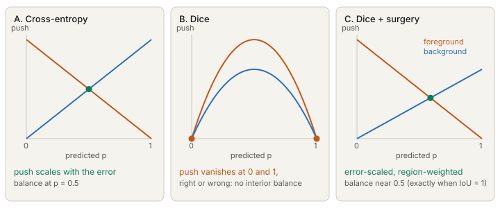
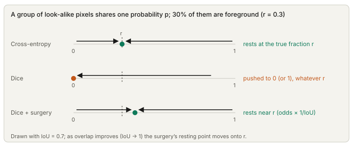
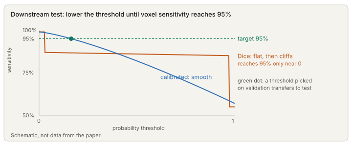

## Links

- **[PMLR 315:3397–3423](https://proceedings.mlr.press/v315/lux26a.html)**: the paper (MIDL 2026, full paper), read in its camera-ready form.
- **Implementation**: a custom backward pass for the softmax, listed in the paper's Appendix D (about 20 lines of PyTorch).
- **Related in this repo**: [SACP](../2025-bereska-sacp/index.html) (conformal margins for segmentation, used in the downstream experiments below); [PHiSeg](../2019-baumgartner-phiseg/index.html) and the [Probabilistic U-Net](../2018-kohl-probabilistic-unet/index.html), both evaluated on multi-rater data; the [MIDL 2026 overview](../midl2026-overview/index.html), where this is the first theory pick.

These notes came out of a question-and-answer session; the questions are kept as section headings.

## In one paragraph

Dice-trained segmenters are overconfident: probabilities sit at 0 or 1 even where the model cannot
tell foreground from background. The authors trace this to the **gradient on each pixel's logit**.
Dice's gradient carries the sigmoid slope $p(1-p)$, so it pushes hardest at $p=0.5$, ignores
*confident* pixels whether right or wrong, and has no balance point between 0 and 1. The fix keeps
Dice's region weights but replaces the sigmoid slope with the **error** $\lvert y-p\rvert$, as
cross-entropy effectively does. The resulting update rule is not the gradient of any loss, so it is
used directly as a vector field. Calibration improves a lot (NLL and ECE often 2–6× lower) with Dice
roughly unchanged.

## Q1. What is the core argument, on one whiteboard?

**Setup.** Binary segmentation, logits $z_i$, probabilities $p_i=\sigma(z_i)$, and
$P=\sum p_i$, $Y=\sum y_i$, $I=\sum p_iy_i$.

**Step 1: Dice's gradient on one pixel.** By the chain rule,

$$
\frac{\partial L_{Dice}}{\partial z_i}=\underbrace{G(i)}_{\text{global, per class}}\cdot\underbrace{p_i(1-p_i)}_{\text{sigmoid slope}},
\qquad G_{fg}=\frac{2(P+Y)-2I}{(P+Y)^2},\quad G_{bg}=\frac{2I}{(P+Y)^2}.
$$

On a large image one pixel barely changes $P$, $Y$ or $I$, so within each class $G$ is close to a
constant.

**Step 2: what this does to individual pixels.** The factor $p(1-p)$ is largest at $p=0.5$ and
vanishes at 0 and 1. A confident wrong pixel ($y=1$, $p\approx0$) gets almost no gradient, so Dice
stops correcting it; uncertain pixels dominate training, and the push on them is towards 0 or 1.

<figure>

<figcaption><b>The push on one pixel's logit, as a function of its predicted probability.</b>
<b>A:</b> cross-entropy pushes in proportion to the error, so a confident mistake gets the biggest
push, and the foreground and background curves balance at 0.5. <b>B:</b> Dice's push is a hump that
vanishes at both ends, so confident pixels are ignored whether right or wrong, and the two curves meet
only at 0 and 1. <b>C:</b> the surgery keeps Dice's region weights (the different slopes) but makes the
push proportional to the error again, so a balance point returns.</figcaption>
</figure>

**Step 3: the balance argument, the core of the paper.** Suppose the network cannot tell some pixels
apart: they share one representation, so they must share one probability $p$, and a fraction $r$ of
them are foreground. Add up the pushes on their shared logit:

| Loss | Total push on the group's logit | Where it is zero |
|---|---|---|
| Cross-entropy | $\sum(p-y)=n(p-r)$ | $p=r$: **calibrated** |
| Dice | $n\,p(1-p)\big[(1-r)G_{bg}-rG_{fg}\big]$ | only at $p=0$ or $p=1$ |

For Dice, $p$ enters only through $p(1-p)$, which is common to every pixel in the group, so it
factors out. The sign of the push is set by the bracket alone, which does not depend on $p$. Unless
the bracket happens to be exactly zero, the group is driven all the way to 0 or 1 whatever its true
foreground fraction. That is the overconfidence. (The paper states this as "the curves intersect only
at 0 and 1"; factoring out $p(1-p)$ is the shortest way to see it.)

**Step 4: the surgery.** Keep the region weights, which are what make Dice robust to class imbalance,
and replace the sigmoid slope with the error:

$$
F_i(z)=\lvert y_i-p_i\rvert\cdot G(i):\qquad (1-p_i)\,G_{fg}\ \text{for foreground},\qquad p_i\,G_{bg}\ \text{for background}.
$$

Read it either as cross-entropy's gradient with region-imbalance weights, or as Dice's gradient with
the sigmoid slope replaced by the error. A confident wrong pixel now gets the *largest* push.

**Step 5: where the surgery's balance point lands** (a derivation made in these notes, not in the
paper). Repeating Step 3, the group's total push is $n\big[p(1-r)G_{bg}-(1-p)rG_{fg}\big]$, zero at

$$
p^*=\frac{rG_{fg}}{rG_{fg}+(1-r)G_{bg}},\qquad
\frac{G_{fg}}{G_{bg}}=\frac{P+Y-I}{I}=\frac{\text{union}}{\text{intersection}}=\frac{1}{\text{IoU}},
$$

so $\text{odds}(p^*)=\text{odds}(r)/\text{IoU}$. Once overlap is good (IoU → 1) the balance point is
$p^*=r$, as calibrated as cross-entropy. While overlap is poor, foreground odds are inflated by
1/IoU, which is the built-in push towards foreground for small, rare structures. The surgery is
therefore exactly calibrated only near perfect overlap.

<figure>

<figcaption><b>Where a group of look-alike pixels ends up.</b> Thirty percent of the group is
foreground. Cross-entropy rests at that fraction. Dice drives the shared probability to an extreme,
here 0, whatever the fraction. The surgery rests near the fraction, slightly above it because
foreground odds are scaled by 1/IoU (drawn with IoU = 0.7); as overlap improves, it moves onto
the fraction.</figcaption>
</figure>

**Step 6: why no loss function produces this.** A vector field is the gradient of some function only
if its mixed second derivatives agree, $\partial F_i/\partial z_k=\partial F_k/\partial z_i$. Write
$F_i=a_i(p_i)\,g_i$, where $g$ is Dice's gradient with respect to the probabilities (whose second
derivatives are symmetric). The condition then holds only if $a_i/[p_i(1-p_i)]$ is the same for every
pixel, which is exactly Dice's own chain-rule factor; any other per-pixel weight breaks it. The
paper's Appendix A shows the special case of two background pixels, where symmetry would need
$p_i=p_k$.

**Practical details.**

- *Implementation:* only the backward pass of the softmax changes; $p(1-p)$ is replaced by
  $\lvert y-p\rvert$. It therefore bolts onto any Dice-based loss (Dice, Tversky, Dice + CE).
- *A smooth cut-off:* a factor $(1-(1-p)^n)(1-p^n)$ sends the push to zero right at $p\in\{0,1\}$. Near
  a correct, confident prediction this acts like label smoothing; near a confident error it ignores
  extreme mistakes, which may help with label noise. Results are flat for $n\ge20$.
- *No loss value exists*, so training is monitored by Dice. Non-conservative fields can circle a
  solution instead of reaching it, as in GAN training; the authors argue the asymmetric part is small
  here but give no bound.

## Q2. How do they measure the calibration improvement?

Every metric compares each pixel's probability with **one reference mask**.

| Metric | What it checks |
|---|---|
| NLL | average −log probability of the true label; punishes confident mistakes heavily |
| ECE | group pixels by predicted probability, compare each group's average prediction with its actual foreground fraction, and average the gaps (bin count not stated) |
| MCE | the worst group gap instead of the average |
| Brier score | mean squared error between probability and label |
| Dice | overlap after thresholding |

They report these over **all pixels** (main tables), where easy background dominates and every method
has ECE ≈ 0.0005–0.005, and over the **active region**, the union of true and predicted foreground
(Appendix H), where the hard decisions are. There the gains are clear: ECE falls from 0.40 to 0.24 on
INbreast, 0.19 to 0.13 on FIVES and 0.31 to 0.26 on KiTS for plain Dice versus Dice with surgery. The
paper says NACL is comparable on the active region; its tables show that only for FIVES (0.125 against
0.125–0.128), not INbreast (0.32 against 0.24).

Dice score, plain Dice versus Dice with surgery: INbreast 64.9 → 74.3, FIVES 88.0 → 87.6, BraTS 69.5 →
71.0, KiTS 76.6 → 74.0.

**The limitation.** With one reference mask, "calibrated" means matching how often *that annotator*
marked a pixel, which mixes the model's uncertainty with the annotator's noise at boundaries.

## Q3. Is there multi-rater data that would test this properly?

None of their datasets (INbreast, FIVES, BraTS-METS, KiTS19) has several annotations per image. These do:

| Dataset | Domain | Raters |
|---|---|---|
| LIDC-IDRI | lung nodules, CT | up to 4 radiologists; the standard benchmark, used by the Probabilistic U-Net and PHiSeg |
| QUBIQ (MICCAI 2020/21) | prostate MRI, brain growth, brain tumour, kidney, pancreas and others | multiple raters per task |
| RIGA | fundus optic disc and cup | 6 ophthalmologists |
| MSSEG 2016 | multiple sclerosis lesions, MRI | 7 raters |
| Gleason 2019 | prostate histopathology | 6 pathologists |
| KiTS21 | kidney and tumour, CT | several independent annotations per case (check how the release packages per-annotator masks) |

**Why this is the right test.** The core argument is about look-alike pixels with foreground fraction
$r$. Rater disagreement makes $r$ observable directly: the image is identical and only the labels
differ, so if 2 of 4 raters mark a pixel, $r=0.5$. Three direct tests follow:

1. **Calibration against the soft label:** train on one rater, or a randomly drawn rater per epoch, and
   check whether $p$ matches the fraction of raters (Brier or ECE against soft labels).
2. **The 1/IoU prediction:** on structures where overlap stays low, the surgery should over-predict
   foreground relative to rater agreement.
3. **The QUBIQ metric:** Dice averaged over thresholds 0.1–0.9 of the probability map against the same
   thresholds of the rater-agreement map.

## Q4. What downstream experiment would have shown the improvement directly?

The paper motivates calibration with resection margins, radiotherapy targets and "adapting outputs to
high-recall solutions", but reports only metrics. Each experiment below should include **plain Dice
with temperature scaling** as a baseline; if one fitted temperature gives the same benefit, the case
for the surgery is much weaker.

**1. Hitting a target sensitivity (the paper's own motivation).** Pick, on validation, the threshold
that reaches 95% voxel sensitivity; apply it to test and measure the sensitivity achieved and the
false positives it costs. An overconfident model has almost no pixels at intermediate probabilities,
so sensitivity barely moves with the threshold and then jumps, and a validation-chosen threshold
misses on test. A calibrated model's sensitivity should rise smoothly and land near the target.

<figure>

<figcaption><b>The most direct downstream test (schematic, not data from the paper).</b> Lower the
threshold until voxel sensitivity reaches 95%. The overconfident model's curve is flat with cliffs, so
it cannot be dialled to the target; the calibrated model's curve is smooth, and a threshold chosen on
validation data should carry over to test data.</figcaption>
</figure>

**2. Volume estimates with error bars (metastases).** Use $\sum_i p_i$ as the volume estimate and a
fitted interval as its uncertainty; check volume error and whether 90% intervals contain the true
volume about 90% of the time. An overconfident model gives near-zero error bars that rarely do.

**3. Finding small lesions.** Use the maximum probability in each predicted component as lesion
confidence and draw an FROC curve by lesion size. Dice gives missed small lesions $p\approx0$, so no
threshold recovers them; if the surgery keeps them at moderate probability, its curve is higher.

**4. Referring hard cases to a human.** Rank scans by uncertainty, refer the top k%, and plot the Dice
of the kept scans against the fraction kept (risk–coverage, AURC). Informative uncertainty removes most
failures with few referrals.

**5. Tighter conformal margins.** Apply the same conformal procedure (for example the
[SACP](../2025-bereska-sacp/index.html)-style one) to each model and compare margin size at the same
guaranteed coverage. Coverage is guaranteed for every model, so efficiency is the only thing that can
differ, and smaller margins mean less healthy tissue inside them.

**6. Predicting failures under a site shift.** Train on one site, test on another, and report
calibration and the AUROC of image-level uncertainty for detecting Dice < 0.5, against Dice with
temperature scaling fitted at the training site. This tests the paper's stated advantage over post-hoc
recalibration, which it argues breaks under shift but never tests.

**If only one:** Experiment 1. It is the use the introduction names, it is cheap (thresholds on
existing models), and it tests the claim that calibrated maps can be dialled towards high recall.
Pairing it with Experiment 6 would also cover the argument against temperature scaling.

## Questions and doubts

- **No temperature-scaling baseline**, although post-hoc recalibration is discussed in the related work.
- **Model selection:** best 5 of 25 runs for 2D by validation Dice; the single best of 10 runs for 3D, so
  no error bars in the 3D table.
- **Calibration over all pixels** is dominated by easy background; the active-region tables are the ones
  to read.
- **Exactly calibrated only as IoU → 1** (Step 5): hard, low-overlap structures should still be
  over-predicted. Per-structure reliability diagrams would show it.
- **Stability:** the non-conservative field comes with no convergence argument beyond "the asymmetric
  part is small".

## Takeaways

- Calibration is decided by the gradient, not the loss value: the per-pixel factor multiplying the
  region weights sets where look-alike pixels come to rest.
- Dice's factor $p(1-p)$ factors out of the group balance, leaving no resting point between 0 and 1;
  cross-entropy's error factor rests at the true fraction.
- The surgery keeps Dice's region weights and swaps in the error factor; its resting point is the true
  fraction with odds scaled by 1/IoU, so it is calibrated once overlap is good.
- The cost is an update rule with no loss behind it. The missing evidence is a downstream test, and
  a multi-rater dataset is where the paper's central argument can be tested directly.
