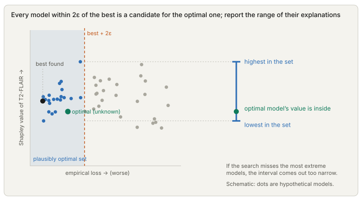

## Links

- **[PMLR 315:1407–1421](https://proceedings.mlr.press/v315/ren26a.html)**: the paper (MIDL 2026, full paper), read in its camera-ready form.
- **Marx et al. 2023**, [*But Are You Sure? An Uncertainty-Aware Perspective on Explainable AI*](https://proceedings.mlr.press/v206/marx23a.html), AISTATS 2023 (PMLR 206:7375–7391): the framework this paper applies.
- **Model class reliance**: Fisher, Rudin & Dominici, *All Models are Wrong, but Many are Useful*, JMLR 2019: variable importance reported as a range over near-optimal models.
- **Related in this repo**: [SACP](../2025-bereska-sacp/index.html), a genuinely conformal method for segmentation, for contrast; [Lux et al. 2026](../2026-lux-gradient-surgery/index.html), another MIDL 2026 uncertainty paper; the [MIDL 2026 overview](../midl2026-overview/index.html), where this is one of the theory picks.

These notes came out of a question-and-answer session; the questions are kept as section headings.

## In one paragraph

The authors explain a glioma segmentation U-Net by asking how much each MRI contrast (T1c, T1n,
T2-FLAIR, T2w) contributes, scored by Shapley values computed on Dice. But many models fit the data
about equally well and still use the contrasts differently (model multiplicity, the "Rashomon set"),
so one model's explanation may not be "the" explanation. Instead of explaining one model, they target
the best model for the whole patient population and build an interval meant to contain *its* Shapley
value with 95% probability, following Marx et al. (2023). They then compare the intervals with how
clinicians rank the contrasts. The argument behind the interval is a clean three-line proof; the
guarantee does not survive how it is applied, because $\epsilon$ is chosen by hand and the search for
the interval's ends is coarse.

## Q1. What does the paper do?

**Contrast-level Shapley values.** For each contrast $i$ and tumour subregion $r$, the Shapley value
averages the gain in Dice from adding contrast $i$ to every subset $S$ of the other contrasts:

$$
\phi_i^{(r)}(\omega)=\sum_{S\subseteq N\setminus\{i\}}\frac{|S|!\,(|N|-|S|-1)!}{|N|!}\Big(D^{(r)}_\omega(S\cup\{i\})-D^{(r)}_\omega(S)\Big),
$$

with $|N|=4$ contrasts. The interval method uses the average over the three subregions.

**Model multiplicity.** Two models with about 90% Dice can rely on T2-FLAIR very differently (0.32
versus 0.52 in the paper's Figure 4b), so a single model's Shapley values may not describe the best
possible model.

**The method (Algorithm 1).** Train the empirical-risk minimiser $\hat\omega$ (5-fold
cross-validation, Dice + focal loss, mean Dice 87.1%). Then, for each contrast, train models on a
mixed objective that pushes its Shapley value down, $\lambda\phi+(1-\lambda)L_{emp}$, or up,
$-\lambda\phi+(1-\lambda)L_{emp}$, with $\lambda\in\{0,0.2,\dots,1\}$. Keep the most extreme Shapley
value whose loss is within $2\epsilon$ of the best. That is 6 λ values × 2 directions × 4 contrasts =
48 trainings, about 576 GPU-hours. They set $\epsilon=0.05$ **by hand**, read as "within 10 Dice
points of the best model" (87% → 77%).

A naming note: the section is titled "Conformal Analysis", but the method is not conformal prediction.
It uses no calibration set and no exchangeability argument; it is a uniform-convergence argument.

## Q2. How does the three-line proof work?

**The cast.**

- $L(\omega)$: a model's **true** loss, its average over all possible patients. Never computable.
- $L_{emp}(\omega)$: its **empirical** loss on the dataset. Computable.
- $\hat\omega$: the model that does best **on the dataset**, found by training.
- $\omega^*$: the model that would do best **on the population**. Unknown.

**The one assumption, uniform convergence.** With probability at least $1-\alpha$ over which dataset
was drawn,

$$
\lvert L(\omega)-L_{emp}(\omega)\rvert\le\epsilon\quad\text{for every model }\omega\text{ in the class at once.}
$$

The dataset mis-measures every model's loss by at most $\epsilon$, simultaneously.

**The proof.** When that event holds,

$$
L_{emp}(\omega^*)\;\overset{(1)}{\le}\;L(\omega^*)+\epsilon\;\overset{(2)}{\le}\;L(\hat\omega)+\epsilon\;\overset{(3)}{\le}\;L_{emp}(\hat\omega)+2\epsilon .
$$

1. The dataset may make $\omega^*$ look worse than it is, but by at most $\epsilon$.
2. $\omega^*$ is best on the population, so its true loss is no larger than $\hat\omega$'s. This is the
   only step that uses what $\omega^*$ is.
3. The dataset may make $\hat\omega$ look better than it is, but by at most $\epsilon$.

**Conclusion.** On the dataset, the optimal model scores at most $2\epsilon$ worse than the best model
found, so it lies in the checkable set

$$
\Omega_\alpha=\{\omega:\ L_{emp}(\omega)\le L_{emp}(\hat\omega)+2\epsilon\},
$$

and its Shapley value lies between the smallest and largest Shapley value of any model in that set:

$$
\phi(\omega^*)\in\Big[\min_{\omega\in\Omega_\alpha}\phi(\omega),\ \max_{\omega\in\Omega_\alpha}\phi(\omega)\Big]\quad\text{with probability}\ge1-\alpha .
$$

<figure>

<figcaption><b>From a loss tolerance to an explanation interval (schematic).</b> Each dot is a model,
placed by its empirical loss and the Shapley value it gives one contrast. Every model within
$2\epsilon$ of the best found (the shaded set) could be the population-optimal one, so the optimal
model's Shapley value lies between the lowest and highest value in the set. If the search misses the
most extreme models in the set, the reported interval comes out too narrow and can miss the optimal
model's value.</figcaption>
</figure>

**A worked example.** Take $\epsilon=0.05$ and suppose training finds $\hat\omega$ with empirical loss
0.13. Then $L(\omega^*)\le L(\hat\omega)\le0.13+0.05=0.18$, and
$L_{emp}(\omega^*)\le L(\omega^*)+0.05\le0.23$. Any model with empirical loss at most **0.23** might
be the optimal one: collect them all and report the lowest and highest Shapley value.

**Why $2\epsilon$ and not $\epsilon$.** Two *different* models are each mis-measured, in the worst case
in opposite directions: $\hat\omega$ can look $\epsilon$ better than it is and $\omega^*$ can look
$\epsilon$ worse. The two errors add.

**Why "uniform" matters.** Step 1 concerns $\omega^*$, which is fixed before the data are seen, so a
concentration bound for one model (Hoeffding, say) would do. Step 3 concerns $\hat\omega$, which was
**chosen because it looked good on this data**. A bound for one fixed model does not apply to a model
selected by the data, since selection favours models whose loss happened to be underestimated. Hence
a bound that holds for every model at once, the same reason generalisation bounds are needed at all.

**What $1-\alpha$ means.** It is a probability over the draw of the dataset: across many possible
datasets, at least $1-\alpha$ of them make the interval contain $\phi(\omega^*)$. It is not a
probability about any one model.

**What the proof does not give.**

- It needs a **real** $\epsilon$. For simple model classes (linear models, small hypothesis classes)
  $\epsilon$ can be computed; for 3D U-Nets no usable bound exists, so a hand-set $\epsilon$ makes the
  "guarantee" a chosen tolerance.
- It needs the **true** minimum and maximum over the whole set. A search that misses the extremes gives
  an interval that is too narrow.
- The set can be **large**. The proof says $\omega^*$ is in $\Omega_\alpha$, not which model it is; with
  a loose $\epsilon$ the interval can be too wide to say much.

## Q3. What is Marx et al. 2023?

Marx, Park, Hasson, Wang, Ermon and Huan, *But Are You Sure? An Uncertainty-Aware Perspective on
Explainable AI* (AISTATS 2023, PMLR 206:7375–7391). An earlier version appeared at a NeurIPS 2022
workshop as *Quantifying Uncertainty in Model Explanations*. Its starting point is the problem Ren et
al. borrow: two nearly optimal models can give very different explanations, so explaining the one
model you trained can mislead. Marx et al. propose explaining the optimal model instead, and build sets
of explanations that contain its explanation with high probability, in two ways: **frequentist**,
through uniform convergence (the version Ren et al. use), and **Bayesian**, through a posterior over
models. They test both on synthetic and real data. Ren et al.'s contribution is applying the
frequentist version to contrast-level Shapley values in 3D segmentation.

## Q4. What are the baselines and experiments?

**Baselines.** Essentially one baseline plus two clinical reference rankings.

| What | Role | What it actually is |
|---|---|---|
| "Naive Deep Ensemble" intervals | the only competing uncertainty method | the 5 cross-validation fold models, with Shapley values for every patient, fold and subregion pooled (1,351 × 3 × 5 = 20,265 values per contrast), summarised by a mean and a t-based 95% interval |
| Consensus ranking | clinical reference | three medical students rank the 4 contrasts on 202 cases, oversampling hard ones (122 with Dice below 0.5) |
| Protocol ranking | clinical reference | fixed BraTS guidance: T1c = 1, T2-FLAIR = 2, T1n/T2w = 3 |

Not compared, though natural: Marx et al.'s Bayesian variant, bootstrap intervals, sampling the
Rashomon set (many seeds or retrainings filtered by the loss tolerance), and model class reliance.

**Experiments.**

1. **Base model** (Table 1): 3D U-Net (MONAI) on BraTS 2024 GoAT, 1,351 patients, 5-fold
   cross-validation; mean Dice 87.1% (necrotic core 83.7%, enhancing tumour 86.6%, oedema 91.2%).
2. **Naive intervals versus clinical rankings** (Figure 3): t-tests of pooled mean ranks find p < 0.001
   for every contrast against both rankings. With 20,265 pooled, dependent values the confidence
   intervals are tiny, so almost any difference is "significant".
3. **Frequentist intervals** (Algorithm 1, Figure 4a): 48 trainings. The intervals are shown only as a
   plot; no values appear in a table or the text.
4. **Model multiplicity** (Figure 4b, 4c): two models at about 90–91% Dice give T2-FLAIR 0.32 versus
   0.52 and T1c 0.42 versus 0.28. This motivates the problem rather than testing the method.
5. **Agreement with clinical rankings** (Table 2), Kendall's τ:

   | | vs consensus | vs protocol |
   |---|---|---|
   | Naive | all non-significant | all non-significant |
   | Frequentist | upper 0.467 (p = 0.015), mean 0.371 (p = 0.042), lower n.s. | all non-significant |

6. **Sensitivity to $\epsilon$** (Appendix A, Table S1): at $\epsilon=0.1$ **every** correlation is
   non-significant, frequentist included.

**What is missing.**

1. **A coverage check**: no setting where $\omega^*$ is known (a synthetic task or a small model class)
   tests whether the intervals contain it. Marx et al. did use synthetic data.
2. **The interval values**, widths and overlaps, which appear only in a figure.
3. **Other interval methods** (Bayesian, bootstrap, Rashomon sampling).
4. **Sensitivity of the min/max search**: a finer λ grid or several seeds per λ would show how much the
   6-point sweep underestimates the interval.
5. **Per-subregion intervals**: the frequentist intervals average over the three subregions, although
   the clinical protocol is subregion-specific (T1c for enhancing tumour, T2-FLAIR for oedema).
6. **The model-selection use case** that Figure 1 and the discussion advertise: no experiment selects a
   model this way and checks whether it does better.
7. **A multiple-comparison correction** for the 12 τ tests: with Bonferroni (0.05/12 ≈ 0.004), neither
   significant result survives.

**The unit of analysis for τ is unclear.** With only 4 contrasts, Kendall's τ can take only the values
−1, −⅔, −⅓, 0, ⅓, ⅔ and 1. Values such as 0.467 mean the ranking is computed over something larger,
probably per subject or per subregion, and the paper does not say which.

## Q5. What is the final takeaway? Is this an ensemble for better explanations?

**No.** They do not combine models into a better explanation; they report a **range**, the lowest and
highest Shapley value any near-optimal model gives each contrast.

| | An ensemble explanation | What Ren et al. do |
|---|---|---|
| Output | one explanation, averaged over several models | an interval per contrast: [lowest, highest] Shapley value across near-optimal models |
| How the models are found | ordinary training with different seeds, folds or data | adversarial training: each model pushes one contrast's Shapley value as low, or as high, as possible while staying within $2\epsilon$ of the best loss |
| What it answers | "what does a typical good model use?" | "how much could a good model's reliance on this contrast vary, and so where could the best possible model's reliance lie?" |

The cross-validation "Deep Ensemble" is the **baseline** they argue against, not their method. The
models trained for the interval are deliberately extreme, so averaging them would be meaningless. And
the Shapley value of an ensemble's *prediction* is not the average of its members' Shapley values,
because Dice is nonlinear in the prediction.

**What it delivers.** A working recipe for ranges of contrast-level Shapley values in 3D segmentation,
and a clear example of model multiplicity.

**What it does not deliver.** A real guarantee ($\epsilon$ is set by hand, and a 6-point search can make
the interval too narrow); strong evidence of clinical alignment (2 of 12 correlations significant, both
gone at $\epsilon=0.1$, none surviving a multiple-test correction); or a test of the model-selection use
it advertises.

**In one line:** treat a model's explanation as a range across the Rashomon set, not a single number,
but a "guaranteed" range needs a real $\epsilon$, which deep networks do not provide.

**Two directions that follow** (not in the paper).

1. **Model selection within the Rashomon set.** Among models within the loss tolerance, prefer those
   whose contrast reliance matches clinical priors (T2-FLAIR for oedema, say), then test whether that
   choice improves robustness on hard cases or under a site shift: the experiment Figure 1 implies.
2. **Explanations with stated uncertainty.** Report each contrast's importance as the range over seeds
   or bootstrap models, and flag contrasts whose ranges overlap as not distinguishable. Cheap, with no
   576 GPU-hours, and honest about what it claims.

## Questions and doubts

- What would a computable $\epsilon$ look like here? A held-out set with a concentration bound for one
  fixed model gives real guarantees, but only for less ambitious statements than "the optimal model".
- How much narrower is the 6-point search than the true interval? A denser λ grid with several seeds
  per λ would show it.
- Is $\phi$ differentiable enough to optimise directly? The mixed objective needs gradients of a Dice
  difference over contrast subsets; the paper does not describe how contrasts are removed during training.
- Are medical students' rankings, with hard cases oversampled, a meaningful reference? The paper itself
  suggests neuroradiologists.

## Takeaways

- Model multiplicity makes "the" explanation ill-posed; a range over near-optimal models is the honest
  report.
- The three-line proof shows exactly what such a range needs: a uniform-convergence bound $\epsilon$,
  required because the best model found was selected by the data.
- Here $\epsilon$ is set by hand and the range is found by a coarse search, so the interval is a
  tolerance-based Rashomon range, not a guarantee.
- The clinical-alignment evidence is weak, and the advertised model-selection use is untested.
