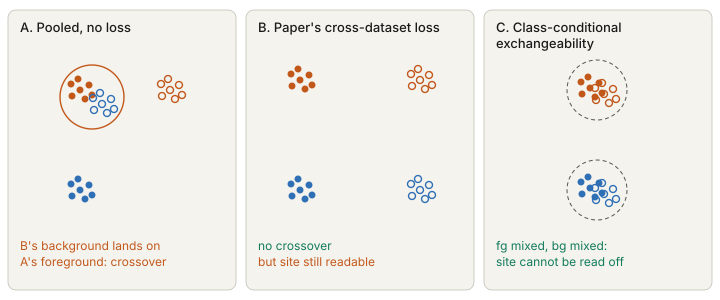

## Links

- **[PMLR 315](https://proceedings.mlr.press/v315/roy26a.html)**: the paper (MIDL 2026).
- **[arXiv:2507.19575](https://arxiv.org/abs/2507.19575)**: the version read for these notes (v1, July 2025, WACV format). The MIDL camera-ready may differ; a search summary mentions an appendix justifying exchangeability through de Finetti's theorem and a causal graph, which v1 does not show.
- **Related in this repo**: [Wu et al. 2022, *Towards IID representation learning*](../2022-wu-iid-representation/index.html), which also treats "the samples share one distribution" as something to *learn* rather than assume; [SACP](../2025-bereska-sacp/index.html), whose conformal guarantee rests on exchangeability; the [MIDL 2026 overview](../midl2026-overview/index.html), where this paper is listed as an outlier.

These notes came out of a question-and-answer session; the questions are kept as section headings.

## In one paragraph

Pooling segmentation data from several sites can make a model *worse* on the original site, the
"data addition dilemma". The paper adds a loss at every U-Net layer that pushes the summed features
of foreground pixels away from those of background pixels, and a cross-dataset version that pushes
one dataset's foreground away from the other dataset's background. The title's probability idea,
exchangeability, is offered as a weaker and more realistic assumption than i.i.d. for pooled data.
In the method it does one job: it licenses pairing foreground and background across datasets. Read
as an *assumption about the data* it undermines itself; read as a *goal for the features*, "within
each class, the site should not matter", it makes sense, and the loss enforces only half of it.

## The method

**Within-dataset loss, at every layer.** With the ground-truth mask max-pooled to each layer's
resolution, sum the layer's features over foreground pixels ($F_g$) and over background pixels
($B_g$), and penalise

$$
\mathcal L_{fd} = -\log \lVert F_g - B_g\rVert^2 .
$$

Each layer has a learnable weight $\alpha$, warm-started at 0 so that early training uses only Dice
plus binary cross-entropy. In spirit this is deep supervision with a contrastive-style separation term.

**Cross-dataset loss, "under assumed exchangeability".**

$$
\mathcal L^{exch}_{fd} = -\log\Big(\lVert F_g(\mathcal D_{base})-B_g(\mathcal D_{novel})\rVert^2+\lVert F_g(\mathcal D_{novel})-B_g(\mathcal D_{base})\rVert^2\Big).
$$

**Experiments.** Histopathology (TNBC, MoNuSeg, an Alzheimer's tau dataset) and breast ultrasound
(UDIAT and a new 15-image US-TNBC set). Gains of +0.5 to +5 Dice. In the data-addition experiment
(MoNuSeg added to TNBC, UDIAT added to US-TNBC) plain training, a pixel-contrastive loss and deep
supervision lose accuracy as data is added, while the cross-dataset loss gains.

## Q1. What is exchangeability, concretely?

A sequence is **exchangeable** if the order carries no information: shuffling it gives the same
joint distribution,

$$
(X_1,\dots,X_n)\ \overset{d}{=}\ (X_{\pi(1)},\dots,X_{\pi(n)})\quad\text{for every permutation }\pi .
$$

It does **not** require independence. Every i.i.d. sequence is exchangeable; the reverse fails.

**Drawing without replacement.** An urn of red and blue balls, drawn without putting them back.
Any order of the same colours is equally likely, so the draws are exchangeable, but a red draw makes
the next red *less* likely, so they are dependent. Exchangeable, not i.i.d.

**A coin of unknown bias.** You are handed one of two coins, one mostly heads and one mostly tails,
without being told which. The flips are exchangeable (same coin throughout) and positively dependent
(a run of heads suggests the heads-heavy coin). Given the coin, they are i.i.d. **De Finetti's
theorem** says every infinite exchangeable sequence is of this form: a hidden parameter $\theta$ is
drawn once, then the samples are i.i.d. given $\theta$. The Bayesian prior is the uncertainty about
which coin you hold.

**Pólya's urn.** Each drawn ball goes back with an extra ball of its colour, so early draws shape
later ones. The sequence is still exchangeable: a sequence's probability depends only on how many
of each colour it contains. Strong dependence and exchangeability can coexist.

**One hospital's scans.** The hospital (scanner, protocol, population) plays the coin. Its scans are
correlated but interchangeable, so they are exchangeable. This is the paper's US-TNBC argument, that
batches depend on earlier batches, and on this point the paper is right.

**Not exchangeable.** Time series with trend or memory; longitudinal scans of one patient; data
collected across a scanner upgrade; actively selected or cherry-picked samples; training and test
sets from different sites. A quick test: if someone secretly shuffled the order, would anything you
believe change?

**Useful facts.** Exchangeable variables share one marginal distribution, and every pair has the same
correlation. In an infinite exchangeable sequence that correlation is non-negative; a finite one can
be negatively correlated (the urn without replacement), and then de Finetti does not apply.

**Where it matters in ML.** Conformal prediction needs only exchangeability of calibration and test
points, which is why its guarantee breaks under site shift. Permutation tests need exchangeability
under the null. Shuffled cross-validation assumes order does not matter, which is why grouped,
leave-one-site-out splits exist. Hierarchical Bayesian models are de Finetti's theorem put to work.

## Q2. Is pooled multi-site data exchangeable?

**Not fully.** Exchangeable samples share one marginal distribution, so assuming the whole pooled
set is exchangeable assumes that which site a sample came from carries no information, the opposite
of a distribution shift. The assumption that fits is **partial exchangeability**: exchangeable
*within* each site, with a parameter per site ($\theta_A$, $\theta_B$), tied together in a
hierarchical model. Full exchangeability holds only if each image's site is chosen at random and
never recorded, in which case every image is a draw from the mixture.

## Q3. How do they link exchangeability to the two losses?

Through two separate justifications, neither of which feeds a derivation.

- **Layer-wise $\mathcal L_{fd}$** is justified causally. Confounders $U$ (scanner, protocol) affect
  both image $X$ and mask $Y$; the features $Z$ are called a mediator in $X\to Z\to Y$, and a good
  mediator should track $Y$, hence foreground/background separation. Proposition 1,
  $P(Y\mid X)=\int P(Y\mid Z)P(Z\mid X)$, is the Markov-chain property, not front-door adjustment,
  which concerns $P(Y\mid do(X))$ and is not used.
- **Cross-dataset $\mathcal L^{exch}_{fd}$** is justified by exchangeability. If the datasets are
  exchangeable, "base" and "novel" are arbitrary labels, so a foreground feature from one dataset and
  a background feature from the other form as legitimate a pair as two from the same dataset.

**The tension.** If base and novel really were exchangeable, their features would have the same
distribution and the cross term would add nothing beyond the within-dataset term. The cross term
changes training only when the datasets *differ*, that is, when exchangeability fails.

## Q4. So what are they really doing? Enforcing exchangeability

The reading that makes sense: **exchangeability is a goal for the features, not an assumption about
the data.** The data is only partially exchangeable; the loss tries to make the representation
behave as if it were fully exchangeable. The useful target is exchangeability *within each class,
across datasets*:

$$
P(Z\mid Y=\text{fg},\ D=\text{base})=P(Z\mid Y=\text{fg},\ D=\text{novel}),\quad\text{and likewise for bg},
$$

that is, $Z\perp D\mid Y$: shuffling dataset labels among foreground features changes nothing, and
the same for background. Domain adaptation calls this **class-conditional invariance**; fairness calls
the same condition **separation** (equalised odds). Conditioning on the class matters: forcing the
*marginal* feature distributions to match can hurt when foreground proportions differ between sites
(Zhao et al., ICML 2019, *On Learning Invariant Representations for Domain Adaptation*).

<figure>

<figcaption><b>Separation is not exchangeability.</b> Orange = foreground, blue = background;
filled = site A, hollow = site B. <b>A:</b> pooling without the loss lets one site's background fall
on the other's foreground. <b>B:</b> the paper's cross-dataset loss removes that crossover, but the
site can still be read off the features. <b>C:</b> class-conditional exchangeability: within each
class the two sites are mixed, so the site cannot be read off.</figcaption>
</figure>

**Does the loss enforce it?** Only partly.

| Requirement | The paper's cross-dataset loss |
|---|---|
| fg(base) ≈ fg(novel), pulled together | no term |
| bg(base) ≈ bg(novel), pulled together | no term |
| fg(base) far from bg(novel), and the reverse | yes, this is all it does |

It also works on summed activations, so at best it matches first moments, and a single $-\log$ of a
sum lets one large distance hide a small one.

**A loss that would enforce it.** Keep the separation terms and add within-class alignment: pull terms
on $\lVert F_g(\text{base})-F_g(\text{novel})\rVert$ and $\lVert B_g(\text{base})-B_g(\text{novel})\rVert$;
per-class MMD or Wasserstein matching (see [integral probability metrics](../integral-probability-metrics/index.html));
or a dataset discriminator per class that the encoder learns to fool, so that chance accuracy means
exchangeable.

**How to check it.** Train a small classifier to predict the dataset from foreground features, and
separately from background features; chance accuracy means exchangeable. Or run a permutation test
that shuffles dataset labels within each class. The paper reports neither: it shows that Dice held up
as data was added, not that the features became exchangeable.

**The price.** Invariance shrinks the divergence term of the Ben-David bound but can raise $\lambda$,
the error of the best joint classifier, if it removes information the task needs. A stain or texture
difference that helps locate boundaries is an example. That is why the loss weights should be
warm-started and tuned.

## Q5. How would the idea carry over to classification?

The target becomes $Z\perp D\mid Y$ for $C$ image-level classes. The pieces map as follows.

| Segmentation (this paper) | Classification |
|---|---|
| fg / bg pixel features | per-image features, grouped by class |
| $F_g$, $B_g$ | class prototypes $\mu_{c,d}$: the mean feature of class $c$ at site $d$ |
| fg far from bg within a dataset | class means far apart within each site |
| fg(A) far from bg(B) | $\mu_{c,A}$ far from $\mu_{c',B}$ for $c\neq c'$ |
| (missing) | **alignment:** $\mu_{c,A}\approx\mu_{c,B}$ |

**Losses.** Cross-entropy plus, on running-average class-by-site prototypes at a few layers, an
alignment term $\sum_c\sum_{d\neq d'}\lVert\mu_{c,d}-\mu_{c,d'}\rVert^2$ and a per-pair hinge
separation term $\sum_{c\neq c'}\sum_{d,d'}\max(0,m-\lVert\mu_{c,d}-\mu_{c',d'}\rVert)$. A one-term
alternative is **supervised contrastive learning with cross-site positives**: same class from
different sites as positives, which is the literal form of "shuffle the site label within a class".
Distribution-level versions: per-class MMD or CORAL, or a class-conditional site discriminator (CDAN).

**What is harder than in segmentation.**

1. *Few samples.* One label per image, not thousands of pixels, so per-class, per-site prototypes are
   noisy; use running averages and batches stratified by site and class.
2. *Different prevalence across sites.* A referral hospital sees more disease; condition on the class
   and weight sites equally.
3. *A class missing at a site.* Align only the pairs that exist.
4. *Site confounded with label.* If one hospital supplies most positives, the network can learn the
   scanner as a proxy for the diagnosis. Enforcing $Z\perp D\mid Y$ removes that shortcut, which is
   the strongest reason to use the idea.

**Checks.** A per-class site classifier at chance; a permutation test within classes; a data-addition
curve on both the base and the new site's test sets; and a weight-space check that the classifier head
is uncorrelated with a site head (Wong et al., *Weight Space Correlation Analysis*, MIDL 2026).

**For regression,** such as gestational age from blind-sweep ultrasound, condition on bins of the
target: $Z\perp\text{site/device}\mid\text{GA bin}$, so that alignment does not erase genuine
differences in the GA distribution between sites.

## The theory claimed, read critically

| Claim | What it actually says |
|---|---|
| Front-door adjustment with mediator $Z$ | Proposition 1 is the Markov-chain identity; no $do(\cdot)$ step is taken, and $Z$ is built using the label |
| Lemma 1: $-\log(\text{Dice}\cdot(k+1))\le\mathcal L_{fd}$ | a lower $\mathcal L_{fd}$ raises a floor under Dice, meaningful only if $k$ is fixed, which the paper does not pin down |
| Lemma 2: minimising $\mathcal L_{fd}$ bounds $\lVert W\rVert_2$ | looks backwards: with $F=Wx$, $-\log\lVert W(x_g-x_b)\rVert^2$ falls as $W$ grows, unless normalisation layers stop it |
| "Axiom 2": SGD on convex Lipschitz functions | a textbook theorem, called an axiom, assuming convexity that networks lack |
| Features "channel-averaged" | the formula sums over pixels (and, for $F_g$, channels), so the loss depends on object size |

## Questions and doubts

- The test sets are tiny (TNBC 50, MoNuSeg 44, US-TNBC 15 images in total), and the "worst-off"
  samples are chosen from the baseline's own scores, so part of their gain may be regression to the
  mean.
- The data-addition experiments pair two H&E nuclei sets and two breast-ultrasound sets, a mild shift,
  one pairing per modality.
- Would adding within-class alignment terms improve the data-addition curve, or does the separation
  term already do most of the work?
- Does the camera-ready's appendix (de Finetti, causal graph) change any of the above? Not checked.

## Takeaways

- **Exchangeability is weaker than i.i.d.**: it allows dependence but requires that order carry no
  information, and it implies identical marginals.
- **Pooled multi-site data is partially exchangeable,** not fully: exchangeable within sites, with
  parameters per site.
- **The paper's real idea is to make the representation exchangeable across sites, within each
  class.** Its loss enforces the weakest part of that, no crossover between classes, and leaves out
  within-class alignment and any test of whether exchangeability was reached.
- **The idea carries over to classification and regression** as $Z\perp D\mid Y$, enforced by
  alignment plus separation on class-by-site prototypes, and checked with a per-class site classifier.
