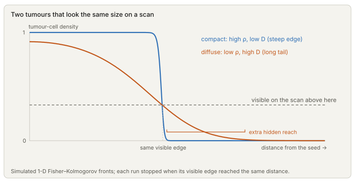

## Links

- **[Interactive version](figures/interactive.html)**: a live Fisher–Kolmogorov simulation on a
  made-up brain slice. Change diffusion and proliferation, move the seed, and watch the visible
  edge and the invisible tail grow.
- **[PMLR 315:781–800](https://proceedings.mlr.press/v315/weidner26a.html)**: the paper (MIDL 2026,
  full paper), read in its camera-ready form.
- **Code**: [jonasw247/brain-tumor-growth-inversion-via-differentiable-neural-surrogates](https://github.com/jonasw247/brain-tumor-growth-inversion-via-differentiable-neural-surrogates).
- **The 2024 short paper it extends**: [OpenReview 7SMswKSKIX](https://openreview.net/forum?id=7SMswKSKIX) (see Q4).
- **Related in this repo**: the [MIDL 2026 overview](../midl2026-overview/index.html), where this is
  listed as an outlier for its scientific-ML framing.

These notes came out of a question-and-answer session; the questions are kept as section headings.

## In one paragraph

Doctors would like to know where a glioblastoma's invisible tumour cells have spread beyond what
the MRI shows, for example to plan radiotherapy margins. A growth model (a PDE) can predict that,
but only once its parameters are fitted to each patient, and fitting means running a slow
simulator thousands of times inside a derivative-free search, which takes days. The authors train a
neural network to imitate the simulator, freeze it, and use its gradients to fit the parameters in
under a minute. A second network supplies a starting guess, which avoids bad local minima. Runtime
falls from about 2,300 minutes to 0.8, with accuracy close to the slow method in shape (though not
in squared error), and the approach carries over to real patients.

## Q1. What does the paper do?

**The growth model** (explained in Q2):

$$
\frac{\partial c}{\partial t}=\nabla\!\cdot\!\big(D(x)\nabla c\big)+\rho\,c(1-c).
$$

**The identifiability problem.** A patient has one scan and the start of growth is unknown, so a
tumour that grew fast for a short time looks the same as one that grew slowly for a long time:
$\rho$, $D$ and the total time $T$ cannot be separated. Measuring time as a fraction of $T$
($t = sT$) gives

$$
\frac{\partial c}{\partial s}=\nabla\!\cdot\!\big(DT\,\nabla c\big)+\rho T\,c(1-c),
$$

so only $DT$ and $\rho T$ affect the final scan. The paper fits $\mu_D=\sqrt{DT}$ and
$\mu_\rho=\sqrt{\rho T}$ (square roots make them length-like) plus the seed location $(x,y,z)$:
**5 parameters**. One snapshot can only reveal the dimensionless groups of the equation.

**The pipeline.**

1. **Forward surrogate.** A 3D ConvNeXt-U-Net maps the 5 parameters plus the tissue maps to the
   final tumour-density map. It is trained on 28,000 simulated tumours with an MSE loss for 35 hours
   and reaches MSE 1.8 × 10⁻³ against the solver. The forward direction is ordinary supervised
   learning because each parameter set gives exactly one tumour (the problem is well-posed).
2. **Inverse by gradients.** Freeze the surrogate and optimise only the 5 parameters, minimising
   $\lVert f_\phi(\theta)-c^\star\rVert^2$ with L-BFGS; backpropagation gives exact gradients of
   the surrogate with respect to $\theta$.
3. **Starting guess.** A separate network predicts $\theta$ directly from the tumour in one pass.
   Gradient search starts there, and whichever of the two answers has the lower loss is kept. This
   "hybrid" step makes the method reliable.
4. **Final check.** One run of the real numerical solver with the fitted parameters produces the
   reported tumour map.

**Recovering the parameters** (Table 1, synthetic). The surrogate-based searches recover $\mu_\rho$,
$\mu_D$ and the seed best, with median errors far below the slow classical search (growth-rate MSE
0.7 for gradient search against 12.2 classical, in units of 10⁻³ %). Means are much worse than
medians because a few runs get stuck in a wrong minimum.

**Fitting the tumour** (Table 2, after the final forward run).

| Method | MSE (×10⁻³) | NCC (×10⁻¹) | Runtime |
|---|---|---|---|
| Classical search (CMA-ES + solver) | **0.34** | 8.95 | 2,300 min |
| Gradient search on the surrogate | 5.91 | 8.19 | 0.7 min |
| Direct prediction only | 4.81 | 8.47 | 0.1 min |
| Hybrid (theirs) | 1.35 | **9.15** | 0.8 min |

The hybrid is about 4× worse in MSE than the slow classical search and better in normalised
cross-correlation (NCC), which compares the shape of the density map; the authors argue shape is
what matters for radiotherapy planning.

**A revealing tension.** The classical search fits the tumour best yet recovers the parameters
worst. Several parameter combinations explain the same tumour almost equally well, a flat valley in
the loss, so good fit does not imply correct parameters: the inverse problem stays partly
ill-posed even after the rescaling.

**Real patients** (Table 3, 75 BraTS cases, no fine-tuning).

- There is no ground truth; the reference is the slow classical fit itself, so the table measures
  agreement with the expensive method, not correctness.
- Gradient search often places the seed wrong, because real anatomy differs from the single atlas
  brain used in training. Starting the seed at the tumour's centre of mass fixes this: Dice with the
  segmentation rises from 34 to 59.
- GliODIL (an optimisation-based competitor) reaches similar accuracy in 50 minutes instead of 0.8;
  LMI (direct prediction with atlas registration) is worse.

**What is worth discussing.**

1. **Forward problems are well-posed; inverse problems often are not.** Learning the inverse
   directly has to average over many valid answers; learning the forward map and searching keeps them
   apart. That is why direct prediction alone is blurry but never fails badly, while gradient search
   is sharp but sometimes gets stuck.
2. **Amortised plus refined inference.** A network gives a fast first guess and per-case
   optimisation refines it, the pattern called semi-amortised inference in the VAE literature (Kim et
   al., 2018). The paper's "hybrid" is this pattern.
3. **Optimising through a surrogate inherits its errors.** The search finds the surrogate's best
   answer, not the solver's, so surrogate error sets a floor on accuracy; that is why the final run
   with the real solver is still about 4× worse in MSE than the classical fit.
4. **The missing baseline: exact gradients from the solver itself.** The textbook route for
   PDE-constrained fitting is the adjoint method, which gives exact gradients for about the cost of
   one extra simulation; alternatively the explicit finite-difference solver could be written in an
   autodiff framework. The paper compares only with a derivative-free search (CMA-ES), so it does not
   separate the benefit of having gradients from the benefit of a fast approximate model.
5. **Hidden costs.** The 0.8-minute runtime excludes generating 28,000 simulations and 35 hours of
   training, paid again if the anatomy or the PDE changes; the real-patient seed problem shows the
   single-atlas training does not fully transfer.
6. **The real task is harder than the test.** Synthetic tests fit the simulated density map
   directly; real patients only give a thresholded segmentation, which removes most of the density
   information.

## Q2. What is the biophysical model?

$$
\underbrace{\frac{\partial c}{\partial t}}_{\text{change in density}}
=\underbrace{\nabla\!\cdot\!\big(D(x)\,\nabla c\big)}_{\text{cells wander outward}}
+\underbrace{\rho\,c\,(1-c)}_{\text{cells multiply, up to a cap}}
$$

This is the Fisher–Kolmogorov (Fisher–KPP) equation, a reaction–diffusion model with two
behaviours: tumour cells move and they divide.

**Tumour-cell density, $c(x,t)$.** A number between 0 and 1 at every point: 0 is no tumour cells, 1
is tissue packed as full as it can get. It is a density, not a yes/no label, which is the point: it
describes cells at concentrations too low for MRI to see.

**Diffusion, $\nabla\!\cdot\!(D\nabla c)$: invasion.** Cells drift from crowded regions towards
emptier ones, like ink spreading in water. The rate depends on the tissue:

| Tissue | Diffusion | Why |
|---|---|---|
| White matter | $D_{WM}$ (fast) | gliomas migrate along nerve fibre tracts |
| Grey matter | $0.1\,D_{WM}$ (slow) | denser, less permissive tissue |
| Cerebrospinal fluid | 0 | cells are assumed not to cross the fluid spaces |

So a tumour stretches along white matter and stops at the ventricles and the brain surface; the
boundary condition is no flux, so cells cannot leave the brain.

**Proliferation, $\rho\,c(1-c)$: logistic growth.** At low density growth is roughly $\rho c$,
exponential; as $c$ approaches 1 the factor $(1-c)$ shuts it off, so the core saturates while the
edge keeps growing. Growth starts from a small seed at $(x,y,z)$ and runs for an unknown time $T$.

**Together the two terms make a travelling wave.** In one dimension with constant $D$, the solution
settles into a front of fixed shape moving outward at speed $v=2\sqrt{D\rho}$, with a tail ahead of
it whose length scale is $\ell\sim\sqrt{D/\rho}$: how far invisible cells reach beyond the edge.

<figure>

<figcaption><b>Same visible edge, different hidden spread.</b> Two simulated 1-D Fisher–Kolmogorov
fronts, each stopped when its density crosses the visibility threshold at the same distance, so both
tumours look the same size on a scan. The compact tumour (high $\rho$, low $D$) ends just past the
visible edge, at about 46 units; the diffuse one (low $\rho$, high $D$) still has cells out to about 73.
Estimating $D$ and $\rho$ per patient is what reveals this difference.</figcaption>
</figure>

- **High $D/\rho$ (diffuse):** a long invisible tail, so treatment margins need to be wide.
- **Low $D/\rho$ (compact):** a sharp edge with little hidden spread.

**Linking density to the scan.** MRI does not measure $c$. Models assume tissue shows as tumour
above a density threshold, usually a higher one for the contrast-enhancing core on T1c and a lower
one for the abnormal region on FLAIR. In the synthetic experiments the paper fits the density map
directly; for real patients it thresholds at 0.33 to compare with the segmentation.

**Why only two combinations can be estimated.** With $t=sT$, only $DT$ and $\rho T$ appear (Q1). The
ratio $D/\rho$, which sets the tail length, is identifiable because $T$ cancels in it, and it is the
clinically useful quantity.

**What the model leaves out.** Mass effect (tumours push and deform the brain; here the anatomy is
fixed); necrosis and the oxygen supply; direction of spread along fibres (extensions use
diffusion-tensor MRI); treatment; and variation between cells (one $\rho$ and one $D_{WM}$ for the
whole tumour). The simplifications are deliberate: one scan supports only a few parameters.

## Q3. Is there a visualisation?

The **[interactive page](figures/interactive.html)** runs the equation live on a made-up 2-D brain
slice, with sliders for white-matter diffusion $D$, proliferation $\rho$ and the visibility
threshold, and a profile of density along a line through the seed. Things to try:

1. **Play with the defaults.** The tumour stretches along white matter, slows at grey matter and stops
   at the fluid spaces: the tissue-dependent diffusion term.
2. **Compare the orange outline with the faint red.** The outline is roughly what a scan shows; the
   faint red beyond it is the invisible tail. "Area with any cells" is usually well above "Visible area".
3. **Make a diffuse tumour** (raise $D$, lower $\rho$): the tail $\sqrt{D/\rho}$ grows and hidden spread
   reaches far beyond the visible edge.
4. **Make a compact tumour** (lower $D$, raise $\rho$): the front is steep and the visible edge is close
   to where the cells stop.
5. **Match the visible size** of a diffuse and a compact tumour and compare their "any cells" areas.
6. **Move the threshold.** The tumour is unchanged; only what counts as visible moves.
7. **Click elsewhere** to move the seed, for example next to a ventricle or near the cortex.

The slice is 2-D with made-up anatomy, in grid units, and leaves out mass effect, necrosis and
treatment. The front-speed and tail-length readouts are exact for constant $D$ in one dimension and
approximate here.

## Q4. Where is the 2024 short paper?

On OpenReview, where MIDL publishes its short papers: **[*Rapid Personalization of PDE-Based Tumor
Growth using a Differentiable Forward Model*](https://openreview.net/forum?id=7SMswKSKIX)** (Weidner,
Ezhov, Balcerak, Menze and Wiestler; MIDL 2024 short papers, submission 117, CC BY 4.0;
[PDF](https://openreview.net/pdf?id=7SMswKSKIX)). It has the same core idea, a deep-learning forward
solver whose gradients with respect to the tumour parameters are used to fit each patient, evaluated
on nine glioma patients, cutting fitting time from hours to minutes with comparable results.

**What the 2026 paper adds** (its footnote): comparisons against other optimisers (CMA-ES with the
solver, CMA-ES with the surrogate, direct prediction); a detailed failure analysis (local minima,
coefficients near the edge of the training range, a stability appendix); a final high-precision
forward run with the real solver; and the explicit hybrid initialisation. The evaluation grows from 9
patients to a 500-case synthetic test set plus 75 BraTS patients, with GliODIL and LMI as baselines.

**Related work from the same group:** *A learnable prior improves inverse tumor growth modeling*,
IEEE Transactions on Medical Imaging 2024 ([doi:10.1109/TMI.2024.3494022](https://doi.org/10.1109/TMI.2024.3494022)),
the CMA-ES-with-prior work cited as a refinement step; and Haouari et al.,
[arXiv:2501.08226](https://arxiv.org/abs/2501.08226), on neural forward solvers for this problem.

## Questions and doubts

- How would an adjoint or autodiff-through-solver baseline compare? It would separate "having
  gradients" from "having a fast approximate model".
- How much of the remaining 4× MSE gap is surrogate error, and would a final gradient step through
  the real solver close it?
- How does the method behave when fitting thresholded segmentations rather than density maps on the
  synthetic set, which is the setting real patients impose?
- Would training on many anatomies rather than one atlas remove the seed-placement failures without
  the centre-of-mass fix?

## Takeaways

- **Learn the well-posed direction, differentiate through it to solve the ill-posed one,** and use an
  amortised guess to start in the right basin.
- **One scan identifies only the dimensionless groups** $DT$ and $\rho T$; their ratio $D/\rho$ sets
  the invisible tail, which is what personalisation is for.
- **Speed comes with a floor:** optimising through a surrogate inherits its error, and good fit does
  not guarantee correct parameters in a flat-valley inverse problem.
