<!--
How to use this file.
It is a Marp deck: slides are separated by `---`, and HTML comments like this one are
presenter notes. Preview it in VS Code with the "Marp for VS Code" extension, or export it:
  npx @marp-team/marp-cli slides.md -o transferability-talk.html      (or .pdf / .pptx)
This folder is deliberately not part of the notes site: tools/build.py does not read
presentation/, and the Pages workflow ignores pushes that only touch it. Figures live in
figures/ and are rewritten by `python3 code/figures.py --figures`.
-->

<!-- _class: lead -->
<!-- _paginate: false -->
<!-- _footer: "" -->

# Transferability estimation

### Which pre-trained model should I fine-tune, and can I tell without fine-tuning them all?

The problem · six scores from NCE to PAS · two benchmarks

Built from the annotated notes in `theory_inclined_papers_with_annotations`.

---

## The practical question

A model zoo holds $M$ pre-trained models. You have one new target task with $n$ examples.

- **Gold standard:** fine-tune all $M$, evaluate, keep the best. Cost: $M$ training runs, each with its own hyper-parameter search
- **Transferability estimation:** compute a cheap score $S_m$ per model, from the frozen model and the target data, and take the top one

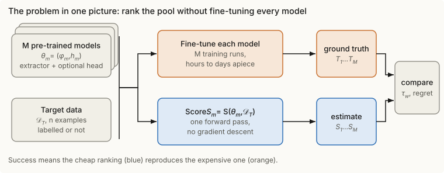

---

## The problem, in symbols

**Given**
- a pool $\theta_m=(\phi_m,h_m)$, $m=1,\dots,M$: feature extractor $\phi_m:\mathcal X\to\mathbb R^{D_m}$, optional head $h_m$ from a source task $\mathcal T^S_m$ (its data $\mathcal D^S_m$ may be unavailable)
- target data $\mathcal D^T$ of $n$ examples, and a test distribution $P^T$

**Ground truth** (expensive): $\;T_m=\operatorname{perf}\big(\operatorname{FT}(\theta_m;\mathcal D^T);\,P^T\big)$, the accuracy, balanced accuracy, AUROC or log-likelihood after fine-tuning (or after retraining only the head)

**Estimator** (cheap): $\;S_m=S(\theta_m;\mathcal D^T)$, one forward pass, no gradient descent

**Goal:** make $\tau_w\big((S_m)_m,(T_m)_m\big)$ high, or, for pure selection, make the regret $\max_mT_m-T_{\hat m}$ small, where $\hat m=\arg\max_mS_m$

---

## How a score is judged

- Kendall's $\tau=\dfrac{2}{M(M-1)}\sum_{i<j}\operatorname{sgn}(T_i-T_j)\operatorname{sgn}(S_i-S_j)$: pairs ordered the same way minus pairs ordered oppositely
- If the correlation is $\tau$, then $\Pr(T_i>T_j\mid S_i>S_j)=\tfrac{\tau+1}{2}$, so $\tau_w\approx0.5$ means about 75% of pairs ordered right (LogME paper)
- **Weighted** $\tau_w$ counts a pair more when $T_i,T_j,S_i,S_j$ are large, because you deploy the top-ranked model
- Also used: Spearman $\rho$, Pearson $r$, the regret of the top pick

> Notes: [You 2021 — LogME](https://msrepo.github.io/theory_inclined_papers_with_annotations/2021-you-logme/) (the $\tau_w$ definition).

---

## The progression we will follow

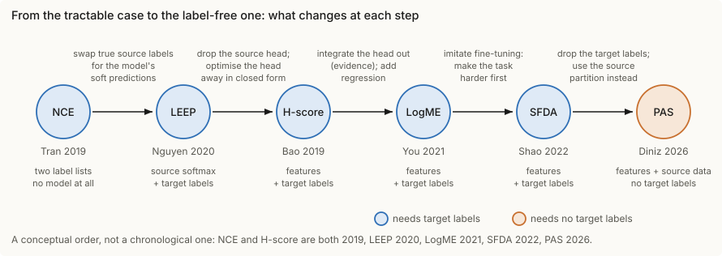

---

## NCE (Tran 2019): the tractable case

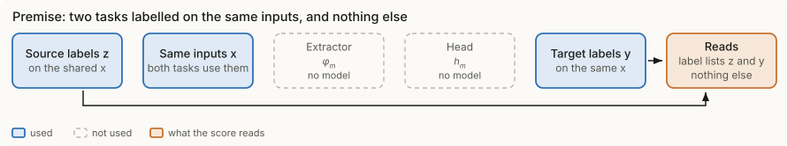

Two tasks on the **same inputs**, with ground-truth label sequences $Z$ (source) and $Y$ (target). No model, no features, no input data: count the joint $\hat P(y,z)$ and compute

$$H(Y\mid Z)=-\sum_{y,z}\hat P(y,z)\log\hat P(y\mid z)$$

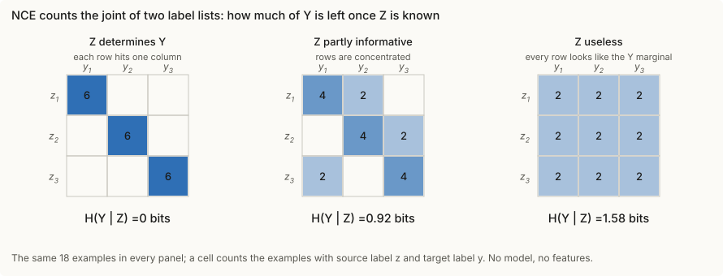

> Notes: [Tran 2019 — NCE](https://msrepo.github.io/theory_inclined_papers_with_annotations/2019-tran-nce-hardness/)

---

## LEEP (Nguyen 2020): use the model's softmax instead

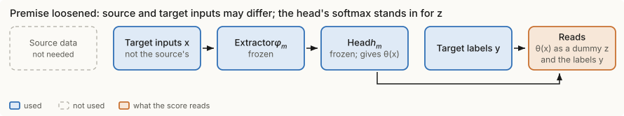

Push target inputs through the frozen source classifier: $\theta(x_i)\in\Delta(\mathcal Z)$, a "dummy" label distribution, and count softly:

$$\hat P(y,z)=\frac1n\sum_{i:\,y_i=y}\theta(x_i)_z,\qquad \hat P(y\mid z)=\frac{\hat P(y,z)}{\hat P(z)}$$

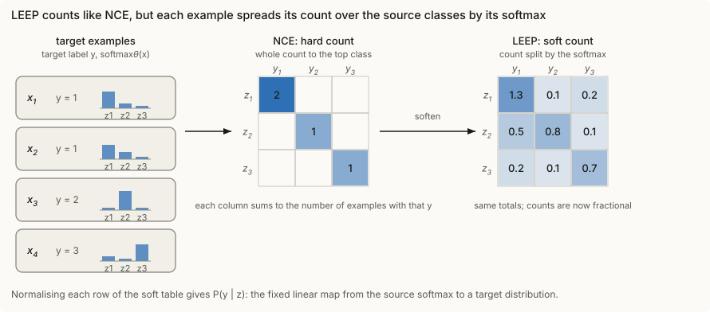

> Notes: [Nguyen 2020 — LEEP](https://msrepo.github.io/theory_inclined_papers_with_annotations/2020-nguyen-leep/)

---

## LEEP: the Expected Empirical Predictor

The **Expected Empirical Predictor** is a fixed linear map of the softmax, $p(\cdot\mid x)=\hat P^{\top}\theta(x)$, and

$$\mathrm{LEEP}=\frac1n\sum_{i=1}^n\log\sum_{z\in\mathcal Z}\hat P(y_i\mid z)\,\theta(x_i)_z$$

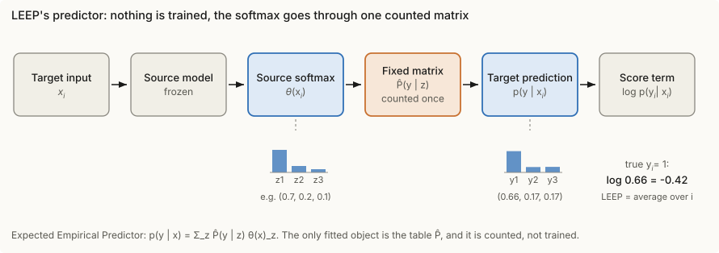

> Notes: [Nguyen 2020 — LEEP](https://msrepo.github.io/theory_inclined_papers_with_annotations/2020-nguyen-leep/)

---

## H-score (Bao 2019): solve the head, then eliminate it

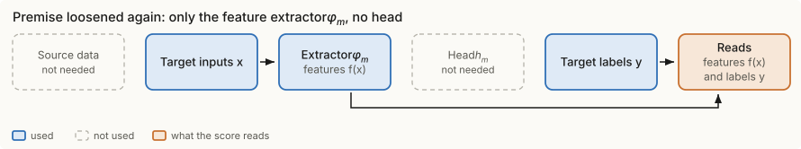

Frozen features $f(x)\in\mathbb R^k$, a linear head, target labels.

$$\mathcal H(f)=\operatorname{tr}\Big(\operatorname{cov}\big(f(X)\big)^{-1}\operatorname{cov}\big(\mathbb E[f(X)\mid Y]\big)\Big)$$

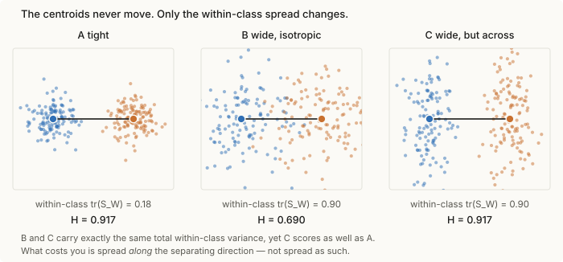

> Notes: [Bao 2019 — H-score](https://msrepo.github.io/theory_inclined_papers_with_annotations/2019-bao-hscore-transferability/)

---

## LogME (You 2021): integrate the head out

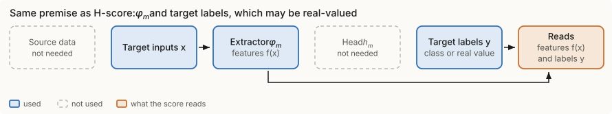

A Bayesian linear model on frozen features $F\in\mathbb R^{n\times D}$. Score the **evidence**, not the likelihood at the best $w^*$:

$$p(y\mid F,\alpha,\beta)=\int p(w\mid\alpha)\,p(y\mid F,w,\beta)\,\mathrm dw$$

$$\small\begin{aligned}\mathrm{LogME}&=\frac1n\Big[\tfrac n2\ln\beta^*+\tfrac D2\ln\alpha^*-\tfrac n2\ln2\pi-\tfrac12\ln\lvert A\rvert\\&\qquad-\tfrac{\beta^*}2\lVert Fm-y\rVert^2-\tfrac{\alpha^*}2m^{\top}m\Big]\end{aligned}$$

with $A=\alpha^*I+\beta^*F^{\top}F$, $m=\beta^*A^{-1}F^{\top}y$, and $\alpha^*,\beta^*$ from a fixed point.

> Notes: [You 2021 — LogME](https://msrepo.github.io/theory_inclined_papers_with_annotations/2021-you-logme/)

---

## SFDA (Shao 2022): imitate fine-tuning, not only the features

Fine-tuning separates classes and learns hard examples late, so a static score should imitate both.

- **Reg-FDA:** a regularised Fisher discriminant projects into $C-1$ dimensions, LDA classifies there, each sample gets a confidence $p_n$
- **ConfMix:** moves each sample toward the other classes by its own difficulty. Re-run Reg-FDA; the score is the average log-likelihood of the second pass

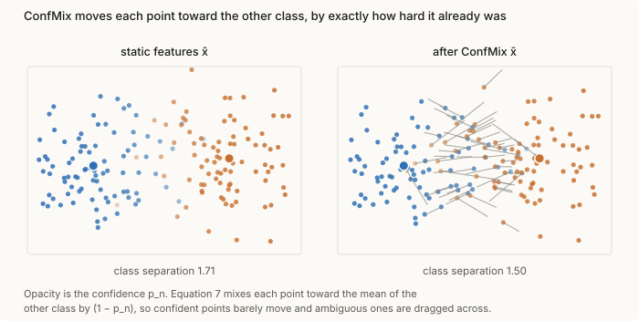

> Notes: [Shao 2022 — SFDA](https://msrepo.github.io/theory_inclined_papers_with_annotations/2022-shao-sfda/)

---

## PAS (Diniz 2026): no target labels at all

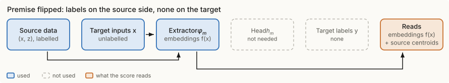

Labelled source, unlabelled target. Unit-norm embeddings, source class centroids $\mu_c=\dfrac{\sum f_\theta(x^S_i)}{\lVert\sum f_\theta(x^S_i)\rVert}$, cosine distance $1-f_\theta(x)\cdot\mu_c$. With $d_{1},d_{2}$ the nearest and second-nearest centroid distances,

$$\mathrm{PAS}=\frac1{\lvert\mathcal D^T\rvert}\sum_j\frac{d_{2j}-d_{1j}}{d_{2j}}=1-\mathbb E\Big[\frac{d_{1}}{d_{2}}\Big]$$

- A Silhouette score with "own cluster" replaced by "nearest cluster": the **average relative margin** of a nearest-centroid classifier, the complement of Lowe's ratio test
- Asymmetric by design. Range $[0,1]$

> Notes: [Diniz 2026 — PAS](https://msrepo.github.io/theory_inclined_papers_with_annotations/2026-diniz-pas/)

---

## PAS: the core idea

PAS uses the **source** classes as a ruler and asks how decisively each unlabelled target point picks one of them:

1. embed to unit length and average each source class into a centroid $\mu_c$
2. for each target point take the cosine distances to all centroids; $d_1$ and $d_2$ are the smallest and second smallest
3. its margin is $(d_2-d_1)/d_2$: 1 on a centroid, 0 when equally close to two. $\mathrm{PAS}$ is the average margin

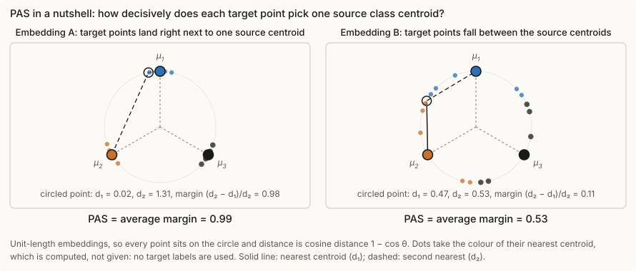

> Notes: [Diniz 2026 — PAS](https://msrepo.github.io/theory_inclined_papers_with_annotations/2026-diniz-pas/)

---

<!-- _class: lead -->
<!-- _paginate: false -->

# Gaps

### Do these scores survive medical imaging?

---

## Chaves 2023: seven scores, ten models, three medical tasks

- **In-distribution:** unstable

> Figure: Chaves et al. 2023, Fig. 3 (arXiv:2308.07444). Notes: [Chaves 2023 — medical TE](https://msrepo.github.io/theory_inclined_papers_with_annotations/2023-chaves-medical-transferability/)

---

## Claßen 2026: do rankings survive a change of seed?

| | |
|---|---|
| targets, sources | 8 MedMNIST 2D sets; the other MedMNIST sets plus ImageNet |
| model | ResNet-18 only |
| metrics | H-score, LEEP, $\mathcal N$LEEP, LogME, NCTI, PARC, SFDA |
| design | nested stratified subsets of 5–75%, 5 seeds; reference tuned for accuracy and for AUROC |

1. **Rankings move under nothing but the seed.** On Breast LogME ranks Blood as both the best and the worst source
2. **The reference ranking moves too.** Accuracy against AUROC reorders almost every source; one goes from 2nd to 11th

Also: $\mathcal N$LEEP and SFDA produce NaNs.

> Notes: [Claßen 2026 — TE robustness](https://msrepo.github.io/theory_inclined_papers_with_annotations/2026-classen-te-robustness/)

---

<!-- _class: lead -->
<!-- _paginate: false -->

# Explorations

### Mode connectivity as a transferability score

---

## To do: mode connectivity between source and target

**Question.** Can the loss landscape between the source solution and the fine-tuned target solution explain, and predict, transferability?

- **Endpoints:** the source model $\theta_S=\theta_m$ from the pool, and the fine-tuned target model $\theta_T^{*}=\mathrm{FT}(\theta_m;\mathcal D^T)$, the **oracle** that defines $T_m$
- **Landscape:** the target loss $\mathcal L_T(\theta)$, and the source loss $\mathcal L_S(\theta)$ for contrast
- **Path:** $\gamma:[0,1]\to\Theta$ with $\gamma(0)=\theta_S$ and $\gamma(1)=\theta_T^{*}$: a straight line, or a learned curve (Bézier or polygonal chain) that keeps the loss low, as in the mode-connectivity literature
- **Model:** fine-tuning as motion through this landscape. The height, length and bending of the path say how far the source solution must be reshaped for the target task

> Related notes: [Achille 2019 — task reachability](https://msrepo.github.io/theory_inclined_papers_with_annotations/2019-achille-task-reachability/) (fine-tuning as a dynamical process)

---

## To do: a path score as a transferability metric

Characterise the path by functionals of $\mathcal L_T$ along it:

$$\mathcal I_T=\int_0^1\mathcal L_T\big(\gamma(t)\big)\,\lVert\dot\gamma(t)\rVert\,\mathrm dt,\qquad B=\max_{t}\Big[\mathcal L_T\big(\gamma(t)\big)-(1-t)\mathcal L_T(\theta_S)-t\,\mathcal L_T(\theta_T^{*})\Big],\qquad \ell=\int_0^1\lVert\dot\gamma(t)\rVert\,\mathrm dt$$

1. **Oracle runs:** fine-tune $\theta_T^{*}$ per source model, trace $\gamma$ and record $\mathcal I_T$, $B$, $\ell$ and the curvature (Hessian or Fisher along the path)
2. **Explain:** which functional tracks the ground truth $T_m$, by $\tau_w$ and regret, against H-score, LogME, SFDA and the rest?
3. **Decode:** find a cheap proxy $\hat S_m$ for the winning functional that needs no fine-tuning (from features, Fisher spectrum or a few gradient steps), and calibrate it to the oracle
4. **Test:** rankings stable across seeds (Claßen 2026) and on the medical benchmarks (Chaves 2023)?

**Open:** a pre-trained and a fine-tuned model often share a basin, so the barrier may be near zero and the signal may sit in path length and curvature; permutation symmetry needs care when the endpoints differ more.

---

## Sources

Notes (rendered): `msrepo.github.io/theory_inclined_papers_with_annotations/` followed by

`2019-tran-nce-hardness` · `2020-nguyen-leep` · `2019-bao-hscore-transferability` · `2021-you-logme` · `2022-shao-sfda` · `2026-diniz-pas` · `2023-chaves-medical-transferability` · `2026-classen-te-robustness`

and for the other axes: `2026-wang-ntk-selector`

Papers: Tran, Nguyen & Hassner, ICCV 2019, arXiv:1908.08142 · Nguyen et al., ICML 2020, arXiv:2002.12462 · Bao et al., ICIP 2019, arXiv:2212.10082 · You et al., ICML 2021, arXiv:2102.11005 · Shao et al., ECCV 2022, arXiv:2207.03036 · Diniz et al., ICLR 2026, arXiv:2604.09863 · Chaves et al., arXiv:2308.07444 · Claßen et al., arXiv:2608.09999

---

<!-- _class: lead -->
<!-- _paginate: false -->

# Supplementary

---

## H-score: between-class covariance

For $C$ classes with priors $\pi_c$ and class means $\mu_c=\mathbb E[f(X)\mid Y=c]$:

$$\Sigma_B=\operatorname{cov}\big(\mathbb E[f(X)\mid Y]\big)=\sum_{c=1}^{C}\pi_c\,(\mu_c-\bar\mu)(\mu_c-\bar\mu)^{\top},\qquad \bar\mu=\sum_c\pi_c\mu_c$$

From data, with $n_c$ of the $n$ examples in class $c$: $\hat\Sigma_B=\sum_c\frac{n_c}{n}(\hat\mu_c-\hat\mu)(\hat\mu_c-\hat\mu)^{\top}$.

- **Two classes:** $\Sigma_B=\pi_1\pi_2\,(\mu_1-\mu_2)(\mu_1-\mu_2)^{\top}$, rank one, pointing along the line joining the centroids
- **Along a direction $w$:** $w^{\top}\Sigma_Bw$ is the variance of the class means projected on $w$: the class gap, with the within-class scatter left out
- **Total variance splits:** $\Sigma=\Sigma_W+\Sigma_B$, so $\operatorname{tr}(\Sigma^{-1}\Sigma_B)$ is the share of the spread the labels explain, summed over directions

---

## H-score worked example: by hand

Two classes, equal priors, 2-D features $(x_1,x_2)$, four points each case. Same centroid gap of 2.

| | **A: split along the quiet $x_2$** | **B: split along the noisy $x_1$** |
|---|---|---|
| class 0 | $(-3,-1.5),\ (3,-0.5)$ | $(-4,-0.5),\ (2,0.5)$ |
| class 1 | $(-3,1.5),\ (3,0.5)$ | $(-2,0.5),\ (4,-0.5)$ |
| means | $\mu_0=(0,-1),\ \mu_1=(0,1)$ | $\mu_0=(-1,0),\ \mu_1=(1,0)$ |
| $\Sigma_B$ | $\operatorname{diag}(0,\,1)$ | $\operatorname{diag}(1,\,0)$ |
| $\Sigma$ | $\operatorname{diag}(9,\,1.25)$ | $\operatorname{diag}(10,\,0.25)$ |
| $\Sigma^{-1}\Sigma_B$ | $\operatorname{diag}(0,\,0.8)$ | $\operatorname{diag}(0.1,\,0)$ |
| $\mathcal H=\operatorname{tr}$ | **0.80** | **0.10** |

The raw gap is the same, so $\operatorname{tr}\Sigma_B=1$ in both. In B each point is already scattered by $\pm3$ along $x_1$ within its class, so a gap of 2 is small against the spread; in A the spread along $x_2$ is about 1.

> Notes: [Bao 2019 — H-score](https://msrepo.github.io/theory_inclined_papers_with_annotations/2019-bao-hscore-transferability/)

---

## H-score worked example: the picture

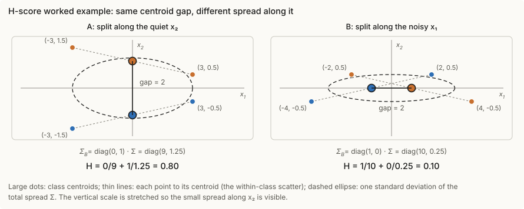

> Notes: [Bao 2019 — H-score](https://msrepo.github.io/theory_inclined_papers_with_annotations/2019-bao-hscore-transferability/)

---

## LogME worked example: by hand

LogME integrates the weights out, so the evidence is a Gaussian density at the target: $\;y\sim\mathcal N(0,C),\ C=FF^{\top}/\alpha+I/\beta$, and $\mathrm{LogME}=\max_{\alpha,\beta}\tfrac1n\log p(y\mid F,\alpha,\beta)$. Here $\alpha=\beta=1$ is fixed (the real score tunes both), with $n=2$ examples, one feature and target $y=(1,-1)^{\top}$.

| | **good feature** | **bad feature** |
|---|---|---|
| $F$ | $(1,-1)^{\top}$, aligned with $y$ | $(1,1)^{\top}$, orthogonal to $y$ |
| $C=FF^{\top}+I$ | $\begin{pmatrix}2&-1\\-1&2\end{pmatrix}$ | $\begin{pmatrix}2&1\\1&2\end{pmatrix}$ |
| $\det C$ | 3 | 3 |
| $y^{\top}C^{-1}y$ | $2/3$ | $2$ |
| $\log p(y)=-\tfrac12\big[n\ln2\pi+\ln\det C+y^{\top}C^{-1}y\big]$ | $-2.72$ | $-3.39$ |
| $\mathrm{LogME}=\log p(y)/n$ | **$-1.36$** | **$-1.69$** |

The determinant (the "Occam" cost) is the same, so the whole gap is the data-fit term $y^{\top}C^{-1}y$: $y$ is a typical draw of $\mathcal N(0,C)$ only when $F$ points along it.

> Notes: [You 2021 — LogME](https://msrepo.github.io/theory_inclined_papers_with_annotations/2021-you-logme/)

---

## LogME worked example: the picture

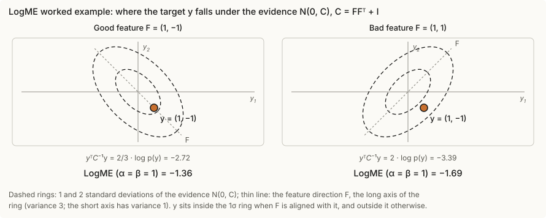

> Notes: [You 2021 — LogME](https://msrepo.github.io/theory_inclined_papers_with_annotations/2021-you-logme/)

---

## LogME: evidence versus likelihood

The likelihood at the best weights asks what the model *could* do; the evidence $\int p(w\mid\alpha)\,p(y\mid F,w,\beta)\,\mathrm dw$ asks how probable $y$ was under the model *before* seeing it. A rigid and a flexible model can fit $y$ equally well and still differ.

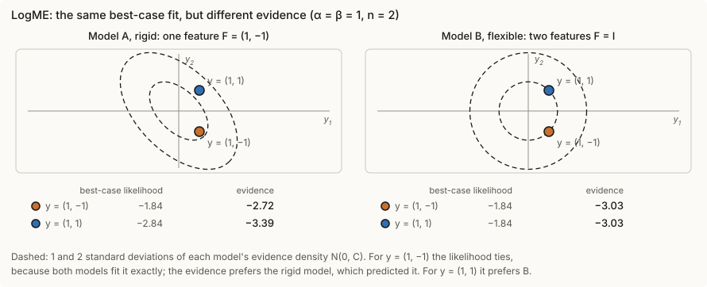

> Notes: [You 2021 — LogME](https://msrepo.github.io/theory_inclined_papers_with_annotations/2021-you-logme/)

---

## LogME: step 1, writing the two Gaussians

A $D$-dimensional Gaussian with isotropic precision is a constant times the exponential of a squared length:

$$\mathcal N(w;0,\alpha^{-1}I)=\Big(\tfrac{\alpha}{2\pi}\Big)^{D/2}e^{-\frac\alpha2\lVert w\rVert^2}\qquad\mathcal N(y;Fw,\beta^{-1}I)=\Big(\tfrac{\beta}{2\pi}\Big)^{n/2}e^{-\frac\beta2\lVert y-Fw\rVert^2}$$

Multiplying them adds the exponents, so the product is the two constants times $e^{-E(w)}$:

$$E(w)=\tfrac\beta2\lVert Fw-y\rVert^2+\tfrac\alpha2\lVert w\rVert^2$$

- **Prior** $\mathcal N(w;0,\alpha^{-1}I)$: which weights are plausible before seeing $y$ (small ones, if $\alpha$ is large)
- **Likelihood** $\mathcal N(y;Fw,\beta^{-1}I)$: how well *this* $w$ explains $y$. As a function of $w$ it is a bump around the best-fit weights
- **Their product** says how plausible $w$ is *and* how well it fits; $E(w)$ is the cost of $w$, small for good weights
- **The evidence** $p(y)$ is the area under that product: the sum over every $w$, not the value at the best one

> Notes: [You 2021 — LogME](https://msrepo.github.io/theory_inclined_papers_with_annotations/2021-you-logme/)

---

## LogME: what the evidence integral does

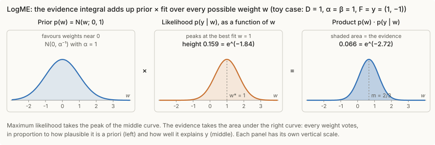

> Notes: [You 2021 — LogME](https://msrepo.github.io/theory_inclined_papers_with_annotations/2021-you-logme/)

---

## LogME: deriving the closed-form evidence

Integrating out $w$ multiplies two Gaussians, $p(y)=\int\mathcal N(w;0,\alpha^{-1}I)\,\mathcal N(y;Fw,\beta^{-1}I)\,\mathrm dw$, which gives

$$p(y)=\Big(\tfrac{\alpha}{2\pi}\Big)^{D/2}\Big(\tfrac{\beta}{2\pi}\Big)^{n/2}\int e^{-E(w)}\,\mathrm dw,\qquad E(w)=\tfrac\beta2\lVert Fw-y\rVert^2+\tfrac\alpha2\lVert w\rVert^2$$

$E$ is quadratic in $w$, so **complete the square** with $A=\alpha I+\beta F^{\top}F$:

$$E(w)=\tfrac12(w-m)^{\top}A\,(w-m)+E(m),\qquad m=\beta A^{-1}F^{\top}y$$

- $m$ minimises $E$: the posterior mean of $w$. $E(m)=\tfrac\beta2\lVert Fm-y\rVert^2+\tfrac\alpha2m^{\top}m$ is just a number
- The remaining integral is exact, with no approximation: $\int e^{-\frac12(w-m)^{\top}A(w-m)}\mathrm dw=(2\pi)^{D/2}\lvert A\rvert^{-1/2}$

> Notes: [You 2021 — LogME](https://msrepo.github.io/theory_inclined_papers_with_annotations/2021-you-logme/)

---

## LogME: reading the closed-form evidence

The $(2\pi)^{D/2}$ factors cancel, and taking the log gives

$$\mathcal L(\alpha,\beta)=\tfrac n2\ln\beta+\tfrac D2\ln\alpha-\tfrac n2\ln2\pi-\tfrac12\ln\lvert A\rvert-\tfrac\beta2\lVert Fm-y\rVert^2-\tfrac\alpha2m^{\top}m$$

| term | where it comes from |
|---|---|
| $\tfrac n2\ln\beta,\ -\tfrac n2\ln2\pi$ | normaliser of the label noise |
| $\tfrac D2\ln\alpha$ | normaliser of the weight prior |
| $-\tfrac\beta2\lVert Fm-y\rVert^2$ | **data fit** |
| $-\tfrac\alpha2m^{\top}m$ | **weight size** |
| $-\tfrac12\ln\lvert A\rvert$ | **Occam term** from the integral: large when $F$ has many strong directions |

**Check** with the worked example ($D=1$, $n=2$, $\alpha=\beta=1$, $F=y=(1,-1)^{\top}$): $A=3$, $m=\tfrac23$, $\lVert Fm-y\rVert^2=\tfrac29$, $m^{\top}m=\tfrac49$, so $\mathcal L=-1.838-0.111-0.222-0.549=-2.72$, the same as $\log\mathcal N(y;0,C)$.

> Notes: [You 2021 — LogME](https://msrepo.github.io/theory_inclined_papers_with_annotations/2021-you-logme/)

---

## LogME: deriving the $\alpha$ and $\beta$ updates

Maximise $\mathcal L(\alpha,\beta)$ by setting its derivatives to zero. Two facts make this short:

- Let $\lambda_i$ be the eigenvalues of $F^{\top}F$. Then $A$ has eigenvalues $\alpha+\beta\lambda_i$, so $\ln\lvert A\rvert=\sum_i\ln(\alpha+\beta\lambda_i)$
- $m$ minimises $E$, so $\partial E/\partial m=0$ there: only the *explicit* $\alpha,\beta$ in $\mathcal L$ need differentiating

$$\frac{\partial\mathcal L}{\partial\alpha}=\frac D{2\alpha}-\frac12m^{\top}m-\frac12\sum_i\frac1{\alpha+\beta\lambda_i}=0\ \Rightarrow\ m^{\top}m=\frac1\alpha\sum_i\frac{\beta\lambda_i}{\alpha+\beta\lambda_i}=\frac\gamma\alpha$$

$$\frac{\partial\mathcal L}{\partial\beta}=\frac n{2\beta}-\frac12\lVert Fm-y\rVert^2-\frac12\sum_i\frac{\lambda_i}{\alpha+\beta\lambda_i}=0\ \Rightarrow\ \lVert Fm-y\rVert^2=\frac{n-\gamma}\beta$$

with $\gamma=\sum_i\dfrac{\beta\lambda_i}{\alpha+\beta\lambda_i}$. Solving for the hyper-parameters:

$$\boxed{\ \alpha=\frac{\gamma}{m^{\top}m},\qquad \beta=\frac{n-\gamma}{\lVert Fm-y\rVert^2}\ }$$

> Notes: [You 2021 — LogME](https://msrepo.github.io/theory_inclined_papers_with_annotations/2021-you-logme/)

---

## LogME: reading the fixed point

- **$\gamma\in[0,D]$ is the effective number of parameters.** Direction $i$ counts $\tfrac{\beta\lambda_i}{\alpha+\beta\lambda_i}\in(0,1)$: near 1 where the data dominate the prior, near 0 where the prior does
- **$\alpha=\gamma/m^{\top}m$:** the prior precision at which the weight norm matches the number of well-determined parameters
- **$\beta=(n-\gamma)/\lVert Fm-y\rVert^2$:** inverse noise variance, with residual over $n-\gamma$ degrees of freedom
- **Why a fixed point:** $\gamma$ and $m$ depend on $\alpha,\beta$, so there is no closed form. Start from any $\alpha,\beta$, recompute $\gamma$ and $m$, update both, repeat; then $\mathrm{LogME}=\mathcal L(\alpha^{*},\beta^{*})/n$

**Check** on the worked example ($\lambda=2$, start $\alpha=\beta=1$): $\gamma=\tfrac23$, $m=\tfrac23$, so $\alpha\to\tfrac{2/3}{4/9}=1.5$ and $\beta\to\tfrac{4/3}{2/9}=6$. The evidence rises from $-2.72$ to $-1.81$ in one step. Here $y$ lies exactly on $F$, so $\beta$ keeps growing; real labels have noise and the iteration settles.

> Notes: [You 2021 — LogME](https://msrepo.github.io/theory_inclined_papers_with_annotations/2021-you-logme/)

---

## SFDA: the Fisher discriminant (Reg-FDA)

Find the projection where the classes are far apart relative to their spread. For one direction $u$, with between- and within-class scatter $S_B$ and $S_W$:

$$J(u)=\frac{u^{\top}S_Bu}{u^{\top}S_Wu}$$

$J$ is unchanged by rescaling $u$, so maximise $u^{\top}S_Bu$ subject to $u^{\top}S_Wu=1$. The Lagrange condition is a **generalised eigenproblem**:

$$S_B\,u=v\,S_W\,u$$

- **Several directions:** SFDA maximises $\dfrac{\lvert U^{\top}S_BU\rvert}{\lvert U^{\top}\tilde S_WU\rvert}$; the solution is the top eigenvectors of $\tilde S_W^{-1}S_B$, and the maximum is the product of their $v$
- **How many:** $\operatorname{rank}(S_B)\le C-1$, so $D'=\min(D,C-1)$
- **Regulariser:** $\tilde S_W=(1-\lambda)S_W+\lambda I$ stays invertible when there are more features than samples per class
- **Cost:** one eigenproblem, no gradient descent

> Notes: [Shao 2022 — SFDA](https://msrepo.github.io/theory_inclined_papers_with_annotations/2022-shao-sfda/)

---

## SFDA: the Fisher discriminant, the picture

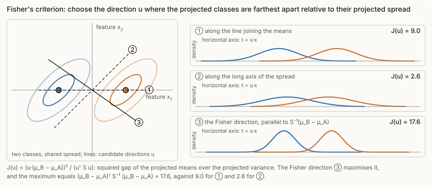

> Notes: [Shao 2022 — SFDA](https://msrepo.github.io/theory_inclined_papers_with_annotations/2022-shao-sfda/)

---

## SFDA and H-score: Fisher, LDA and the eigenvalues

- **Fisher is LDA's direction.** For two classes $S_B\propto\Delta\Delta^{\top}$ with $\Delta=\mu_A-\mu_B$, so the eigenproblem gives $u\propto S_W^{-1}\Delta$, the same as LDA's $w=\Sigma^{-1}(\mu_A-\mu_B)$. LDA classifies by thresholding the projection on it
- **H-score uses the same eigenvalues.** With $\Sigma=S_W+S_B$, $S_Bu=vS_Wu$ rewrites as $S_Bu=\frac{v}{1+v}\Sigma u$, so
$$\mathcal H=\operatorname{tr}\big(\Sigma^{-1}S_B\big)=\sum_i\frac{v_i}{1+v_i},\qquad \text{each term in }[0,1)$$
- **Check** on the H-score worked example, case A: $S_W=\operatorname{diag}(9,0.25)$ and $S_B=\operatorname{diag}(0,1)$, so $v=1/0.25=4$ along $x_2$ and $\mathcal H=4/(1+4)=0.80$

> Notes: [Shao 2022 — SFDA](https://msrepo.github.io/theory_inclined_papers_with_annotations/2022-shao-sfda/), [Bao 2019 — H-score](https://msrepo.github.io/theory_inclined_papers_with_annotations/2019-bao-hscore-transferability/)

---

## SFDA: deriving LDA from Bayes' rule

Each class is a Gaussian with a **shared** covariance, $x\mid c\sim\mathcal N(\mu_c,\Sigma)$, with prior $q_c$. Bayes' rule, then the log of the numerator expanded:

$$p(c\mid x)=\frac{q_c\,\mathcal N(x;\mu_c,\Sigma)}{\sum_kq_k\,\mathcal N(x;\mu_k,\Sigma)},\qquad \log\big(q_c\mathcal N\big)=\mu_c^{\top}\Sigma^{-1}x-\tfrac12\mu_c^{\top}\Sigma^{-1}\mu_c+\log q_c\;\underbrace{-\tfrac12x^{\top}\Sigma^{-1}x-\tfrac12\log\lvert2\pi\Sigma\rvert}_{\text{same for every class}}$$

The underbraced terms multiply every term of the numerator and denominator, so they cancel:

$$\delta_c(x)=x^{\top}\Sigma^{-1}\mu_c-\tfrac12\mu_c^{\top}\Sigma^{-1}\mu_c+\log q_c,\qquad p(c\mid x)=\frac{e^{\delta_c}}{\sum_ke^{\delta_k}}$$

- **Intuition:** $-\tfrac12(x-\mu_c)^{\top}\Sigma^{-1}(x-\mu_c)$ is minus half the squared distance to the class mean in units of the spread, so LDA picks the nearest mean, with a head start $\log q_c$ for common classes
- **SFDA** takes $\Sigma=I$ in the Fisher space, which gives $\delta_c=x^{\top}\mu_c-\tfrac12\lVert\mu_c\rVert^2+\log q_c$

> Notes: [Shao 2022 — SFDA](https://msrepo.github.io/theory_inclined_papers_with_annotations/2022-shao-sfda/)

---

## SFDA: LDA from Bayes' rule, one dimension

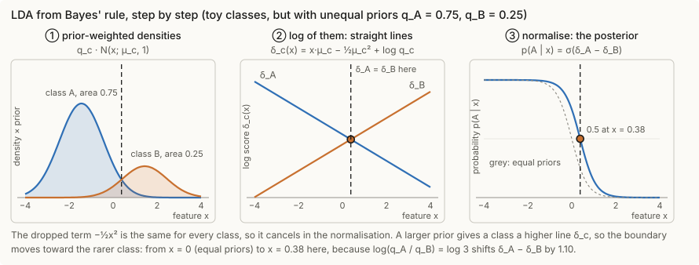

> Notes: [Shao 2022 — SFDA](https://msrepo.github.io/theory_inclined_papers_with_annotations/2022-shao-sfda/)

---

## SFDA: LDA with a correlated covariance

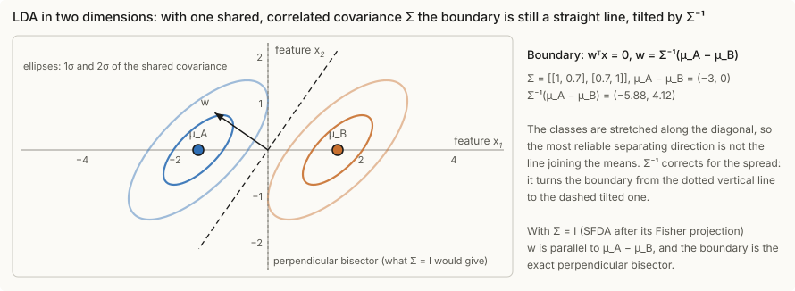

> Notes: [Shao 2022 — SFDA](https://msrepo.github.io/theory_inclined_papers_with_annotations/2022-shao-sfda/)

---

## SFDA: LDA on the toy example

LDA treats each class as a Gaussian of the same width and applies Bayes' rule. With identity covariance the $-\tfrac12x^2$ term is shared by all classes and cancels:

$$\delta_c(x)=x\,\mu_c-\tfrac12\mu_c^2+\log q_c,\qquad p(c\mid x)=\frac{e^{\delta_c}}{\sum_k e^{\delta_k}}$$

In the toy (equal priors, $\mu_B=-\mu_A$) this reduces to $p(A\mid x)=\sigma(2\mu_A x)$: a sigmoid whose slope is the distance between the class means.

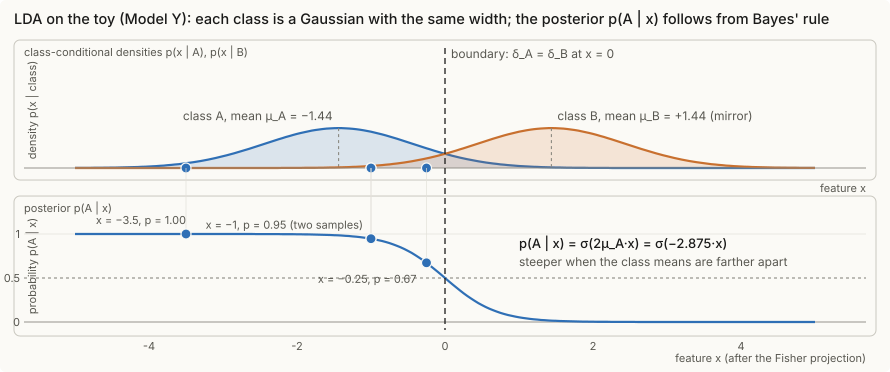

> Notes: [Shao 2022 — SFDA](https://msrepo.github.io/theory_inclined_papers_with_annotations/2022-shao-sfda/)

---

## SFDA worked example: ConfMix by hand

Binary target, so the Fisher space is 1-D ($D'=C-1=1$). Take $U=1$, equal priors, and class B the mirror image of class A, so $\mu_B=-\mu_A$ and LDA gives $p=\sigma(2\mu_A\hat x)$ for a class-A sample. Then:

$$\tilde x=p\,\hat x+(1-p)(-\mu_A),\qquad \tilde\mu_A=\operatorname{mean}(\tilde x),\quad \tilde p=\sigma(2\tilde\mu_A\tilde x),\quad \mathrm{SFDA}=\operatorname{mean}\log\tilde p$$

**Model X** ($\mu_A=-1$): four samples, all $\hat x=-1$, $p=0.88$, so $\tilde x=-0.76$, $\tilde p=0.76$. **Model Y** ($\mu_A=-1.44$, $\tilde\mu_A=-1.23$):

| sample | $\hat x$ | $p$ | $\tilde x$ | $\tilde p$ |
|---|---|---|---|---|
| 1 | $-3.50$ | 1.00 | $-3.50$ | 1.00 |
| 2, 4 | $-1.00$ | 0.95 | $-0.87$ | 0.90 |
| 3 | $-0.25$ | 0.67 | $+0.30$ | 0.32 |
| $\operatorname{mean}\log p$ | | **$-0.127$** | | **$-0.339$** |

Model X goes from $-0.127$ to $-0.273$. Both models tie on the first pass; ConfMix drags Y's ambiguous sample 3 across the boundary (its confidence falls from 0.67 to 0.32), and Y ends lower. A constructed toy, to show the mechanism.

> Notes: [Shao 2022 — SFDA](https://msrepo.github.io/theory_inclined_papers_with_annotations/2022-shao-sfda/)

---

## SFDA worked example: the picture

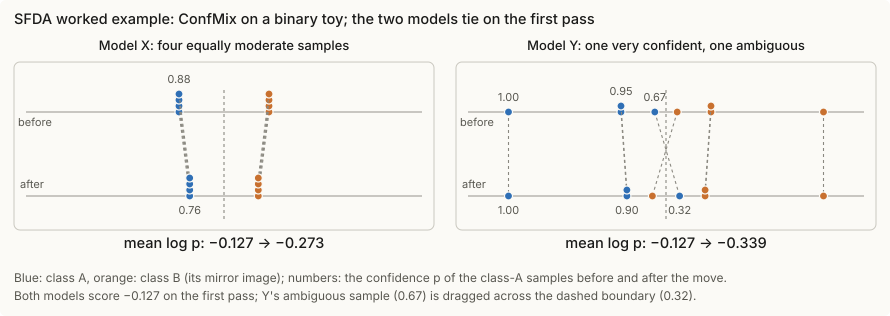

> Notes: [Shao 2022 — SFDA](https://msrepo.github.io/theory_inclined_papers_with_annotations/2022-shao-sfda/)
